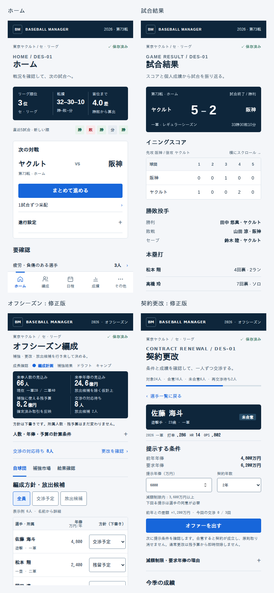

# Baseball Manager — デザインシステム v2

更新日: 2026-10-19（UI-04のナビゲーション承認を反映）

照合基準: `main` / `16b1cdda240e36254a79cb9317752877982c3800`（PR #435反映後）

状態: **DES-01の具体仕様を確定。画面実装は後続UI-01〜03で段階的に移行する。**

本書は新UIの正本。承認済みのスポーツ分析ハイブリッドを、ネイビーのヘッダー・要約帯、白い表面、青の操作色で具体化する。写真・顔画像・装飾アバター、グラデーション、通常領域の影は使わない。情報密度と比較のしやすさを優先し、判断に必要な数値・条件・主操作を近くに置く。

この文書PRはゲームロジック・保存形式・既存UI・CSS・JSX・依存・CIを変更しない。ここに記すトークンと部品名は後続実装の契約であり、既存の `:root` や共通部品に実装済みという意味ではない。既存の動作と旧CSSは対象画面の置換・検証まで維持し、文書の確定だけを理由に全画面へ上書きしない。

開発・PRの運用は [AGENTS.md](../AGENTS.md)、ゲームの振る舞いは [SPEC.md](../SPEC.md) と現行コード・テスト、検証の運用は [TEST_STRATEGY.md](./TEST_STRATEGY.md) を参照する。[青写真](./REFORM_BLUEPRINT_V1.md) は一次監査とロードマップ。2026-10-19のユーザー指示により[UI-04](./implementation/ui-04.md)の「その他→経営」、共通通知・設定とOB移設を承認済みとする。青写真の「成績→分析」改名・無関係な全画面再構成は含めない。承認済み範囲の小修正に毎回の新規モックや再承認を必須にしない。

## 1. 承認した画面と参照PNG

写真なしの二軍編成・選手比較・選手詳細・ランキングを方向性の参考とし、ホーム・試合結果・オフシーズン編成・契約更改で共通仕様を具体化した。参考画像の架空データ・不正確な文字・操作構造はゲーム仕様に転記しない。二軍4画面の実装とゲーム内検証はUI-02で行う。

| 画面（全文PNG） | 360px | 390px | 1440px |
|---|---|---|---|
| ホーム | [360px](./design/des01/des01_home_360.png) | [390px](./design/des01/des01_home_390.png) | [1440px](./design/des01/des01_home_1440.png) |
| 試合結果 | [360px](./design/des01/des01_result_360.png) | [390px](./design/des01/des01_result_390.png) | [1440px](./design/des01/des01_result_1440.png) |
| オフシーズン編成 | [360px](./design/des01/des01_offseason_360.png) | [390px](./design/des01/des01_offseason_390.png) | [1440px](./design/des01/des01_offseason_1440.png) |
| 契約更改 | [360px](./design/des01/des01_contract_360.png) | [390px](./design/des01/des01_contract_390.png) | [1440px](./design/des01/des01_contract_1440.png) |

初期表示の根拠: オフシーズン [360×800](./design/des01/viewport_offseason_360.png) / [390×844](./design/des01/viewport_offseason_390.png)、契約 [360×800](./design/des01/viewport_contract_360.png) / [390×844](./design/des01/viewport_contract_390.png)。共通部品と状態は [状態一覧PNG](./design/des01/des01_states_390.png) を参照。

モックは独立した静的表示状態。選手名・年俸・人数・成績は表示確認用サンプルで、ライブのセーブではない。名前や固定額を本番へハードコードしない。更改画面はオフシーズンの選手選択後であり、シーズン中のContractTabの機能を廃止する指示ではない。全タブ・全状態・全球団の設計が確定したという意味でもない。

## 2. 現行実装の参照先（移行前の保守用）

| 役割 | 参照先・確認事項 |
|---|---|
| 基底スタイル | [src/styles.css](../src/styles.css)。旧ダーク系の `:root`、`.card`、`.tbl`、`.btn` 等がある。これだけを現在の明色UIの手本にしない |
| シェル・PCホーム | [calm-ui.css](../src/calm-ui.css)。`.calm-shell`、`.calm-home`、`.calm-primary`、`.calm-secondary` |
| モバイル共通フロー | [mobile-flow.css](../src/mobile-flow.css)。`.flow-screen`、`.flow-row`、`.flow-tabs`、`.flow-player`。詳細・結果CSSもここから読込 |
| 詳細・比較表の基盤 | [calm-details.css](../src/calm-details.css)。`.calm-detail` 内の色変数、表・ボタン・フォーカス・固定列 |
| 日程・結果の見せ方 | [calm-results.css](../src/calm-results.css)。日程リスト、局所スクロールするカレンダー、結果表、スコアダイアログのスタイル |
| 画面とナビ | [App.jsx](../src/App.jsx)、[HubShell.jsx](../src/components/hub/HubShell.jsx)。HubShellがCalm系CSSを読み、主要ナビを定義 |
| ホーム・編成の入口 | [MobileHome.jsx](../src/components/MobileHome.jsx)、[DashboardTab.jsx](../src/components/DashboardTab.jsx)、[MobileRoster.jsx](../src/components/MobileRoster.jsx)。モバイルとPCで別の描画経路があるため、対象ルートの呼び出し元まで確認する |
| 比較・ダイアログ | [PlayerComparisonTray.jsx](../src/components/PlayerComparisonTray.jsx)、[useResultDialog.js](../src/components/useResultDialog.js)。既存の比較表、終了操作、フォーカス復帰を再利用する際の参照先 |

UI-04Aのナビは **ホーム／編成／日程／成績／経営** の5枠。経営は概要/補強/契約/財務。受信箱・ニュースはヘッダー通知、OBは成績→記録・球団史、バランス検証はヘッダー設定→開発者向けへ移す。既存の取引tab IDと保存形式は維持する。CSSの760pxモバイル本文切替と1024pxシェル切替を維持し、760/761・1023/1024pxも検証する。

### 実装上の注意

Calm系CSSと旧CSS、インライン指定、`!important` が併存している。セレクタ・読込順・適用スコープを調べずに末尾へ上書きを追加すると、他画面へ影響する可能性がある。既存変数が効くスコープなら再利用し、ない場合は対象クラスへ限定する。架空の共通トークンや汎用コンポーネントが実装済みだと仮定しない。

`useResultDialog` のフォーカス対象は現状 `button`、`select`、`[tabindex="0"]` に限定される。入力欄・リンク・入れ子ダイアログ等を追加するときは、そのままで十分とはみなさず、関連実装とテストを確認する。

追加の照合対象は `OffseasonPlanningScreen.jsx` / `offseasonPlanning.js` / `calm-planning.css`、`ContractRenewalPhaseScreen.jsx` / `renewalRules.js` / `contract.js` / `calm-renewal.css`、`ResultScreen.jsx` / `postGameProcessing.js`。保存表示は `useGameState.js` の `saveDirty` / `saveQueueState` 等の実状態へ接続する。画面に公開されていない成功状態を仮定しない。

人数見込みは一軍＋二軍＋育成から放出候補を除いた人数で、支配下70枠の残数とは別。年俸見込みは `planningSummary()` の値を使う。当年契約済みは現年俸、それ以外はsessionの成立条件 `terms.salary`、なければ前年年俸。提示中の下書き `entry.salary` を未合意年俸へ使う集計ではない。現行注記「未合意は提示額」との不一致は後続の対象画面で別途扱い、本PRではソースを修正しない。

通常更改の年俸は年額で、残予算から即時控除しない。FA契約は年俸×年数を先払いする。年俸見込みを残予算から再度引いた「補強余力」は作らない。最低年俸保障と減額制限は別のルール。減額制限超過は同意を伴う既存の提示経路を保持し、一律の最低入力値で禁止しない。

## 3. 代表画面の判断と構造

| 画面 | 最初に見える判断材料 | 主操作 | 詳細・PC配置 |
|---|---|---|---|
| ホーム | 順位、戦績、首位との差、直近の勝敗、次の対戦 | まとめて進める。1試合ずつ采配は副導線 | PCは結果・打線を並置。スマホは要確認と結果を縦に読む |
| 試合結果 | 勝敗、対戦球団、最終スコア、記録対象 | ハブに戻る | イニングと勝敗投手／個人成績をPCで並置。追加の「次の試合」操作は作らない |
| オフシーズン | 人数・年俸の見込み、確定取引後の予算、対応待ち | 状況に応じた契約更改・補強／結果確認 | 自球団・補強市場・結果確認を維持。3列の一覧＋方針絞り込み。工程帯は現在地の説明でありクリック式工程遷移ではない |
| 契約更改 | 選手の状態、今季成績、前年と要求年俸、提示額 | オファーを出す → 条件確認 → 既存の提示処理 | PCは選手一覧と交渉詳細を並置。スマホは選択した選手を集中表示し、一覧へ戻る |

モックはHTML/CSSをブラウザで描画したPNG。選手名と数値は表示確認用サンプルで、ライブのセーブや参考画像の値を実装する指示ではない。試合結果のボックススコアは打者側を代表表示し、投手・相手側は同じ部品の適用対象としている。打線・更改対象・編成一覧は代表行を抜粋した表示例。各画面は独立した表示状態で、単一の実ゲーム進行を収録したものではない。

モックのリンク・展開・入力はレビュー補助。試合進行、交渉判定、保存、タブ切替のゲーム処理は接続していない。新しい永続状態・ルート・selectorを作成済みとみなさない。

スマホのオフシーズンは装飾的な英語分類を省き、上部の余白・要約帯を圧縮する。360×800・390×844で最初の標準選手行まで見せる。契約更改は短い選手情報・成績行の直後に前年／要求／提示年俸・年数・主操作を置き、減額制限内の基準額と下回る場合の同意条件を入力直下に常時表示する。説明と履歴は主操作より後へ置く。初期表示内を狙うために文字・タップ領域を縮めず、長い名前や拡大表示では自然に縦スクロールさせる。

## 4. 配色トークン

以下を新UIの仕様とする。既存の `:root` に実装済みという意味ではない。

| トークン | 値 | 意味 |
|---|---|---|
| `--ds-navy` | `#0E263B` | ヘッダー・主要な要約帯 |
| `--ds-canvas` | `#F4F6F9` | ページ背景 |
| `--ds-surface` | `#FFFFFF` | 表・入力・独立パネル |
| `--ds-text` | `#162B3D` | 本文・名前・数値 |
| `--ds-muted` | `#526778` | 補助ラベル・条件説明 |
| `--ds-inverse` | `#FFFFFF` | ネイビー上の主要文字 |
| `--ds-inverse-muted` | `#C9D8E3` | ネイビー上の補足 |
| `--ds-accent` | `#1766DA` | 主ボタン・リンク・選択下線 |
| `--ds-selected` | `#E9F1FD` | 選択行・比較対象 |
| `--ds-divider` | `#D6DFE7` | 表と節の分離。入力の輪郭には使わない |
| `--ds-control-border` | `#70889B` | 入力・選択・副ボタンの輪郭 |
| `--ds-success` / 面 | `#17634A` / `#E7F3EC` | 保存成功・合意など肯定的状態 |
| `--ds-warning` / 面 | `#855200` / `#FFF1D6` | 対応待ち・注意 |
| `--ds-danger` / 面 | `#B12C38` / `#FAE9EB` | 失敗・不可逆操作 |
| `--ds-focus` | `#1766DA` | 3px outline、offset 3px |

青は操作や選択、緑は成功、赤は失敗や危険。球団色は識別のみ。勝敗・状態は必ず文字を添える。参考二軍比較の青い数値強調は、算出方向や比較条件が明確な場合に限定し、無条件に「大きい＝良い」としない。

## 5. 文字と寸法

| 役割 | スマホ | PC | 備考 |
|---|---|---|---|
| 画面見出し | 26px / 700 | 28px / 700 | 行高1.3 |
| 節見出し | 18px / 700 | 18px / 700 | 行高1.4 |
| 本文・主要操作 | 16px | 16px | 説明文の行高1.6～1.65 |
| 表・一覧・タブ | 14px | 14px | 比較項目を小さくして収めない |
| 補足・条件・表見出し | 12px | 12px | 主要な判断材料の代替にしない |
| 要約値 | 20～24px | 26px | 単位は14px |
| 最終スコア | 40px | 44px | 対戦球団との視線を揃える |
| ブランド・英語分類 | 10～12px | 10～12px | 装飾的な分類のみ。必要情報は別に12px以上で表示 |

本番の書体は既存 `Noto Sans JP` とOSフォールバック。数字は同一フォントの `tabular-nums` を指定し、数値だけ別の装飾書体へ変えない。今回の描画環境ではArial＋IPAゴシックをローカルに同梱した。PNGはNoto Sans JPでの最終字形確認ではない。本番採用時のフォント読み込み、iPhoneのOSフォールバックと折り返しはUI-01で確認する。

間隔は4pxを単位として `4 / 8 / 12 / 16 / 20 / 24 / 32`。スマホ左右16px、PCコンテンツ左右32px、節間24～28px、PC列間32px。通常パネル角丸6px、ボタン・入力4px、状態ラベル3px。既存部品に無条件で上書きしない。

## 6. 共通部品の仕様

| 部品の責務名 | 仕様 |
|---|---|
| AppHeader | 54pxスマホ／56pxPC。球団・年度・現在地の意味を維持。ロゴは文字のみ |
| ContextSaveStatus | 対象年度と保存状態を別要素にする。単に画面を表示しただけで保存済みにしない |
| MetricBand | 3指標は3列、4指標はスマホ2×2・PC4列。指標ごとのカード化なし |
| Section | 見出し＋内容。通常は囲わず、必要な区切り線と余白のみ |
| DataTable | 14px、数値右揃え、名前左揃え。表見出し40px、行44～48px以上。名前選択ボタン44px以上 |
| Tabs／Filter | タブ48px、青文字＋3px下線。絞り込み44px以上、選択面＋青い輪郭と文字。タブとフィルタの意味論・状態を区別 |
| Button | 主操作は青、副操作は白、リンクは補助。高さ44px以上、通常文字16px。危険操作は独立領域 |
| Input／Select | 高さ44px以上、ラベルと単位を常時表示。年俸入力は万円、契約年数は年 |
| StateLabel | 色＋具体的な状態名。クリック操作のないラベルをボタンのように見せない |
| Disclosure | 高さ44px以上、開閉を見分ける。判断に必要な比較項目を隠さない |
| PlayerIdentity | 名前・役割・所属。写真、顔、装飾アバターなし。契約詳細ではコンパクトな見出しと短い成績行にする |
| RosterPlanTable | 選手・所属／年俸／方針の3列。44pxの操作領域を保持し、標準行は約72px。成績・説明は詳細へ。全員・交渉予定・放出候補は表示の絞り込みでありゲーム状態を変更しない |
| OfferForm | 前年・要求・提示額・契約年数と主操作を優先。減額制限の入力検証・警告と確定前の条件確認を実装時に維持。減額制限内の基準額と下回る場合の条件は入力直下に常時表示。根拠の説明は主操作直後に展開可能とする |
| ConfirmationDialog | 対象・条件・費用・確定後の影響を提示。戻ると確定を分ける。既存ロジックに接続する |

PCの更改は一覧＋詳細。スマホは選手選択後の詳細ビューで、一覧の対象・条件・位置を戻れる状態にする。既存 `savedView` 等を維持し、見た目だけのために別の保存形式を増やさない。

### 表と長い名前

名前列を `position: sticky` で保持し、表全体は独立スクロール領域にする。イニング表では球団列を固定。表の選択状態は固定セルにも同じ面を適用する。横スクロール可能な領域はキーボードでフォーカス可能にする。

長い選手名は2行を標準として折り返すか十分な列幅を確保する。収まらない場合は行を拡張し、72pxへ固定して切り落とさない。省略する場合はタップできる詳細導線で全文を表示し、hoverだけにしない。未記録値をソート用の0へ補完しない。並べ替えは既存処理へ委譲し、条件・方向を表示する。

## 7. 状態と数値の意味

| 状態 | 表示 | 操作・データの扱い |
|---|---|---|
| 実測0 | `0`、`.000`、`0.00`など | 該当指標のフォーマッタで表示。欠測にしない |
| 未記録 | `—`＋「未記録」 | 値を生成せず理由を説明 |
| 算出不可 | `—`＋「算出不可」 | 0打数・0投球回などの条件を示す |
| 対象外 | 「対象外」 | 未記録と別に表示 |
| 読込中 | 「読み込み中」 | 値を0や前の選手の値で代用しない |
| 空 | 「この条件に該当する選手はいません」等 | 画面の理由に合わせる。条件変更の導線 |
| 処理中 | 具体的な処理名＋可能なら進捗 | 二重実行を防止。画面表示と処理完了は別 |
| 保存待ち | 「変更あり・保存待ち」 | 最新変更は未保存であると分かる |
| 保存中 | 「保存中」 | 主体セーブの結果を待つ |
| 保存成功 | 「保存済み」 | 永続化成功を確認してから表示 |
| 保存失敗 | 「保存失敗」＋原因・再保存 | 変更内容を保持し、成功表示しない |
| 下書き | 「未確定」「放出候補」 | 所属・予算を確定値として変更しない |
| 契約の状態 | 未合意／合意／再交渉待ち／減額制限の対応待ち／FA宣言／自由契約／戦力外 | 各状態の既存の許可操作を保持。全て「未合意」に潰さない |
| 無効 | 無効ボタン＋直近の理由 | オフシーズンの終了は対応待ち解決まで無効。別画面の閲覧までブロックしない |

主体セーブ成功と、通算・詳細履歴の読込／保存状態は別の意味。ヘッダーだけで全データの成功を保証しない。数値の丸め・投球回・金額は既存 `fmtAvg` / `fmtIP` / `fmtSal` 等へ委譲し、CSS移行で再計算しない。

## 8. レスポンシブとアクセシビリティ

- 360px／390px：16px左右余白。名前と主操作を維持。表だけを局所スクロール。ホームの下部ナビはsafe areaを含め、最終行を覆わない。
- 761～1023px：UI-04Aでは5項目のボトムナビを維持。本文末尾の余白と共通ヘッダーの左右余白を両境界で検証する。本文の760px切替とは独立して扱う。
- 1024px以上：ホームに5枠のサイドナビ、主内容は最大1320pxのシェル内で2列。専用画面は内容を最大1320px以内に配置。
- 幅1440px、高さ900pxで主内容の入り方を確認。長い一覧は縦スクロールし、全てを初期画面に詰め込まない。
- 現行更改には700pxの選択ビュー切替がある。移行時に760pxと統一するかはUI-03で扱い、今回の仕様だけで現行境界を変更しない。
- 操作は44px以上。主な文字は4.5:1以上、フォーカス・入力輪郭は3:1以上を確認する。罫線は装飾のため同一基準を一律に適用しない。
- キーボード、読み上げラベル、選択状態、フォーカス復帰、Escape、背景スクロールを実装時に検証。 `useResultDialog` の現在の対象セレクタが入力やリンクまで十分に対応すると仮定しない。
- `role=status` は処理状況、`role=alert` は失敗。色・スピナーだけで説明しない。過剰なアニメーションを新設しない。

## 9. 旧Calm配色の履歴（移行前の保守用）

| 用途 | 参照値 | 再利用時の注意 |
|---|---|---|
| 基本面・主要文字 | `#fff` / `#17243a` | `.calm-detail` では `--detail-surface` / `--detail-text` |
| 補助文字 | `#53657c` | `--detail-muted`。薄くしすぎて読めなくしない |
| 主操作・リンク | `#1262d4` / `#095cc7` | 主ボタンは `.calm-primary`、リンク色は `--detail-blue`。別用途の青を機械的に統一しない |
| 淡青の補助面・罫線 | `#edf4fc`、`#f0f7ff` / `#dce6f2` | 状態や領域の区切りに限定。すべての情報を色付き箱にしない |
| 成功・警告・危険 | `#14714b` / `#805700` / `#b42332` | `--detail-good` / `--detail-warn` / `--detail-bad`。文字ラベルも併記 |
| フォーカス | `#377ccc`、3pxのoutline | 既存の `:focus-visible` を参照。輪郭が切れないことも確認 |

この表は既存画面を保守するための履歴情報であり、新配色の承認ではない。新UIの指定は本書4節を使う。旧画面の保守だけにこの履歴を参照する。

これらの `--detail-*` は `.calm-detail` 内の変数であり、全画面の `:root` にあるわけではない。CSSの実値はソースを正とし、色やトークンを変更するPRでは本書も更新する。球団色は識別の補助に使い、主要操作や警告の意味を球団ごとに変えない。

## 10. 作業手順と受け入れ条件

1. 最新mainと対象ルートを確認し、「何を判断・操作しやすくするか」「変えないもの」を短く整理する。既存の共通部品・対象CSS・データの出所を確認する。
2. 本書の共通仕様と承認PNGを参照する。代表画面A/Bと、写真なしの分析・二軍画面Cの方向性を基準とする。未承認の全画面構成やナビ変更、機能追加は別途モック・要件で扱う。今回の範囲内の小修正は直接進め、再承認を繰り返さない。
3. 一つの画面・操作フローから変更する。ゲームロジック・永続化・物理演算・依存追加・全体CSS再編を混在させない。
4. 同じデータ・年度・日付・選択条件で変更前後を確認する。乱数を含む画面は同じseedや再現可能なテスト状態を使い、安定した比較を行う。

### 画面確認

| 確認幅 | 基本の確認内容 |
|---|---|
| 390×844px | 主要操作、戻る導線、下部ナビ、表内スクロール、読みやすさ |
| 360×800px | 長い名前、折り返し、ボタン密集、ページ全体のはみ出し |
| 1440×900px | PC側の描画経路、一覧比較、過剰な引き伸ばしや空白 |
| 関係する境界の両側 | レイアウト変更時は760/761px、1023/1024px等を対象CSSに応じて確認 |

変更に関係する通常・未記録・実測0・空・読み込み中・エラー・無効状態も確認する。存在しない状態をテスト目的で本番ロジックへ作り足さない。スクリーンショットだけで操作確認を代替しない。

### 自動検証と報告

検証は [docs/TEST_STRATEGY.md](./TEST_STRATEGY.md) と [AGENTS.md](../AGENTS.md) の3段階運用に従う。開発中は変更に直結したテスト、PR品質ゲートは同一コミットのCI（ビルド・全Vitest・中核E2E）、大規模移行／リリース前は全E2Eを使用する。Work側で同じ全セットを理由なく再実行しない。文書のみの変更は参照リンク・方針の整合・差分範囲を検証し、ローカルのビルド・単体・E2E再実行と画面確認は不適用とする。CI設定は変更せず、実際の実行状況を記録する。コマンドは [package.json](../package.json) と [CONTRIBUTING.md](../CONTRIBUTING.md) を確認する。[playwright.config.js](../playwright.config.js) の現行 `mobile-webkit` は進行smokeの `E1 new game` に限定される。CI成功を全画面のWebKit検証済みと解釈しない。

PRには次を記録する。

- 対象画面、改善する判断・操作、再利用した部品・スタイル、基準からの例外と理由。
- 対象コミット、表示寸法、ブラウザ、再現条件を伴う変更前後の画像。取得できない場合は「未検証」と理由を明記する。画像はPR添付や参照可能な成果物に置き、消える作業ディレクトリだけを根拠にしない。
- 実行コマンドと結果、操作・フォーカス・consoleの確認結果。既存失敗と今回の失敗を区別し、未実行・不適用は成功と分ける。

ビルド・単体テストの成功や過去の `design-qa.md` は、今回の目視・操作確認の代わりではない。環境上確認できない項目があってもコードや文書の作業は進められるが、実画面検証済みと報告しない。文書のみのPRでは画面検証を不適用と記録し、参照先・変更範囲・矛盾の有無を確認する。

## 11. モックの検証記録と限界

Chromium 141で静的HTML/CSSを描画した。初版の4画面＋状態一覧を7幅（360／390／1440／760／761／1023／1024px）で確認し、35状態でページ全体の横はみ出し0件・44px未満の可視button/input/select/summary 0件。最終修正の編成・更改2画面も同じ7幅で再確認し、14状態で同じ条件を満たした。360×800・390×844では最初の編成行の下端約745px、更改主操作の下端約681px。これは標準名・サンプル6人の結果であり全所属選手の保証ではない。

計測は [初版レイアウト](./design/des01/layout-check.json)、[最終修正レイアウト](./design/des01/revision-check.json)、[限定操作確認](./design/des01/interaction-check.json)、[代表配色](./design/des01/contrast-check.json) を参照。全幅の状態・表示寸法はJSONに記録している。全文PNGは内容の高さまで描画領域を広げて書き出した画像であり、初期表示の判定にはviewport画像を使う。

未検証: ゲーム内改修・試合や交渉の実操作・保存互換性・Noto Sans JPの最終字形・iPhone実機・Safari/WebKit・スクリーンリーダー・ダイアログ実操作・200%拡大・全タブ／全状態。静的モックのJSONやCI成功を、これらの合格として扱わない。今回の文書PRでは参照リンク・仕様の整合・差分範囲を検証し、ローカルのbuild／単体／E2Eの再実行は不適用。CI設定は維持し、PRの実際のCI状況は別途報告する。

## 12. 段階的な移行

UI-01は共通シェル・ホーム・結果、UI-02は編成・分析・二軍4画面、UI-03はオフシーズン・更改・経営。本書はこの順序を参照するが、各着手前に最新main・関連FIX・対象経路を再照合する。ゲームの全ロジック修正を待ってデザイン準備を止めず、同時にロジック改修をUI変更へ混在させない。未確定の全画面再構成・ナビ名称変更は別要件とする。
