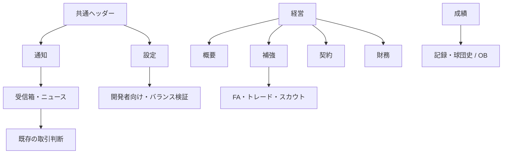

# UI-04 球団経営・ナビゲーション刷新

作成日: 2026-10-19。照合main: `3f8f414d9e5d35938b21dc33b607379e5e2f26a2`（#481マージ済み）。本書はユーザーの統合実装指示を現行コードへ対応付けた要件・画面設計。今回の実装範囲はUI-04Aのみ。B〜D、FIX-M2、QA-04全体の完了を意味しない。

## 目的・受入条件

状態把握→判断→実行→結果確認の順に球団を経営できる構成にする。「その他」を廃止し、既存9機能へのアクセスと取引・保存・進行を保持する。DES-01、360/390/1440px、760/761・1023/1024pxを対象にする。成績は改名しない。

UI-04Aでは5分類、経営4領域の入口、共通通知、設定、OB移設、復帰、未読/要対応の区別と編成エラー中の閲覧を受け入れる。概要は予算と既存画面への実動作する暫定入口。財務・取引画面の全面移行は含めない。

## 現行コードとの照合

- App→HubShell→HubContentRouterが実描画経路。ホームだけMobileHomeとDashboardTabに分岐する。主要ナビは1024pxでsidebar/bottomを切替、ホーム本文は760pxで切替。
- 既存tab IDはdashboard/roster/schedule/stats/leaderboard/standings/records/mailbox/news/alumni/trade/contract/fa/scout/finance/balance。取引・保存のIDは維持し、表示分類だけマッピングする。
- HubShellの離脱時validateLineupが他画面の閲覧を妨げる。閲覧ガードを外し、試合開始時の既存検証は残す。
- useGameState.tabBadgesのtradeは未読だけを数える。UIの読取モデルで、配達済み・未解決の取引とposting_requestを既読と独立して数える。メール・ニュースselectorと既存unread selectorを利用し、永続stateは追加しない。
- MailboxTabの読取はhandleMailRead、確定はuseOffseason.handleMailAction。トレードはTradeTab→同じ既存ハンドラ。新しい確定処理・予算/枠ルールは作らない。
- FinanceTabは#481のforecastClubFinance/calcClubGameFinance/contractPayrollを利用。onBlur確定、旧配色、年俸上位の重複はBで移行。Aで財務エンジンを変えない。
- NewsTabのニュースには一般の既読保存がない。「ニュース未読」を作らず、既存answeredによる回答待ちを表示。一般ニュース既読履歴をDで検討する場合も別途保存設計が必要。

## 情報設計

| 主分類 | 下位画面 | 内部ID |
|---|---|---|
| ホーム | 次戦、結果、重要な対応待ち | dashboard |
| 編成 | ロスター、一軍/二軍、育成、起用設定 | roster（既存内包） |
| 日程 | 日程、試合、結果 | schedule |
| 成績 | 成績、ランキング、順位表、記録・球団史 | stats/leaderboard/standings/records |
| 成績→記録・球団史 | 記録 / OB | records/alumni |
| 経営 | 概要 / 補強 / 契約 / 財務 | management/reinforcement/contract/finance |
| 経営→補強 | 補強トップ / FA / トレード / スカウト | reinforcement/fa/trade/scout |
| ヘッダー通知 | 受信箱 / ニュース | mailbox/news |
| ヘッダー設定 | 開発者向け→バランス検証 | settings/balance |

旧9機能は上表のmailbox/news/alumni/trade/contract/fa/scout/finance/balanceに一対一で対応する。日常操作を深くしないため、経営概要からFA/トレード/スカウトへ直接進める入口も置く。予算は経営の初期画面で表示する。

## ナビゲーション・復帰・通知

- 主要5項目はPC/スマホで同じ定義を使う。セクションごとに最後のtabを記憶する。FA等では補強、OBでは記録・球団史を選択表示する。
- 通知/設定とそこからの外部導線には戻る入口を表示し、ブラウザの戻るでも復帰する。訪問元の本文をhiddenで保持し、検索・候補選択・スクロール・フォーカスを復元する。主分類を明示的に選んだときは一時的な復帰経路を解除する。年度/セーブの切替で経路を再初期化する。
- 一時UI履歴はネイティブの `#hub/<既存tab ID>` フラグメントを使用し、同じエントリーへUI状態を付ける。`pushState` による履歴を戻った後の再読込でWebKitがクラッシュする事象を、初回CIとゲーム非依存HTTPページで再現したため。URLはセーブや外部向けディープリンクではなく、再読込後は通常の「続きから」フロー。Hub表示中はスクロール復帰をUIで管理し、離脱時にブラウザの元の設定へ戻す。
- 未読は既存の配達済みunread selector、要対応は配達済みの未解決取引/ポスティングと未回答インタビュー。既読化は取引確定ではない。予算や人数に架空の警告を生成しない。
- 経営のバッジは未解決トレード/ポスティング、編成は既存の編成バッジ。FA候補数や契約残年数の件数を要対応件数と混ぜない。
- Aは既存受信箱の閲覧・確定を残し、トレードメールから既存取引画面へのリンクを追加。個別対象の集中表示はC、受信箱/ニュース/OB本文のDES-01移行はD。
- 通知入口の未読/要対応と保存状態は独立表示。全画面で実saveDirty/saveQueueState/saveResultを参照する。
- ナビはbuttonの通常のTab/Enter操作、aria-currentで現在地を示す。開閉はnative details/summary。入力付きモーダルを本工程で増やさない。

## Bの経営概要・財務の実装基準

390px/1440pxの[ワイヤーフレーム](../design/ui04/wireframes.html)は表示サンプル。サンプル額を本番に埋め込まない。PCは左の要約と右の対応事項、スマホは判断順に縦配置。装飾カードを増やさず、金額は既存fmtSalに委譲する。

経営概要の順序は、編成予算→全所属契約年俸→支配下/残枠→対応待ち→補強/契約/財務の入口。contractPayroll、evaluateRosterCapacity/draftCapacityContextを再利用する。人気・信頼度・戦力課題は実データがある場合だけ補足表示する。

財務の初期表示は次の4段階:

1. KPI: 編成予算残枠、年間運営差額見込み（選手給与控除前）、年間売上見込み、契約年俸総額。
2. 経営アクション: チケット価格入力→需要/主催売上/運営差額の比較→明示確定。onBlur自動確定を廃止。入力下書きと確定値を分離する。
3. 詳細: チケット/飲食/物販、スポンサー/放映権/会員、固定費/興行費/原価。実績と残り試合予測を区別し、実測0/未記録/算出不可を分離する。
4. 関連情報: 推定条件・日程の概算理由・契約/補強への導線。年俸上位の詳細は契約へ移す。架空の過去年次収支/推移は作らない。

budget=編成予算残枠（現金ではない）、revenueThisSeason=売上実績、clubFinance.income=内訳、costs=選手給与を含まない運営費、operatingSurplus=売上−運営費、contractPayroll=現所属の契約年俸。営業利益・現金残高・支払済み給与と表示しない。通常更改の年俸を予算から再控除した「補強余力」を作らない。

球場投資は既存10/25/50億円。現Lv/費用/投資後予算/動員/売上/給与前運営差額の比較を確定前に提示。前後を同じ人気・成績・日程・手動価格で既存エンジンへ渡す。単純回収年数は費用÷年間運営差額増分が正のときだけ参考値として表示し、実利益保証にしない。手動価格を維持する。下書きで永続stateを変更せず、確定後は保存対象の実stateを表示する。

## 工程・依存関係・完了条件

| 工程 | 優先度 | 依存 | この初回PRでの状態 / 完了条件 |
|---|---|---|---|
| UI-04A | P0 | #481 main | 実装対象。全9機能・PC/スマホ・復帰・編成エラー中閲覧・保存不変・回帰・同一head CI・独立PR |
| FIX-M2 | P1 | #481 | 未着手・別PR。試合前需要による動員、運営費で負予算になる境界の定義、通常/CPU/Worker一致、回帰・必要な長期検証 |
| UI-04B | P1 | Aマージ、予測受入はM2検証反映 | 未着手。概要/財務、実績+予測、価格明示確定、投資比較、給与表示移設、保存再開 |
| UI-04C | P1 | Aマージ | 未着手。補強/契約の一覧・詳細・比較・復帰、オフシーズン更改接続、通知から対象へ直接移動。既存取引のみ利用 |
| UI-04D | P2 | Aマージ、Cの導線整合 | 未着手。受信箱/ニュース/球団史/設定の本文移行と状態整理 |
| QA-04 | P1 | B/C/D・M2完了 | 未着手。新規→全5分類、全9機能、詳細復帰、通知取引、予算一致、財務エンジン一致、保存再開、年度/試合、キーボード/戻る/重なり、PC/スマホ同義を実操作 |

UI変更とM2は分離し、各工程は原則前工程のレビュー/マージ後の最新mainから開始。AにB以降の財務/契約ロジックを混ぜない。

## 非対象・検証

旧セーブ移行、保存スキーマ全面変更、CPU補強AI、年俸/ドラフトルール、現金会計化、収支パラメータ再校正、新投資メニュー、全画面CSS一括置換は非対象。既存互換処理は維持する。

同じ固定fixtureで360/390/1440pxの変更前後を撮影する。境界4幅の全5分類を実操作し、キーボードとブラウザ戻る、通知の既読化/未対応維持、取引の未確定/失敗/二重実行、全clubデータの保存前後不変を確認。Chromium/WebKitの対象specを通常CIへ接続する。既存finance/posting/trade E2Eは旧ナビの操作だけを新導線へ更新し、金額・保存・所属の期待値は維持する。

検証結果・画像・CIは[UI-04A検証記録](../validation/ui-04a/README.md)とPR本文に記録する。未実行を成功扱いにせず、Aの成功をQA-04全体の成功としない。
