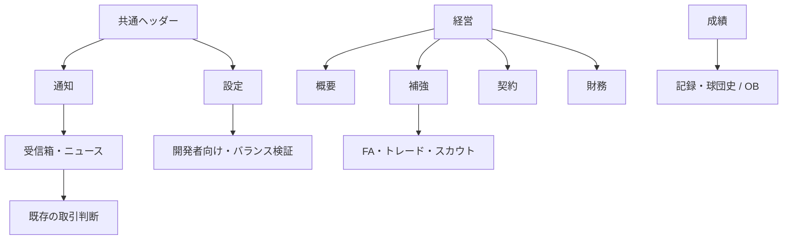

# UI-04 球団経営・ナビゲーション刷新

作成/更新日: 2026-10-20。照合main: `f687fc13d5599b9f2d2541b49347d22ee1f1e6f0`（#485マージ済み）。UI-04A/FIX・FIX-M2・UI-04Bはマージ済み。今回のUI-04Cを独立PRで実装・検証し、未マージで提出する。DとQA-04全体は未着手。既存要件と工程順序は維持する。

## 目的・受入条件

状態把握→判断→実行→結果確認の順に球団を経営できる構成にする。「その他」を廃止し、既存9機能へのアクセスと取引・保存・進行を保持する。DES-01、360/390/1440px、760/761・1023/1024pxを対象にする。成績は改名しない。

UI-04Aでは5分類、経営4領域の入口、共通通知、設定、OB移設、復帰、未読/要対応の区別と編成エラー中の閲覧を受け入れる。概要は予算と既存画面への実動作する暫定入口。財務・取引画面の全面移行は含めない。

## 現行コードとの照合

- App→HubShell→HubContentRouterが実描画経路。ホームだけMobileHomeとDashboardTabに分岐する。主要ナビは1024pxでsidebar/bottomを切替、ホーム本文は760pxで切替。
- 既存tab IDはdashboard/roster/schedule/stats/leaderboard/standings/records/mailbox/news/alumni/trade/contract/fa/scout/finance/balance。取引・保存のIDは維持し、表示分類だけマッピングする。
- #482でHubShellの離脱時validateLineupガードを除去し、編成不正でも閲覧可能にした。試合開始時の既存検証は残っている。A-FIXでは変更しない。
- useGameState.tabBadgesのtradeは未読だけを数える。UIの読取モデルで、配達済み・未解決の取引とposting_requestを既読と独立して数える。メール・ニュースselectorと既存unread selectorを利用し、永続stateは追加しない。
- MailboxTabの読取はhandleMailRead、確定はuseOffseason.handleMailAction。トレードはTradeTab→同じ既存ハンドラ。新しい確定処理・予算/枠ルールは作らない。
- FinanceTabは#481のforecastClubFinance/calcClubGameFinance/contractPayrollを利用。onBlur確定、旧配色、年俸上位の重複はBで移行。Aで財務エンジンを変えない。
- NewsTabのニュースには一般の既読保存がない。「ニュース未読」を作らず、既存answeredによる回答待ちを表示。一般ニュース既読履歴をDで検討する場合も別途保存設計が必要。

## 情報設計

| 主分類 | 下位画面 | 内部ID |
|---|---|---|
| ホーム | 次戦、結果、重要な対応待ち | dashboard |
| 編成 | ロスター、一軍/二軍、育成、起用設定 | roster（既存内包） |
| 日程 | 日程、試合、結果 | schedule |
| 成績 | 成績、ランキング、順位表、記録・球団史 | stats/leaderboard/standings/records |
| 成績→記録・球団史 | 記録 / OB | records/alumni |
| 経営 | 概要 / 補強 / 契約 / 財務 | management/reinforcement/contract/finance |
| 経営→補強 | 補強トップ / FA / トレード / スカウト | reinforcement/fa/trade/scout |
| ヘッダー通知 | 受信箱 / ニュース | mailbox/news |
| ヘッダー設定 | 開発者向け→バランス検証 | settings/balance |

旧9機能は上表のmailbox/news/alumni/trade/contract/fa/scout/finance/balanceに一対一で対応する。日常操作を深くしないため、経営概要からFA/トレード/スカウトへ直接進める入口も置く。予算は経営の初期画面で表示する。

## ナビゲーション・復帰・通知

- 主要5項目はPC/スマホで同じ定義を使う。セクションごとに最後のtabを記憶する。FA等では補強、OBでは記録・球団史を選択表示する。
- 通知/設定とそこからの外部導線には戻る入口を表示し、ブラウザの戻るでも復帰する。訪問元の本文をhiddenで保持し、検索・候補選択・スクロール・フォーカスを復元する。主分類を明示的に選んだときは一時的な復帰経路を解除する。年度/セーブの切替で経路を再初期化する。
- 一時UI履歴はネイティブの `#hub/<既存tab ID>` フラグメントを使用し、同じエントリーへUI状態を付ける。`pushState` による履歴を戻った後の再読込でWebKitがクラッシュする事象を、初回CIとゲーム非依存HTTPページで再現したため。URLはセーブや外部向けディープリンクではなく、再読込後は通常の「続きから」フロー。Hub表示中はスクロール復帰をUIで管理し、離脱時にブラウザの元の設定へ戻す。
- 未読は既存の配達済みunread selector、要対応は配達済みの未解決取引/ポスティングと未回答インタビュー。既読化は取引確定ではない。予算や人数に架空の警告を生成しない。
- 経営のバッジは未解決トレード/ポスティング、編成は既存の編成バッジ。FA候補数や契約残年数の件数を要対応件数と混ぜない。
- Aは既存受信箱の閲覧・確定を残し、トレードメールから既存取引画面へのリンクを追加。個別対象の集中表示はC、受信箱/ニュース/OB本文のDES-01移行はD。
- 通知入口の未読/要対応と保存状態は独立表示。全画面で実saveDirty/saveQueueState/saveResultを参照する。
- ナビはbuttonの通常のTab/Enter操作、aria-currentで現在地を示す。開閉はnative details/summary。入力付きモーダルを本工程で増やさない。

## Bの経営概要・財務の実装基準

390px/1440pxの[ワイヤーフレーム](../design/ui04/wireframes.html)は表示サンプル。サンプル額を本番に埋め込まない。PCは左の要約と右の対応事項、スマホは判断順に縦配置。装飾カードを増やさず、金額は既存fmtSalに委譲する。

経営概要の順序は、編成予算→全所属契約年俸→支配下/残枠→対応待ち→補強/契約/財務の入口。contractPayroll、evaluateRosterCapacity/draftCapacityContextを再利用する。人気・信頼度・戦力課題は実データがある場合だけ補足表示する。

財務の初期表示は次の4段階:

1. KPI: 編成予算残枠、年間運営差額見込み（選手給与控除前）、年間売上見込み、契約年俸総額。
2. 経営アクション: チケット価格入力→需要/主催売上/運営差額の比較→明示確定。onBlur自動確定を廃止。入力下書きと確定値を分離する。
3. 詳細: チケット/飲食/物販、スポンサー/放映権/会員、固定費/興行費/原価。実績と残り試合予測を区別し、実測0/未記録/算出不可を分離する。
4. 関連情報: 推定条件・日程の概算理由・契約/補強への導線。年俸上位の詳細は契約へ移す。架空の過去年次収支/推移は作らない。

budget=編成予算残枠（現金ではない）、revenueThisSeason=売上実績、clubFinance.income=内訳、costs=選手給与を含まない運営費、operatingSurplus=売上−運営費、contractPayroll=現所属の契約年俸。営業利益・現金残高・支払済み給与と表示しない。通常更改の年俸を予算から再控除した「補強余力」を作らない。

球場投資は既存10/25/50億円。現Lv/費用/投資後予算/動員/売上/給与前運営差額の比較を確定前に提示。前後を同じ人気・成績・日程・手動価格で既存エンジンへ渡す。単純回収年数は費用÷年間運営差額増分が正のときだけ参考値として表示し、実利益保証にしない。手動価格を維持する。下書きで永続stateを変更せず、確定後は保存対象の実stateを表示する。

## 工程・依存関係・完了条件

| 順 | 工程 | 優先度 | 必須依存 | 状態・完了条件 |
|---|---|---|---|---|
| 完了 | UI-04A | — | #481 | #482マージ済み。主要ナビ・既存9機能の移設・暫定入口。本文の全面移行は未完了 |
| 完了 | UI-04A-FIX | — | #482 | #483マージ済み。通知スロット再訪・戻る/進む/再読込・年度/セーブ切替 |
| 完了 | FIX-M2 | — | #483 | #484マージ済み。試合前需要、主催収益・Workerの一致、赤字予算と支出制限。[詳細](./fix-m2.md) |
| 完了 | UI-04B | — | A-FIX・M2 | #485マージ済み。[記録](../validation/ui-04b/README.md)。概要/財務指標と欠測、価格の下書き/比較/明示確定、投資の同条件比較、保存再開 |
| 4 | UI-04C | P1 | #485 | この独立PRで実装・検証（未マージ）。[記録](../validation/ui-04c/README.md)。補強/契約の対象選択・詳細・比較・実行・結果・復帰、既存更改と接続、通知の該当案件・解決済み表示 |
| 5 | UI-04D | P2 | C | コード未着手。受信箱/ニュース/球団史/設定のDES-01本文移行、未読/要対応/対応済みを実データと一致 |
| 6 | QA-04 | P1 | 全工程 | 全体未着手。新規→5分類/9機能→試合→シーズン中財務/取引→オフシーズン→年度→保存再開を実操作 |

原則この順序で前工程をレビュー・マージしてから最新mainの独立ブランチを作る。M2は#483後のmainから開始し、B/Cの独立部分は設計だけ並行可。今回のPRはCの補強・契約表示/操作と、通知案件の接続。Dの受信箱/ニュース/球団史/設定本文全面移行は含めない。PR作成後はマージせず停止する。

## UI-04B: 実装と比較の定義

- `HubManagementTab`：編成予算・全所属契約年俸・支配下/残枠・配達済み要対応を既存selectorから表示。受諾済み未所属指名を残枠に含め、人気/信頼の欠測を0と混同しない。
- `FinanceTab`：DES-01の4指標→価格/投資→実績/残り/年間→展開可能な費目/年俸/前提。年俸上位の詳細は契約へ移し、既存選手詳細へ接続。
- `financeView`：入力下書きと比較は読取専用。既存エンジンの費目別費用レンジを追加公開したが、計算式・計上・価格範囲・投資費用・保存形式は変更しない。
- 価格は今季実績を維持し、残り試合だけへ変更案を適用。球場は同じ人気/勝敗/年度契約/日程/確定価格を通年に適用して比較する。投資比較に未確定の価格案を混ぜず、手動価格を維持する。
- 投資の年間動員は実動員累計ではなく現在条件の推定。回収年数は費用÷年間給与前運営差額増分で、増分が正でなければ算出不可。シーズン末も通年比較であり残り試合予測とは異なる。
- 確認は画面内。確定ハンドラは既存のまま、取消は永続stateを変更しない。最新の予算/人気/日程で再比較し、二重実行を防止。通知往復は入力を保持、セーブ/年度切替は既存Shellの境界でリセットする。
- #484までのデータを受入基準とし、旧セーブの新規移行は行わない。既存互換表示・旧投資費用と手動価格操作は保持する。

## UI-04C: 補強・契約の判断と確定

- `ContractTab`：全所属/満了/回答待ち/当年契約済みの読取、選択→一軍成績・能力・年俸/残年→参考反応→最終確認→回答待ち。既存の `calcPlayerDemand` は参考要求額、`evalOffer` はシーズン中の提示評価として区別する。通常更改は提示時に予算を控除しない。返答予定/返答結果は保存済みメールを優先し、回答後にローカルの「回答待ち」を残さない。年俸欠測では提示のみ禁止し、対象であれば明示確認付きの自由契約は維持する。
- 旧シーズン中の「会話」操作は永続オファーを送らず画面内の会話ログだけを追加していた。判断に必要な条件・参考反応・最終確認へ集約する。実際の提示判定、最終回答の遅延、出来高/条項、育成年数制約、辞退時の所属維持は変えない。
- 進行中の有効なオフシーズン計画があれば、契約画面から既存の更改/編成計画へ戻す。シーズン中の別処理で同じ契約を更改しない。
- `TradeTab`：所属球団→候補の契約/実績/スカウト能力→詳細/共通比較→金銭→両球団への影響→確認して提案→結果。`applyTradeTransaction` を読取用の見積りにも使用し、登録枠・予算・所属を同じ基準で検証する。CPU評価/乱数判定/逆提案条件は従来通りで、閲覧・比較・取消では消費しない。逆提案は追加選手/金銭を含む最終条件で再確認する。
- `HubScoutTab`：候補一覧→詳細/比較→獲得条件→確認→結果→一覧。スカウト獲得は年俸1年分の控除、契約残り2年、二軍配属。FAの年俸×年数の先払いと混同しない。確認時は最新IDからindexを引き直し、候補消失・予算/枠不足を再判定。派遣と報告削除にも確認を付ける。派遣期間/報告生成/保存の仕組みは再設計しない。
- FA市場はUI-03Cの候補・条件・比較・明示確定を再利用。新たな市場交渉方式を追加しない。
- 通知→取引はメールID、契約回答→契約は選手IDを一時UIで保持する。既読にするだけでは実行しない。解決済みの案件も参照でき、確定ボタンを再表示しない。元のトレード下書きは同一セッションの保持済み本文へ復帰する。年度/セーブ/球団切替で以前の対象を持ち込まない。
- 受信箱のトレード/ポスティングの直接操作にも確認を追加。受信箱全体のDES-01移行はD。共通確認は画面内表示で、取消は元の操作、成功で操作ボタンが消えた/無効になった場合は残る対象見出しへフォーカスを戻す。通知から案件を開いた際も対象見出しへ移す。明示的な案件リンクでは履歴の旧フォーカス/位置の復元を抑止し、通常のback/forwardでは従来どおり復元する。
- 新たな永続state・保存スキーマ・収支/契約/CPUルールは追加しない。スカウトとポスティングの既存確定ハンドラへ成功/失敗の戻り値を追加し、UIで成功を推測しない。未記録予算のスカウト派遣を無効にする。

## A-FIX: 履歴と画面状態の契約

再現: 財務→通知→ニュース→ヘッダー通知→ニュース→戻る。#482の`replace`は末尾だけ変更する一方、`open`はtab IDでのみ再訪を判定していた。ニュース表示中に受信箱を追加すると経路が`finance,news,mailbox`となり、再びニュースへ置換すると`finance,news,news`となる。両実ブラウザでREDを確認。[再現・回帰・実画面](../validation/ui-04a-fix/README.md)。

| 操作 | 責務 |
|---|---|
| `open(target)` | 新しい画面は1つフラグメント履歴を作る。通知の受信箱/ニュースは同一スロット。既存の祖先スロットは新規追加せず実履歴を遡り、要求されたサブタブをそのエントリーで表示。非同期移動が完了するまで重複再訪をまとめる |
| `replace(target)` | 現在のスロット内の切替。通知の反復で履歴を増やさない。祖先への置換も実履歴の再訪処理へ統一 |
| `back()` | 現セッションの直前の異なるスロットへブラウザ履歴を移動。windowのない検証環境のみ一時経路を短縮 |
| `popstate` | 現セッションの実エントリーをUIへ反映。祖先再訪の指定サブタブを置換し、位置/フォーカスを復元。ネイティブhash追加のnullイベントは無視 |
| `navigate(target)` / 外部tab変更 | 主ナビの明示移動は一時経路・位置情報・保留再訪をリセットし、新しい訪問として開始 |
| セーブ/球団/年度切替 | UIセッションと本文を再初期化。旧履歴を踏んでも旧経路・旧入力を復元しない。無効エントリーは現在の有効ルートへ再基準化 |
| 再読込 | URLは一時UI履歴。既存の続きからフローに戻り、前ドキュメントの履歴IDを再利用しない |

ブラウザの物理的な過去エントリーを削除する仕様ではない。無効な過去訪問を現在のルートに置換して、URL/表示/一時経路の矛盾と古い復帰ボタンを防ぐ。`pushState`への回帰、新規のセーブスキーマ・永続UI履歴は導入しない。

元画面をhiddenのまま保持し、FAフィルタ・選択・遷移前タブ・入力・スクロール・フォーカスを復元する。年度/セーブを越えて未確定トレード入力を持ち込まない。保持中本文にも最新のゲームstateを渡し、確定取引や既読を過去のUIへ巻き戻さない。戻って経路から外れた画面のforward再マウント時の全入力復元まで保証するものではない。

## FIX-M2: マージ済みの基盤と調査根拠

調査に基づく修正内容・検証は[FIX-M2要件と決定](./fix-m2.md)、[検証記録](../validation/fix-m2/README.md)に記載。以下の表は調査着手時の確認事項として保持する。

A-FIXレビュー・マージ後に最新mainを確認し、独立PRで実施する。以下はコード照合による調査ポイントであり、財務バグの実ブラウザ再現・修正完了を意味しない。

| 調査先 | 現行コードで確認したこと / 次の検証 |
|---|---|
| `src/engine/regularGameUpdates.js` | 勝敗/人気を更新した`updated`を`applyClubGameFinance`へ渡す。試合前の人気/勝率/価格による見積りと、試合後実績への入力順を固定fixtureで比較。試合後の需要変化が当該試合へ混入していないかRED化 |
| `src/engine/clubFinance.js` | `calcClubGameFinance`が価格・人気・勝率・球場Lv・収容上限を使用。主催の興行収入と全試合の年度契約/固定費を区別。`applyClubGameFinance`は同年度/roundの重複を排除し、運営差額を予算へ加算。試合前quote→実績→重複適用の一致、実測0/欠測を検証 |
| `src/hooks/useSeasonFlow.js` | 通常/単試合オートとCPU対戦は共通更新関数へ主催区分を渡す。同じ試合前チームと結果を入力し、両球団の金額/主催数/計上roundを比較 |
| `src/workers/singleDayCore.js` / `seasonBatchCore.js` | 同じ共通更新へ接続。ユーザー視点と実ホームを混同しない。通常/CPU/1日Worker/まとめWorkerの需要入力・売上・予算差分が等しいことを検証 |
| `src/engine/clubFinance.js` / `src/hooks/useOffseason.js` | `nextClubBudget`のオーナー配分・年俸控除と`startClubFinance`の年度リセットを確認。負の運営差額/予算を入れ、給与二重控除なし・翌年予算・保存再開を検証 |
| `src/hooks/useGameState.js` / `src/engine/saveload.js` | 球場投資の最新予算ガード、チケット確定値、レジャー検証/復旧。負予算を無断で0化・破損扱いにしないか確認 |
| `src/engine/contract.js` / `tradeTransaction.js` / FA・スカウト処理 | 既存の不足予算/支配下枠/FA先払い/更改ルールとCPU判断を棚卸し。試合進行を止めず、実支出のガードを一致させる。負予算の許容方針はこの調査で確定 |

基本回帰: `src/engine/__tests__/clubFinance.test.js`、`clubFinance.lifecycle.test.js`、`regularGameUpdates`関連、Workerテスト、財務/取引/保存のE2E。通常/CPU/Workerの同条件比較、ホーム/アウェー、安価/高価/自動価格、低人気/満員/未記録、予算0/直前不足/負値、年度・保存を含める。負予算を許容しない大規模な経済ルール変更が必要なら独立した設計判断を記録し、UI移行へ隠さない。

## B/C/D/QAの補足受入条件

- **B:** 経営概要は編成予算残枠・全所属契約年俸・支配下/残枠・対応待ち・次の判断の順。`contractPayroll`と人数の既存読取関数を使う。財務は主要指標→操作→実績/予測→内訳/条件。価格は現在値→下書き→同条件比較→明示確定とし、キャンセルでstateを変更しない。球場投資は現Lv/費用/後予算/動員/年売上/運営差額/計算可能な参考回収年数。既存10/25/50億円と手動価格を維持。0・負値・欠測・算出不可と実績/予測を区別する。
- **C:** FA/トレード/スカウト/比較/未解決提案を判断対象中心に整理。既存の詳細/比較と更改UIを再利用。年俸/残年/要求/成績/能力/年齢・予算影響→判断→結果を揃え、オフシーズン更改と二重処理しない。通知から可能な範囲で案件選択へ接続し、解決済みならその状態を表示。確定は既存ドメイン関数を使う。
- **D:** 既読だけでトレード/ポスティングを対応済みにしない。一般ニュースに架空の未読を作らない。長文の本文/行間、一覧と詳細、年度/カテゴリ、未回答インタビュー、成績→記録・球団史→OBを整理。開発者機能は設定内へ限定し、空の将来設定を作らない。
- **QA:** 全工程マージ後、固定fixtureと実ゲーム進行で新規/全5分類/全9機能/試合/価格・投資/FA・トレード・契約/オフシーズン/年度更新/セーブ再開を検証。画面移動だけで金額・所属が変わらない、取引前後と全CPU球団の整合、保存維持、収益の実績/予測を確認。360/390/760/761/1023/1024/1440px、Chromium/WebKit、キーボード/タッチ、横はみ出し・固定ナビ重なり・戻る/進む/再読込・長名・空/エラー・0/未記録/算出不可・ロード中・保存状態・コンソールエラーを記録。

## 非対象・検証

旧セーブ移行、保存スキーマ全面変更、CPU補強AI、年俸/ドラフトルール、現金会計化、収支パラメータ再校正、新投資メニュー、全画面CSS一括置換は非対象。既存互換処理は維持する。

同じ固定fixtureで360/390/1440pxの変更前後を撮影する。境界4幅の全5分類を実操作し、キーボードとブラウザ戻る、通知の既読化/未対応維持、取引の未確定/失敗/二重実行、全clubデータの保存前後不変を確認。Chromium/WebKitの対象specを通常CIへ接続する。既存finance/posting/trade E2Eは旧ナビの操作だけを新導線へ更新し、金額・保存・所属の期待値は維持する。

検証結果・画像・CIは[UI-04A検証記録](../validation/ui-04a/README.md)とPR本文に記録する。未実行を成功扱いにせず、Aの成功をQA-04全体の成功としない。
