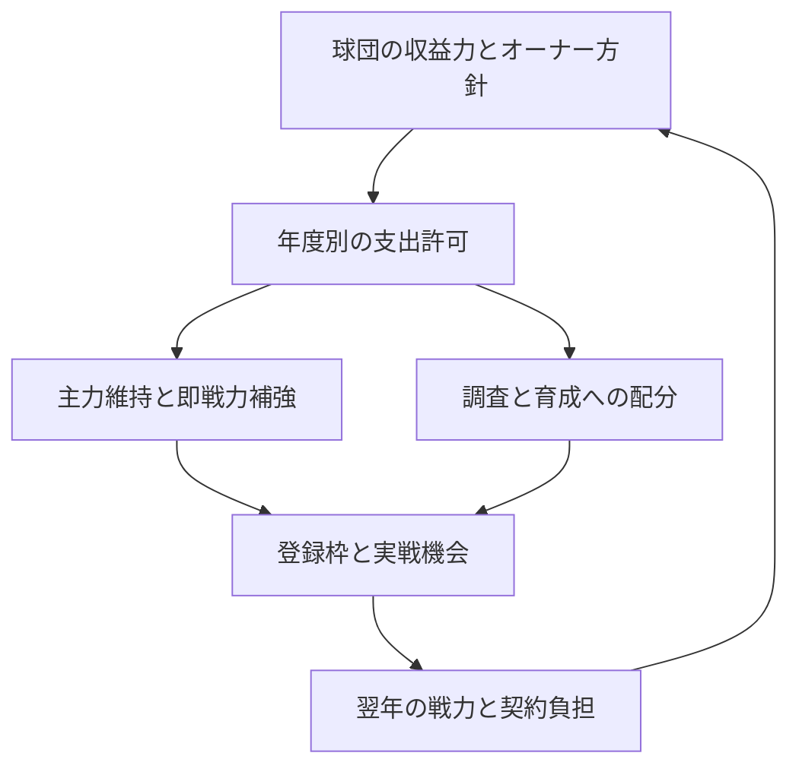

# GM-01 球団経営と編成のゲームデザイン

作成: 2026-10-26（日本時間）。照合main: `677c14fb5f96723846d01d0f72c25ac6a0d651b7`（#503マージ後）。

状態: **構想の具体案・設計レビュー用。製品実装・係数の確定・ゲームバランスの合格認定ではない。** 利用者はOOTP型の年間予算とFM型の将来負担を軸に、他機能の改善も含めた設計を依頼した。具体的な導入範囲は本書で確認する。

## 1. 何を面白くするか

「今年勝てる選手を取る」「主力を残す」「次の主力へ投資する」の三つが、どれも状況次第で合理的になるゲームを作る。資金・登録枠・実戦機会・調査時間の制約を通じて、今季の判断が翌年以降へ残る。数字を小さくして難しくすること自体を目的にしない。

スマホで、数試合を進めて結果を確認し、必要な選手だけ比較し、まとまったオフに編成を決める利用を前提にする。毎日の会計操作や、全選手の育成設定を義務にしない。自動進行と委任でも、何を優先して何を諦めたかが分かるようにする。

### 成功条件

- 契約の直前に、年俸・契約総額・各年度の負担・新人枠・同じ役割の競争相手を確認できる。
- 同じ候補でも、優勝を狙う年と再建する年で、獲得する理由と見送る理由が変わる。
- 主力の更改や新人獲得が可能な余地を残しながら、大型補強には機会費用がある。
- 裕福な球団の優位は残り、低予算球団には育成・早期確保・入替による現実的な進路がある。
- 成績・成長・故障には不確実性が残る。課金的な能力購入や、勝率を揃える裏補正で均衡を作らない。
- 10年以上の進行、二軍の成立、契約・所有権・保存再開を維持する。

### 今回の構想に含めるもの／後回しにするもの

含めるのは、財務と契約の責務整理、編成計画、CPU共通制約、スカウト、育成・コーチ、球場投資、ファンとオーナー評価の接続である。全てを同じPRで作る許可ではない。

完全な現金会計、税・減価償却・銀行借入、施設建設シミュレーター、全世界の選手DB、代理人との会話生成、戦術・物理エンジンの全面変更、全画面改装は対象外。MLBのサラリー調停やFMのFFPを国内野球へそのまま移植しない。完全バックアップ/復元は引き続き保留。利用者がスキップした単年PA/BF0の2件の個別診断も再開しない。

## 2. 参考作品と採用の判断

公式資料を参照した。FMは23/24の説明、OOTPは24のマニュアルと公式Wikiで確認した仕組みであり、最新版の全挙動を検証したという意味ではない。下記からこのゲームへの提案を導く部分は設計判断である。

| 参考 | 確認できる考え方 | このゲームへの適用 |
|---|---|---|
| [FM24 財務][fm-finance] | 給与/移籍予算の調整と3シーズンの財務予測 | 年間に使える枠と、複数年の契約負担を同時に提示 |
| [FM23 Squad Planner][fm-planner] | 当季と先の2季の構成を検討し、若手の昇格経路を考える | 既存の補強計画を、人数だけでなく役割・年齢・契約満了へ接続 |
| [FM24 スカウト][fm-scout] | 役割等の条件に沿った調査と、観察による情報の改善 | 予算残高から独立した調査能力、対象と時間の選択 |
| [OOTP 予算/契約延長][ootp-finance] | 当年FA余力と翌年の延長余力を区別 | 同じお金を二つの独立財布にせず、対象年度ごとの負担として表示 |
| [OOTP オーナー][ootp-owner] | 年間予算と球団財務・オーナー方針の関係 | 見える理由で年度配分し、年度途中の恣意的な没収を避ける |
| [OOTP 育成][ootp-development] | 投資は成長の可能性を改善するが成功を保証しない | 資金、コーチ、適切な実戦機会を上限付きで接続 |

### Approaches

| 案 | 得られるもの | 負担と限界 | 判断 |
|---|---|---|---|
| 既存の当年配分率だけを100%→25%へ | 最小変更で残予算の膨張を抑える | 契約の負担時期・コーチ・スカウトとの関係は残る | 校正候補へ戻す。独立先行実装はしない |
| **年間の支出許可枠＋各年度の契約負担＋編成計画** | 維持・補強・育成の選択を一つの仕組みで説明できる | 契約/年度/取引の共通化が先に必要 | **今回の推奨。利用者が関心を示した構想を具体化** |
| 現金・借入・設備会計まで全面導入 | 詳細な経営再現 | 画面・移行・CPU・調整の負担が大きい | 将来も必要性を確認してから |

前の25%案の「76.31億→43.65億」は、[既存3seed×10年の行動を固定した投影](https://github.com/shotaro-hue/baseball-manager/blob/balance/budget-allocation-20261026/docs/validation/budget-allocation-design-20261026/README.md)である。新しい契約制度・CPU行動の実測ではなく、本設計の目標値や現実の適正配分率の根拠には流用しない。

## 3. 現行から使うもの、直すもの

[コード照合と相互作用](../../design/club-management-20261026/source-audit.md)に根拠をまとめた。主な判断は以下。

| 現行の機能 | 活用 | 改善が必要な接続 |
|---|---|---|
| 球団別動員・価格・収入/運営費・予測 | 売上規模と主催試合の実計上を維持 | 収入計上と支出許可を分離。選手給与前差額を可処分利益と呼ばない |
| 更改、FA、新人獲得、支配下昇格 | 条件・所属・確認操作を維持 | 通常更改/CPU更改/FA等で異なる負担認識を、対象年度ごとに揃える |
| 補強計画、65人開始・CPU通常67人・70人上限 | 再実装しない | 人数留保へ予算・役割・将来の契約負担を追加 |
| 一二軍の実測、捕手層、出場機会の分配 | 基盤を維持 | 実測を成長の小さな要素へ接続。若手の抱え込みに機会費用を作る |
| ドラフトの公開/球団別評価・追加調査 | 基盤を維持 | 通常スカウトと精度/期間/情報アクセスの原則を統一 |
| コーチ・育成目標 | 既存の役割を活用 | 単発の採用費で続く効果、同職種の加算を継続費用と担当枠へ整理 |
| 財務の価格/改修比較 | 既存の下書き→比較→確認を維持 | 投資後の編成可能額と複数年効果を同条件で比較 |
| フロント方針、起用方針、人気、モラル、通知 | 別々の役割を保つ | 再建/勝負方針と行動の一貫性、役割に応じた期待、重要通知に絞る |

## 4. 意思決定の構造

4つの制約を分けて説明する。

1. **お金**: 支出してよい枠と、契約で将来に約束した年俸。
2. **登録枠**: 支配下・育成・一軍、受諾済み新人を含む実数と予定。
3. **実戦機会**: ポジション/投手役割ごとの起用容量。高い将来性でも全員を育てきれるとは限らない。
4. **情報と時間**: 調査できる対象数・精度・報告期日。画面を開き直して結果を変えない。

「勝負」「再建」を選ぶだけで能力・収入・成長へボーナスは与えない。行動の優先順位とオーナーとの合意目標を変える。既存`frontOfficePlan`のcontend/retool/rebuild/neutralを編成の長期方針、`managementPolicy`を日々の起用の好みとして使い、第三の重複モードを増やさない。

## 5. 年間予算と収支

### 5.1 用語と一つの資源

- **球団収支**: 実際に発生した収入/運営費の記録。現在の`clubFinance`を継続する。
- **年間支出許可額**: オーナーが認めた、その年度の選手年俸・コーチ・調査/育成・一時費用・承認済み投資に使える総枠。
- **確定負担**: 当該年度に効く契約年俸、継続スタッフ費用、実行済み一時費用、確定した投資支出。
- **留保**: 未更改選手・未獲得新人等に用意した予定額。確定負担とは別であり、契約したら置き換える。
- **追加余力**: 年間支出許可額から確定負担と留保を引いた額。現金残高ではない。

基本式は`追加余力 = 年間支出許可額 − 確定負担 − 留保`。FA用・更改用・育成用は同じ総枠の用途別計画であり、独立した追加資金ではない。実行済み支出を再び留保しない。売上/運営差額、許可総額、追加余力の三つを混ぜない。

### 5.2 いつ予算を決めるか

新規ゲームでは開幕前に当年度枠を持つ。以降は、実際のポストシーズン終了後、翌シーズン向けの更改・市場・ドラフト判断を確定する前に翌年度枠を提示する。カレンダーの`year=Y`のオフでも`budgetSeason=Y+1`を明示する。ドラフト等の画面順序そのものは最初の工程では変えない。

当年の決算は閉じ、次年度の契約・留保を別の年度へ積む。春の年度更新は枠の新規再配布ではなく、既に提示した年度枠を有効化する。二回目の支給や契約年数の二重減算を起こさない。シーズン中の更改は翌年度からの条件を保存し、当年度の年俸と収支参考値を途中で書き換えない。

### 5.3 年間枠の決め方

配分の説明可能性を先に固定し、係数は校正で決める。

1. 球団別の継続的な興行/商業収益から運営費を引いた、**選手給与前**の持続可能な余力を予測する。
2. 過去最大3年の実績を平滑化し、初年度/欠測時は現行プロフィールと通常条件の予測を使う。未記録を実測0として扱わない。
3. 親会社等の支援方針と、編成/育成/投資へ回す配分を加味して許可総額を決める。現行`TEAM_DEFS.budget`を新制度の総額と同一視しない。既存の「基礎予算＋差額60%」をそのまま加算しない。
4. 前年からの通常変化には上限を置き、大型契約の履行と最低限の試合成立を確保する。変更理由を売上見込み・支援・方針・過去の未達に分解して表示する。

初期の探索範囲は、平滑化1年/3年、通常増減の年10%/15%、収益からの配分率50%/65%/80%。これらは比較する仮説で、最適値ではない。支援基準を既存35〜65億の残枠から機械的に転記しない。12球団の現所属年俸・通常運営費・新人維持を含む年次表で、初年度から不自然な資金難/余剰がない範囲を確認する。

一つの係数で全指標を合わせようとせず、支援基準→配分率→年次平滑化の順に一要因ずつ校正する。これでも「FAを取らないのが常に正解」なら予算だけを緩めず、価格/選手価値/成長との関係を調べる。

### 5.4 シーズン中の収入と追加配分

入場料等は従来どおり試合ごとに計上するが、通常の予測収入をもう一度編成枠へ足さない。最初の導入では年度枠を固定し、収入改善は次年度の配分へ反映する。既存の価格/投資比較にはその影響を示す。

後続の投資工程で、中間の定期審査を1回設ける案を追加する。予測超過分、既に許可した追加額、残る費用から算出し、同じ好調分で何度も追加配分しない。25%はこの**未配分の上振れ**へ掛ける比率の比較候補であり、当年の全運営差額へ機械的に掛ける既定値ではない。予測操作だけで即座に使える枠を作らない。

賞金、ポスティング、引退試合、金銭トレードは収入/支出の種別と帰属年度を記録する。対価を伴う金銭トレードはその時点の承認枠へ反映。賞金等の臨時収入は、最初の年度枠固定版では決算/翌年審査へ反映し、後から定める追加配分以外の即時支出枠にしない。既存セーブの当年ルールは維持する。

### 5.5 余剰・赤字・負担超過

未使用の年間枠を無制限に現金として繰り越さない。同時に「使い切らないと損」にもしない。余剰のうち翌年に残す承認積立は後続の投資工程で導入し、資金源・上限・使用目的を記録する。最初の年度枠版は積立なしで、余剰が翌年の予算削減理由にならない方針を明示する。

既存契約の債務を、予算変更だけで消したり自動解雇したりしない。既存負担が新枠を超す場合、追加余力を負値で表示し、新しい任意支出を止める。保有選手による進行、無金銭で負担を悪化させない交換、満了時の再編は可能にする。

試合成立の欠員についてだけ、最小年俸の必要ポジション補充に使途を限定したオーナーの例外承認を可能にする。総額と理由を別記し、一般のFA予算へ開放しない。新契約で将来枠を無視しても翌年に全額救済される仕組みにはしない。例外承認が繰り返される球団は校正失敗として調べる。

## 6. 契約・FA・新人・トレード

### 共通の契約負担

2月1日以前から有効な年俸2億×3年の契約は、対象3年度に各2億の確定負担を作る。年間年俸×契約年数は額面総額として表示できるが、初年度枠から全額を引いて翌年も再び年俸を引く方式にはしない。**2月1日より後に新規加入した年度は初年度だけ在籍月数で按分するため、額面総額と球団の年度別負担合計は異なる。** 満了選手の更改では留保/予測を新契約へ置き換える。提示だけならオファー用の留保、受諾で確定、辞退/期限切れ/上書きで留保を解放する。

### 契約年数の正本と効力年度（GM-01の必須仕様）

**契約年数は「署名した年から何回春を越したか」ではなく、どのシーズンの戦力と年俸を何年度分約束したかで決める。** 合意日と効力開始年度を分離し、各契約に一意の`contractId`、`signedSeason`、`agreementPhase`、`startSeason`、`endSeason`、`annualSalaryManYen`、保証の扱いを記録する。`termYears = endSeason - startSeason + 1`。正本は契約とその効力期間であり、`contractYearsLeft`は画面/旧処理向けに対象シーズンから導出する互換投影とする。金額未記録・重複契約・年度逆転を黙って補正しない。

| 合意・加入した時点 | 契約 | 負担の対象年度 | 契約満了 |
|---|---|---|---|
| 2026年公式戦中の新規加入 | 1年 | 2026年の加入月〜11月の費用（途中月は日数比で分配） | **2026年の契約年度終了後** |
| 2026年公式戦中の新規加入 | 3年 | 2026年の加入月〜11月の費用＋2027・2028年の各年額 | **2028年終了後** |
| 2026年シーズン終了後のオフに合意 | 1年 | 2027年のみ | **2027年終了後** |
| 2026年シーズン終了後のオフに合意 | 3年 | 2027・2028・2029年の各年額 | **2029年終了後** |
| 2027年の開幕前に新規加入 | 1年 | 2027年のみ | **2027年終了後** |

- 契約の効力開始シーズンは取引フェーズから明示的に決める。公式戦中・開幕前の当年契約は当年、シーズン終了後のオフの契約は翌年。ポストシーズン中の新規加入を当年契約として成立させない。カレンダーの`year`や`contractSignedYear`だけで開始年度を推測しない。
- シーズン途中加入の1年契約は当年に満了し、同じ年のオフに来季契約を**改めて結ぶ対象**とする。今の`remainingContractAfterSeason`にある「`contractSignedYear === year`なら減算しない」という例外を、新制度へ持ち込まない。また今の`renewalEligible`の同年署名チェックを「同一オフの契約判断は1回」という独立の取引ID/解決状態へ置き換える。これにより、当年途中加入者の正当な翌年更改まで止めない。
- 年度残数は、対象年度に有効な契約について`max(0, endSeason - targetSeason + 1)`で表示する。翌年開始の合意済み契約は「来季から○年」と別枠表示し、当年度にすでに1年消化したものと混ぜない。契約の合意・受諾・撤回・再読込で年数が変化しない。
- 既存長期契約の途中更改は勝手に重ねず、期限延長を設ける場合は旧契約の将来負担の扱いと新契約開始時点を同一トランザクションで定義する。FA移籍/トレードでは既存の終了年度を継承し、移籍だけで契約が1年延びない。
- 移行対象の旧セーブで署名フェーズが分からない場合、`contractSignedYear`から当年/翌年契約を無理に逆算しない。旧期間・現在の残数・オフ進捗を保全した状態で、新制度が始まる未開始年度を起点に将来負担へ移し、変換理由を残す。現在進行中の旧年度を再計算しない。

### 年度途中の加入・移籍・契約終了（月割りで確定する設計）

以下は新制度の費用計上ルールであり、現行コードに実装済みの支払処理ではない。**選手一覧・契約画面の「年俸」は1シーズンの契約年額を維持し、当該球団が負担する給与費用だけを在籍した契約対象期間に応じて月割りにする。** 公式戦の消化ラウンド数、選手本人の出場試合数、所属球団の主催数では按分しない。

#### 期間の正本と現実との違い

[日本プロ野球選手会公開の統一契約書様式（2018年、第3条）](https://jpbpa.net/wp-content/uploads/2021/12/uc2018.pdf)は、年俸相当の参稼報酬の対象を**2月1日〜11月30日**とし、2月1日より後の契約締結について**300日基準で日割り**する規定を持つ。ここで採用する**10か月基準の月割りはゲーム用の簡略化**であり、NPBの厳密な300分の1ルールや銀行振込の回数を再現すると主張しない。年俸は12回払いの事例もあるが、振込回数と費用の対象期間は分ける。

- 当該シーズンの給与対象は**2月1日（含む）〜12月1日（含まない）**の10か月。2月から11月までの各月を年俸の1/10とし、12月〜翌1月に新たな当年度の選手給与費用を計上しない。年度予算は前もって年額分を拘束でき、試合ごとに給与を振り込む仕組みは不要。
- 新規獲得・トレード・支配下化の効力開始は**ゲーム内カレンダーの年月日**で決め、契約IDと効力開始日を保存する。例えば試合終了後に成立した移籍は、直前の試合日を旧球団側へ帰属させたうえで翌暦日から新球団の在籍期間とする。シーズンの143公式戦は日時を特定するための日程ソースとして使えるが、按分の分母にはしない。
- 2月1日以前から有効な契約はその年度の年俸満額。**開幕前でも2月1日より後に初めて加入するなら当年度を按分**する。オフシーズンに翌年開始として契約した場合は、その翌年の2月1日から有効として満額。11月30日後の取引はその年度へ遡らせず、翌シーズンの扱いにする。
- 同じ月の途中で加入・移籍・年俸変更した場合だけ、**その月の月額を実際の在籍日数で分配**する（例：7月16日加入なら7月は16/31か月＋8〜11月の4か月）。月の途中をすべて1か月と数えて、両球団に7月分を二重請求したり、月末移籍だけで給与が無料になったりしない。うるう年2月も実暦日で扱う。

#### 金額計算と保存の原則

年俸`a`万円、対象年度`Y`とし、2月1日から各日付`d`の直前までの経過を月単位で`M_Y(d)`とする。2月1日を0、各月1日にはそこまでの完了月数、同月途中は`経過した日数/その月の実日数`を加え、12月1日を10とする。範囲外は0〜10へ丸める。累計負担は`E(a,d)=Math.round(a*M_Y(d)/10)`（万円）。**期間[開始日,終了日)の費用=`E(a,終了日)-E(a,開始日)`**とする。

同一額の契約について、在籍期間をどこで分割しても差分を足せば同じ年額になる。契約後の当年残負担は`a-E(a,加入日)`。計算結果は予算審査・オファー留保・受諾後の確定負担・トレード相手の引受費用・年度報告に共通利用する。丸めは各期間で先に行わず累計差分で扱い、取引順序・保存再開による端数の生成/消失を防ぐ。年俸を正本から按分後の金額へ書き換えない。対象年度・年月日・金額の未記録を推測で0にしない。

| 年俸1億円の選手の2026年加入時期 | 当年度負担額 | 画面の年俸 |
|---|---:|---:|
| 2月1日以前から在籍 | **1億円** | 1億円 |
| 4月1日加入（4〜11月の8か月） | **8,000万円** | 1億円 |
| 6月1日加入（6〜11月の6か月） | **6,000万円** | 1億円 |
| 7月1日加入（7〜11月の5か月） | **5,000万円** | 1億円 |
| 7月16日加入（7月16/31＋8〜11月） | **約4,516万円** | 1億円 |

**2026年7月1日加入・年俸1億円×3年**なら額面契約総額3億円でも、2026年の球団負担5,000万円、2027年1億円、2028年1億円で、**実際の球団負担見込みは2億5,000万円**。2026年の1年契約なら2026年の5,000万円のみで満了し、2027年の契約が無条件に付くことはない。契約の年額、額面総額、今季実負担、来季以降の予算拘束、全期間の球団支出見込みを別々に表示する。

#### 移籍・昇格・終了・期限

| 事象 | 当年度の負担 | 次年度以降 |
|---|---|---|
| 2月1日以前から有効な新契約 | 年俸の満額 | 契約が続く各年度の年俸満額 |
| 2月1日後のシーズン中FA/発掘契約 | 表示は年俸のまま、当年度予算へは加入日から11月30日までの**月割り費用だけ**を計上。契約年数には加入年度を含む | 契約が続く年度の満額。短い初年度でも契約は自動延長しない |
| 育成から支配下への年俸変更 | 変更前の在籍期間は旧年俸、変更後は新年俸の月割り費用。旧額への遡及請求なし | 支配下契約が有効な年度は新年俸で計上 |
| 更改 | 既存契約の当年度負担を維持。シーズン後の合意は翌年2月1日から | 未更改留保を合意額へ置換し、同一期間を二重予約しない |
| トレード | 移籍日を境に旧球団はそれまでの在籍分、新球団はそれ以降の在籍分。**移籍月の費用も日数で分ける** | 残る契約年度の負担を引受先へ移す。給与一部負担交渉は未導入 |
| 満了時の退団 | 既に確定した当年度の負担は維持 | 満了後の新たな費用0 |
| 球団都合による保証契約の途中解雇 | 未経過期間の保証債務も元球団が負担。月割りを抜け道にしない | 将来年度の保証負担も元球団に残す |
| 正式な本人引退・ポスティング移籍 | 正式解除の有効日までの月割り負担（契約上の残債があれば別途計上） | 解除合意に従って将来債務を処理。移籍収入は別管理 |

同一選手が同年中に複数回移籍しても在籍期間を重ねず、移籍前に確定した費用を売手へ残して両球団同時に更新する。給与の移転には現行`applyTradeTransaction`の所有権・枠・金銭の原子的更新を維持する。年額が途中で変わる場合も、各年額の累計差分を在籍した範囲だけ合算し、単純な年俸差分の二重按分はしない。

**登録・移籍期限は月割りとは別に判定する。** [2026年7月31日のNPB新規支配下契約・譲渡の期限](https://npb.jp/news/detail/20260731_02.html)を参考に、原則7月31日を支配下新規獲得・トレード・育成からの支配下化の期限とする。外国人の現行`FOREIGN_DEADLINE_DAY`と国内/CPU/発掘の全経路をGM-00で照合し、例外は実装された登録ルールを確認してから限定導入する。CSと日本シリーズは[2026年のCS出場資格に関する公式情報](https://npb.jp/games/2026/info_cscl.html)も別に確認する。シーズン最終盤だけの安価な獲得を、実際には登録不可なのに通してはいけない。

コーチはGM-01では**年度ごとの雇用**として扱い、原則オフ〜開幕前に採用/更新/解任を確定する。これは年末に採用して全年度分の成長ボーナスを得る抜け道を防ぐためで、選手の月割り規則とは分離する。コーチの中途交代についてはGM-03で在任期間と育成効果を合わせて検討する。過去年の旧支出を遡って更新しない。

最初の新制度は年俸が契約年数中一定という単純さを維持する。年別変動給、契約金、給与負担割合つきトレードを同時導入しない。FA最大3年、更改最大7年等の既存上限も今回のみで変更しない。3年度を画面に主表示し、4〜7年契約の残期間も展開・全期間審査できるようにする。

次年度以降の予算は保証されないため、契約審査には保守的な年度別枠と未充足人数の最低維持費を使う。既存の大型契約が後日の不振で予算超過することと、初めから成立不能な契約を新たに承認することを区別する。支出許可は契約成立時に将来分も審査して拘束し、試合ごとに二度支出計上しない。オファーが辞退・失効した際は各年度の留保を解放する。GM-00で2/1・月初・月中・月末・7/31・11/30・12/1、複数移籍、育成昇格、保証契約解除、欠測日時、うるう年を検証する。

### 獲得・更改の同じ条件

自球団とCPUの資金審査、外国人・育成・登録枠・期限、所属更新を共通化する。CPUが1年契約を選ぶことは可能だが、同じ契約を結んだときの負担計算に違いを作らない。新制度のCPUは、必要性と将来余力があれば複数年を評価できるようにする。全員が常に単年を選ぶ状態を、長期契約の戦略が成立したとは扱わない。

新人は「指名予定」「受諾済み未加入」「加入済み」を区別する。指名決定後は実年俸へ置換し、入団時に同じ額を再留保しない。現行にないドラフト契約金をこの工程で導入しない。育成から支配下への変更は対象年度の年俸差額と枠だけを変え、一軍昇格とは独立に判定する。

トレードは金銭と、受け渡す選手の各年の年俸負担を両球団で同時に更新する。支払現金だけ通って高額年俸の引受が無制限になる状態を作らない。金銭なしでも将来負担が増すなら審査する。無金銭かつ負担を悪化させない交換は負予算時も可能とする。所属・履歴・ラインアップ参照の既存原子性は維持する。

### 出来高・オプトアウトの扱い

現行は交渉評価と条件保存がある一方、検索した経路では履行/精算を確認できなかった。まず小さな再現で、実際の支払い/離脱経路が存在するか確認する。

新制度の最初のリリースは固定年俸で成立させる。履行のない条項は新提示の加点/選択肢を一時停止し、既存保存条件は削除も遡及課金もしない。条項復帰は、発動条件・費用留保・精算・CPU利用・保存再開を一揃いで実装する別工程とする。曖昧な「活躍したら何%」のまま新しい債務を作らない。既存の未定義条項は経過扱いと表示し、全契約を勝手に再交渉しない。

## 7. 編成計画と市場の面白さ

### 金額で見る判断例

以下は説明用の架空球団であり、校正結果でも実際の球団財務でもない。単位は億円。2026年オフに2027年以降を計画する。

| 項目 | 2027年 | 2028年 | 2029年 |
|---|---:|---:|---:|
| 年間枠（2028年以降は保守的な審査見込み） | 50 | 52 | 54 |
| 既に確定した年俸・コーチ・調査/育成等 | 30 | 32 | 34 |
| 未更改・新人等の留保 | 10 | 15 | 14 |
| 追加契約の前の余力 | 10 | 5 | 6 |
| 年俸4億×3年のFAを追加した後 | 6 | 1 | 2 |
| 年俸8億×3年のFAを追加した後 | 2 | -3 | -2 |

4億の選手なら契約できるが、翌年の自由度は小さくなる。8億の選手は今の余力だけなら払えても、そのままでは将来の審査を通らない。確定した負担削減、短い契約への変更、別候補、若手起用を比較する。既に留保してある選手を同じ見込み額で更改しても、余力をもう一度減らさない。

### 役割と将来の構成

既存の補強予定に、今年/翌年/翌々年の役割表を加える。先発・救援・捕手・各守備位置について、主力、控え、次の候補、契約満了、健康/登録制約、若手の予定機会を見られるようにする。予定表で順序を変えても、選手の能力・モラル・契約・起用を勝手に変更しない。

例えば、主力遊撃手の契約が来年まで、22歳の候補が二軍にいるなら、今季は控えだけ補強して候補を試す選択と、主力へ長期延長して候補を別の守備位置で育てる選択を比較できる。若手がいるだけで「育成成功確定」とは見なさない。

FA・トレードの候補には、総合評価だけでなく、埋める役割、既存選手から増える戦力の見込み、契約期間、若手への影響を示す。能力の小さな上積みに大金を使うか、層を厚くするかを判断できるようにする。

初期市場は共有の候補を各球団が評価する現行形を維持する。オークションや代理人AIは同時に作らない。CPUが残予算順で逐次獲得する現行順序の影響を測定し、必要な場合は後続で「同じ市場ラウンドに提示し、選手が選ぶ」方式を設計する。競争不足の原因を未測定で価格の一律引上げへ置き換えない。

オファー中の留保は同一選手/提示IDへ結び、上書きは差額を置き換える。留保済みでも受諾時に最新の所有権・契約・枠を再確認する。成立不能な回答は現状を維持して取消理由を示し、別の選手を自動放出して成立させない。

## 8. スカウトと情報

最初に直すのは、残予算が多いほどレポート精度が上がる接続と、壁時計3秒で発掘が終わる進行である。精度は承認した調査費・担当の質・観察蓄積に基づき、取引で財布が減っても既存報告は悪化させない。

ドラフトの公開/球団別レポート・固定観測を共通の出発点にする。優先対象は「必要ポジション・年齢帯・即戦力/将来」の少数条件。標準の自動推薦を用意し、全員の追加調査を必須にしない。

- 派遣/報告のIDとゲーム内の期限を保存する。通常季は進行ラウンド、オフは市場の決定ステップを使い、画面を閉じても期限経過後に一度だけ届く。表示単位はその時計に合わせる。
- 候補は年度/市場の共有プールから探す。報告取得のたびに新しい高能力選手を生成し続けない。既存発見選手を削除しない。
- 報告は日時・対象・評価幅・根拠を持つ。再表示/リロード/同じ調査の重複要求で乱数や評価を引き直さない。
- 潜在能力は確定値として売らない。調査しても見込みに幅が残り、入団直後に真の将来性が全経路へ公開されないよう、詳細・比較・ソート・CPU評価の入力を揃える。
- 自球団とCPUで同じ情報ルールを使う。CPUが他球団の非公開レポートや未来の成長乱数を使う方式にしない。

新しい隠し方はスカウト工程で全参照を揃えて導入する。財務だけの最初の工程で選手詳細の一部を隠し、他画面に真値が残る中途半端な移行はしない。既存`fromScout`を理由に評価幅0へする挙動も、その工程で見直す。

## 9. 育成・コーチ・出場機会

### 9.1 コーチ年俸を現実的な年度費用にし、重複採用を防ぐ

現行`COACH_GRADES.salary`は3,000/7,000/15,000/30,000万円で、`hireCoach`が採用時にさらに`×12`するため、3.6/8.4/18/36億円が一括控除される。継続費は現行の年度予算式に明示されていない。これは実際のNPBコーチ年俸とは大きく異なる。[2024年の職種別相場解説](https://athlete-live.com/category_taiikukai/baseballcoach-income/)では一般に1,000〜1,500万円、高待遇球団で2,000〜3,000万円程度とされ、[元コーチの取材証言](https://www.nikkan-gendai.com/articles/view/sports/363081/2)には二軍800〜1,000万円程度の事例がある。全コーチの公式給与台帳ではないため、以下は**初期校正用のゲーム数値**であり、実額の断定ではない。

| 専門コーチのグレード | 年額・万円（暫定） |
|---|---:|
| 平凡 | 800 |
| 経験豊富 | 1,200 |
| 一流 | 1,800 |
| レジェンド | 3,000 |

**GM-01で年額定義・年度継続費・効果の重複制限を同時導入する。** 金額フィールドは`annualSalaryManYen`（万円/年度）とし、採用時の`×12`を廃止。採用/継続時に当該年度へ一度だけ確定計上し、年内に何度画面を開いても再課金しない。GM-01では原則オフから開幕前にだけ当年採用・解任を確定し、公式戦中の任意の交代は実装しない。途中採用を許して年末に全年度分の育成効果を受ける抜け道を防ぐ。期間途中の費用/効果の按分はGM-03で合わせて検討する。既存`coaches[].salary`の大きな値は旧採用時の費用として保全し、新制度の翌年年俸へ機械的にコピーしない。

NPB実球団には一・二軍で多数の指導者がいるが、このゲームの5職種は**プレイヤーが選ぶ追加の専門強化枠**とする。基本監督・二軍指導陣等の費用は既存の`clubFinance`固定運営費に含む会計上の設計仮定とし、選択した5枠の追加年俸のみ別途年度支出許可へ計上する。固定運営費にも同じ任意コーチ費用を追加し、二回差し引かない。5枠全員がレジェンドでも追加年俸は計1.5億円。額面だけで採用が常時最適にならないよう、費用対効果を校正する。

現行の`developPlayers`は打撃/投手/メンタルの同職種ボーナスを単純合計する。費用だけ現実水準へ下げると複数グレードの買い占めが最適になり得る。このためGM-01で**職種ごとに効果を発揮する担当は原則1名**とし、複数グレードの同時新規雇用を防ぐ。旧セーブに既存の複数コーチがいる場合は勝手に削除せず、担当者の選択、残員の処遇、翌年度更新時の費用を明示する。既存年度へ効果変更や請求を遡及させない。各職種0人でも基本スタッフによって試合と通常育成が成立する状態を維持する。

GM-03では上記の1担当枠を、主任・補助の役割や担当範囲へ拡張する必要があるか実測で判断する。補助を導入する場合でも、費用・担当容量・補助効果の上限を同時に定義し、「人数を買えば無限に成長する」状態へ戻さない。コーチ費用だけで選手の成長を保証しない。

### 9.2 育成費を能力の直接購入にしない

年度に一度、標準案を初期値として育成・調査へ配分する。通常範囲では投資を増やすほど効果は改善するが、追加効果は逓減させる。貧しい球団でも標準育成を維持できる費用水準から校正する。

成長の中心は既存の年齢・選手特性・成長/衰退・偶発性である。育成費と担当コーチ、役割に合う実戦機会は、その周囲を小さく改善する。初期の検証では合成効果を基礎成長量の最大+10%に制限し、既存のコーチ加算へ更に同じ効果を積まない。確率/端数の扱いは専用成長工程で校正する。衰退を投資で消さず、潜在上限を資金で引き上げない。

### 9.3 実戦の質と量

一軍/二軍の実測PA・BFを所属移動をまたいで集計する。野手/先発/救援に別の十分量を置き、到達後は効果を飽和させる。一軍の控えで数打席だけ出ることが、二軍の適切な継続起用より常に有利にはならない。

実戦機会0でも自然成長を0にしない。故障、捕手の守備のみ、記録欠測、登録待機を単純な怠慢にしない。大量登板や全試合固定起用で成長点を無限に稼げない。既存の疲労・故障・登録クールダウンを維持する。

若手の「次に試したい役割」と実績との差を定期的に知らせ、まとめ進行を毎試合止めない。既存の9守備成立・捕手配分・ローテ/救援・機会分配を育成効果のために壊さない。

## 10. 球場・人気・オーナー

### 球場投資

設備費は、年俸やスカウトの年額とは異なる一時支出として年度枠に計上する。画面上で用途を分けても、同じ資金を二回使えない。最初の財務工程では現行の10/25/50億円、即時改修、効果を維持し、単年度枠で払える投資だけ扱う。改修を必須攻略にしない。

後続では「承認積立で次年度以降に実行」を加える。積立時点で利用可能枠から拘束し、実行時に同額をもう一度控除しない。取消・返還・持越し・費用超過の規則を、その工程の着手前に定める。工期や銀行借入は加えない。

比較は同じ勝率/人気/価格で、売上・運営費・運営差額・将来の配分見込みを示す。運営差額ベースの単純回収年数と、実際に編成へ使える枠の回復を混同しない。将来の配分は保証しない。価格を上げれば常に得になるか、設備が必ず最優先になるかは固定条件の探索で調べる。

### 人気と評価

人気は動員へ効く既存経路を維持する。ただし勝利→人気→収入→補強の循環が数年で固定王朝を作らないか観測する。平滑化と育成の成否を通して対抗する余地を残し、試合の勝率を裏で平準化しない。

会見の選択だけで人気/モラルが繰り返し得られる現行の強さも、収益に関係する校正対象とする。最初の財務工程では変更しない。後続で、発言と実際の起用/編成の整合、同じ宣言の反復、目標の難度を評価へ反映する。自由入力の会話AIは不要。

オーナー評価は、合意した勝負/整備/再建の目標と、財務規律・翌年の基盤で評価する。再建を選ぶだけで勝敗を無視できたり、優勝宣言だけで予算が増えたりしない。初期には解雇・突然の強制売却を追加せず、理由のある評価と次年度配分へ反映する。

選手のモラルも役割に応じた期待と実績を扱う。控え捕手とレギュラーへ同じPAの不足判定を課さない。現行の年俸自己比較など、機能していない疑いのある枝は再現確認から別修正する。財務変更のついでにモラル係数を全面変更しない。

## 11. CPUと委任

- 財務許可と登録枠のvalidatorは自球団・CPU・委任で共有する。CPU固有の予算増量や無条件選手生成で帳尻を合わせない。
- 既存の`frontOfficePlan`と組織層評価を再利用し、主力維持→試合成立の不足→新人/育成余地→上積み補強の順に資源を見積もる。勝負年は安全余力を使い、再建年は年齢/期間/役割を重視する。
- 新人留保を単なる固定人数×最低年俸へ戻さず、既存の実候補・受諾/拒否・実空き枠を使う。
- 方針の更新に節目と継続性を置く。一時的な連敗で毎回再建へ反転しない。強制変更する条件と理由は記録する。
- 候補の比較理由と見送り理由を診断sinkへ出す。全候補の重いログをセーブに蓄積しない。
- 委任は予算配分・候補推薦・調査・日々の起用をまとめて扱える。大きな契約・主力放出をどこまで任せるかは既存の確認方針に従う。

## 12. 画面の判断要件

既存のホーム/編成/日程/成績/経営とDES-01を維持する。新しい財務専用ナビや同じ情報のダッシュボードを増やさない。これは画面レイアウトの確定モックではなく、実装時に既存部品へ載せる情報契約である。

| 利用場面 | 最初に分かること | 次にできること |
|---|---|---|
| 経営概要 | 対象年度の追加余力、翌年の確定年俸、新人予定/支配下枠、重要案件 | 契約/補強計画へ移動 |
| オフシーズン計画 | 翌年度予算、確定/未確定の負担、役割と年齢層 | 更改/補強/若手起用の予定を比較 |
| 契約/FA詳細 | **年俸は常に年額表示**。途中加入は2〜11月の対象10か月から加入後の在籍月数で今季費用を計上。月中は日数按分し、将来年額・契約額面と実負担見込み・実行後余力の違いを提示 | 同条件の確認→確定 |
| ドラフト | 評価幅、役割、受諾済み、新人留保と育成機会 | 指名/調査/終了を判断 |
| 二軍/育成 | 目標、実測機会、疲労、昇格可能性 | 目標/起用方針を変更 |
| 財務/投資 | 球団収支と年度枠の違い、配分理由、同条件投資比較 | 価格/改修/後続の積立を確定 |

画面を開く、比較する、並び替えるだけではお金・レポート・方針を確定しない。未知の将来値には幅/未確定を付ける。主指標の横に短い根拠を置き、詳細は展開する。通知は契約満了・確定回答・重大な予算/役割不足等を優先し、同じ警告を毎日送らない。

360/390/1440px、Chromium/WebKitで、候補選択→確認→確定→一覧復帰を検証する。実iPhoneのタッチ・速度を代替検証済みと主張しない。

## 13. 保存と実装上の境界

本書は実装計画ではないが、後の計画で変えてはいけない原則を定める。

### 年度と正本

年度枠は`budgetSeason`と方針version、承認額、根拠のスナップショットを持つ。契約は選手ID、合意年度、効力開始年度、対象年度別の固定年俸を一つの正本で持つ。既存の`salary/contractYearsLeft`は試合/旧表示との互換投影として扱い、新旧の両方を別々に更新する実装にしない。

新制度では、残予算は年度枠・契約・留保・一時支出から導出する。互換の`team.budget`コピーが必要でも、読込時にそれを第二の正本にせず、検証/再計算する。UIに計算や永続stateを複製しない。具体的なtype/配置は実装者に任せるが、既存`clubFinance.version=1`の収入/費用記録と支出許可のversionは分ける。

契約の正本には在籍期間と退団後の保証残額も含める。所属名簿から消えた選手の保証負担を集計から落としたり、途中移籍までの経過負担を返したりしない。全選手の毎試合給与履歴は不要で、契約/移籍の境界ごとの小さな期間記録で再現する。

取引は最新の所属・枠・対象年度で見積→検証→一度だけ適用する。入力を変えただけの見積は純粋関数。反復回答・再試行・同じ新人の受諾・年度画面再訪で重複計上しない。両球団・市場・留保の更新は一つの確定処理で整合させる。通常/手動/Worker/まとめ進行の全経路は同じ関数を使う。

### 導入時期と旧セーブ

- 新規ゲームは新制度の開幕前計画から始める。
- 既存の当年度は、残枠・契約・臨時収入・収入の配分方式を維持する。進行中のオフも旧ルールで完走する。
- 新制度は、次の**まだ始まっていないオフシーズン**から翌年度計画として導入する。導入する年度を画面に明記し、ロードだけで経営を変えない。
- 既存の長期契約は年俸と残年数から今後の負担を引き継ぐ。過去のFA総額控除を現金前払と断定しない。返金・架空残高・過去年俸変更を行わず、経過措置として記録する。
- 未記録/不正な年俸・version・契約年度は0や既定versionへ黙って補正しない。現行の復旧経路で止め、元の保存を保つ。
- 閉じた年度は集計と採用方針を小さく保持する。全候補評価や毎日予測をセーブへ追加しない。保存世代/不変履歴/GCの既存保護を維持する。

## 14. 段階的な実装と止める条件

順序は、財務だけを先に細くして契約の不整合を放置しないためのもの。各工程は独立PRとし、既存仕様から変わるゲームルールを本文に明示する。係数未検証のまま全工程を同時実装しない。

| 工程 | 完成させる判断/成果 | 先行条件・止める条件 |
|---|---|---|
| **GM-00 接続の実証と金額契約** | 更改/途中加入/移籍/終了/新人/昇格/コーチ/臨時収入の最小シナリオ、契約の署名年度と効力年度の違い、**2〜11月の10か月月割り・同月途中の費用分配・NPB統一契約書の300日日割りとの差**、7月31日登録期限、コーチ給与の二重計上と同職種加算、年度別の金額表、条項の履行確認、係数候補表 | 調査結果と本書が違えば更新。ゲーム処理変更なし。係数の最終選定や新制度の長期合格とはしない |
| **GM-01 年度枠と契約の共通化** | 更改前の翌年度提示、契約start/end年度による残年数の正本化、**年俸表示と2〜11月基準の実負担月割り（移籍月の在籍日数分配）の分離**、全期間の契約審査、留保置換、人/CPU同条件、追加コーチ年俸の正常化と同職種重複制限、保存移行。接続後の校正で係数を最終選定し、固定年俸で一通り遊べる | GM-00後。現行売上/価格/成長/試合は維持。契約共通基盤→市場/CPU→年度切替→UIを小PRへ分け、未接続/未校正の新制度を公開しない |
| **GM-02 編成と情報** | 既存補強計画へ役割/満了/将来余力を追加。通常スカウトのゲーム時計・共有候補・精度を接続 | GM-01の負担定義が安定。真値の漏れる参照を含め一貫して移行 |
| **GM-03 育成の選択** | 主任コーチ・育成/調査配分、機会を使う上限付き成長、CPU同条件 | GM-02後。成長式の変更は財務PRと分離。低予算球団の再建経路が消えるなら中止/再校正 |
| **GM-04 投資と球団方針** | 承認積立、中間の追加配分、目標/会見/人気の整合。未実装条項は履行一式ができたものだけ復帰 | 収益と戦力の循環を測定。必須改修・無限投資・固定最適宣言になるなら調整 |

最初のリリース単位は**GM-01**。スカウト・成長を待たず、既存の編成/試合/育成で遊べる。ただし費用の一貫性とCPUの利用は同じリリースで完結する。新ルールを途中接続の状態で新規ゲームへ有効化しない。必要なら純粋な見積/validatorと未使用データ型だけを先にマージし、有効化は最後の接続PRへ限定する。

## 15. 破綻を見つける検証

### 正しさは合格必須

同一契約の人/CPU一致、**途中加入時は年俸を年額のまま保持し、実負担だけ按分して予算/留保/契約詳細へ反映すること**、契約署名フェーズ/開始・終了年度/残年数（公式戦中1年・オフ1年・複数年を含む）、7月31日登録期限・CS登録資格、2月1日/4月1日/6月1日/7月1日/7月16日/7月31日/11月30日・うるう年の月中端数、同年中の複数移籍で総負担保存、提示と確定の留保置換、途中更改、新人受諾/辞退/加入、育成昇格、両球団の移籍、コーチ年度給・旧採用費の移行・同職種1担当・公式戦中の変更不可、143試合の収支、臨時収入、負予算、重複適用、保存→冷起動→再保存→続行を対象にする。未記録と0は別。4〜7年契約の画面外年度も検査する。

既存の捕手・外国人・支配下・日程成立制約を維持する。70人超過、所属重複、二軍未実施、同じ収入/費用/留保の二重反映は0を要求する。健康で登録可能な新人の初年度機会0と、複数年連続0を観測する。故障/守備のみ/期間外を混ぜて起用バグと断定しない。

### 面白さは複数の状態で比べる

| シナリオ | 選択が成立している状態 | 失敗の兆候 |
|---|---|---|
| 主力更改と大型FAが重なる | 両方/片方/若手代替を、将来負担付きで比較できる | 大金が余り全て取るか、全主力を放出するしかない |
| 優勝争いの補強 | 短期の上積みに費用をかける理由がある | いつも単年最低額/内部昇格だけが最適 |
| 低予算球団の3年再建 | 若手の機会と継続費を確保し、戦力を改善できる | 世代交代前に主力流出・欠員・救済が反復 |
| 同ポジションの若手が複数 | 起用/転向/放出/補強見送りの違いが残る | 抱えるだけで全員最大成長する |
| 高額の長期契約選手が衰える | 将来枠の拘束が見え、周囲で立て直せる | 契約解除で負担が消える、又は進行不能になる |
| 調査費と補強費を迷う | 情報の改善に価値があり、観察しても外れ得る | 精度が残財布/再表示で変わる、全調査が必須 |
| 改修か補強か | 状態によって回収と戦力の優先順位が変わる | 改修が常に最初の正解、又は永久に払えない |
| 不振・故障・予算超過 | 予告と説明があり、最低限の運営を続けられる | 突然の没収、自動解雇、都合のよい無限補填 |

### 校正の方法と報告

GM-00では固定ケースの金額表と、既存実績を使う読み取り専用の見積で不成立な係数候補を除く。残した候補は暫定で、新契約/CPUの行動が変わる結果をこの段階では確定しない。

GM-01を隔離した開発環境で一通り接続してから、1seed×3年のスクリーニング→候補を絞った3seed×10年の順に進め、公開前に係数を最終選定する。旧版の#503を再実行せず比較資料として再利用する。ただし新しい行動方針や契約基盤で公平な対照が必要なら、その差を明示して比較実行する。乱数消費が変わった世界を「同じ試合結果での因果比較」と呼ばない。

各長期実行では、現状維持・勝負年重視・育成再建の複数方針を、同じ初期球団条件で比較する。全組合せを最初から走らせず、低/中/高資金の代表状態で破綻を絞る。平均だけでなく球団別、下位分位、主力残留、予算による離脱、将来拘束、ドラフト数、例外承認、若手机会、年俸/能力の分布、育成/投資の費用対効果を出す。

優勝の偏りや低予算球団のCS進出は観測指標とし、30シーズンの小標本で「何%なら良作」という閾値を捏造しない。3年程度で判断が変わる代表ケースと、10年で特定方針が全条件を支配しないかを合わせて評価する。係数を選んだseedとは別の確認seedを少なくとも1本確保し、追加実行の目的と費用を記録する。

Nodeの長期ハーネスは既存どおりプレーオフ/賞金/不変receiptの一部を省く。金額ルールを変える今回の受入では、実Appで通常/手動/Worker/まとめ進行と、ポストシーズンの実収入・年度越し・保存を追加確認する。CIと同じ全件の二重実行はしない。各PRの必要な検証と、正確なheadのCIを揃え、最後に全体のコードレビューを一度行う。マージは利用者が判断する。

## 16. 設計判断の確度と実装者へ任せるもの

**今回の推奨として固定した原則**: 年度枠を契約前に提示、収支と許可の分離、各年度への負担計上、人/CPU共通制約、既存編成基盤の再利用、旧年度の非遡及、段階導入。利用者が個々の細則まで承認したとは記さない。

**GM-00で候補を絞り、GM-01公開前の校正で確定する数値**: 球団別支援、配分率、平滑化、将来審査の保守性。GM-00は現行の金額契約の実証と暫定候補表を成果とする。新制度の動的な進行で最終選定した基準表・理由・代表シナリオを本書へ追記してから公開する。固定行動の投影や実装者の直感だけで本番係数を決めない。

**後続工程で具体化するもの**: 新たな育成/調査予算の標準額、スカウトの期日/候補容量、育成効果と十分機会の役割別水準、主任/補助効果、積立の上限/返還、目標と条項の発動条件。GM-01では調査・育成の新たな投資項目をまだ作らず、追加専門コーチの費用のみ第9.1節の校正済み年額へ移す。同職種の加算禁止はこの費用改定と一緒に有効化し、担当制の高度化はGM-03へ残す。この設計だけを、その全機能の一括実装の承認としない。

**実装者の裁量**: 純粋関数・selector・データ型のファイル分割、既存UI部品への配置、同じ意味の短いラベル、focused testの最小構成。保存の正本/年度境界、費用の意味、情報の公平性を変える判断は裁量に含めない。

## 17. 設計の確認記録

実装者視点のbuilder checkを1回実施し、計画に影響する質問が3件あった。以下は利用者の細則指定ではなく、設計者の提案として解決した。新たなユーザー確認が必要な質問は残さず、具体案として本書全体を提示する。

| 質問 | 本書への反映 |
|---|---|
| 年度途中の加入/移籍/終了の負担は満額か按分か | 第6節をユーザー指定に合わせ、143公式戦按分から2〜11月10か月の月割りへ変更。月途中だけ実暦日で分け、保証・終了・複数移籍の端数を保全。コーチは年度費用と効果を同時に扱うまで別ルール |
| GM-01で主任/補助効果も変えるのか | 今回の追加見直しで第9.1節を更新。GM-01で現実的な年額と同職種1担当の重複対策を同時導入、GM-03で主任/補助・担当範囲の高度化を検討。既存名簿の非破壊移行も明記 |
| GM-00の静的見積だけで係数を確定してよいか | 第14〜16節を、GM-00で暫定候補→接続したGM-01の動的検証→公開前の最終選定へ修正 |

これはコード実装のレビューや実ゲーム検証ではない。反映後の文書検証と製品テストを区別する。

初回提出時に相対リンク5件、公式資料の参照リンク定義6件、明示したソースパスの存在、金額例と当初の143試合按分の算術3,888ケースを確認した（**採用しない旧案の検証**）。後続の設計レビューでコーチ年俸・同職種加算・契約効力年度・NPB登録期限を追記し、ユーザーの月割り指定で金額式を再設計した。新規の月割り式について製品テストで検証したという意味ではない。製品コード・定数・保存形式は未変更で、新制度のunit/E2E/長期バランス検証は未実施。

[fm-finance]: https://community.sports-interactive.com/sigames-manual/football-manager-2024/finances-r4964/
[fm-planner]: https://www.footballmanager.com/features/recruitment-revamp
[fm-scout]: https://community.sports-interactive.com/sigames-manual/football-manager-2024/transfers-recruitment-and-scouting-r4962/
[ootp-finance]: https://wiki.ootpdevelopments.com/index.php?title=OOTP_Baseball:Screens_and_Menus/Team_Menu/Front_Office/Finances
[ootp-owner]: https://manuals.ootpdevelopments.com/index.php?man=ootp24&page=ownership
[ootp-development]: https://wiki.ootpdevelopments.com/index.php?title=OOTP_Baseball:Screens_and_Menus/Team_Menu/Player_Development
