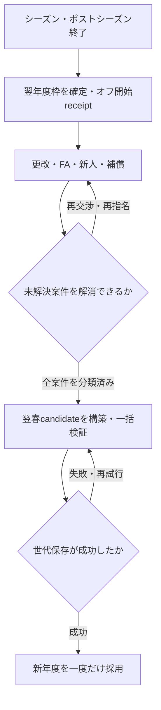

# GM-01 A1 本番接続設計

作成: 2026-10-30（日本時間）。基準main: `b255d2c2482dd50cba49f9620405e669c7f159b5`（#515マージ済み）。工程: **A1-0、設計のみ**。

根拠: [本番接続監査](../../design/gm-01-a1-0/audit.md)、[GM-01親設計](./2026-10-26-club-management-gameplay-design.md)、C-2B〜G-2の既存設計と現行コード。[実装計画](../plans/2026-10-30-gm01-a1-integration.md)と[受入試験](../../validation/gm-01-a1-0/README.md)を一緒に読む。本書の新しい型・関数・画面動作は、明記した既存APIを除き**後続実装の契約**である。

## 1. 目的・範囲・採用案

目的は、同じ年俸・期間・登録枠の取引が、人/CPU/Workerで同じ結果となり、年度更新・保存・再開で一度だけ成立すること。新しい交渉の複雑さを先に増やさない。

| 案 | 判断 |
| --- | --- |
| UIから既存の新APIを順に直接呼ぶ | 不採用。旧CPU、春の予算配布、別state、保存に抜け道が残る |
| 契約/保存/CPUを全面書換え | 不採用。既に検証した月割り・receipt・容量対策を失う |
| **既存基盤に必要な不足を補い、単一world adapterへ接続し、最後に保存単位で切替** | 採用。段階PRをマージでき、一般プレイは完成するまでlegacyを継続できる |

ユーザーが指定した段階切替を具体化する案であり、係数や未履行条項の追加承認を受けたという意味ではない。A1-0で実行するのは文書PRまで。A1-1以降の実装・本番有効化・マージには進まない。

非対象: 代理人、高度な競合入札、出来高履行、年別変動給、給与一部負担トレード、成長式の刷新、借入/現金会計、完全バックアップ製品化。スカウトのゲーム時計/精度の刷新はGM-02、コーチの中途交代効果はGM-03へ残す。

## 2. 正本とデータの置き場所

### 2.1 一つのworldと制度envelope

`teams/faPool/offseasonPlan/mailbox`と新契約状態を、契約取引・進行の単位として一つのworld snapshotで扱う。チームや選手snapshotを台帳の外へもう一組正本として保存しない。既存の履歴ストアは維持する。

```js
// 後続で導入する保存契約。enumと責務をここで固定する。
contractEconomy = {
  schemaVersion: 1,
  mode: 'legacy' | 'annual',
  epoch: 'save-lifetime-and-migration-identity',
  revision: 0,
  randomRoot: { algorithmVersion: 1, seed: 'persisted-once' },
  clock: { season: 2026, phase: 'preseason' | 'season' | 'offseason',
    date: '2026-02-01', offseasonTurn: 0 },
  cycle: { season: 2026, stage: 'playing' | 'postseason' | 'offseason-open'
    | 'planning' | 'ready-for-spring' | 'new-season', transitionReceipts: [] },
  engine: { version: 2, spending, transactions,
    acquisitions: [], faProtectionLists: [], faPersonnelMoves: [],
    faCompensationStandings: [], offseasonDepartures: [] },
  budgetPolicies: [], staffContracts: [], incomeReceipts: [],
  decisions: [], migration: { version: 1, status: 'pending' | 'applied' | 'deferred',
    migrationId, fromSaveId, observedSeason, earliestOffseason, issues: [] },
  legacyEvidence: { contracts: [], marketEntries: [], staff: [], clauses: [] }
};
```

legacyモードは新engineを稼働させず、必要なmode/移行境界情報だけを持つ。未移行の保存ではenvelope自体がなくてもlegacyとして読める。annualでは全必須フィールドを検証し、不足を空配列/0で補って稼働させない。

- `teams`は現在の配置、`spending.ledger`は契約条件/雇用/支払者期間の正本。両者の所属を同一candidateで照合する。
- `engine`にteams/faPoolやdraftPoolを複製しない。`toAnnualState(world)`がclock、唯一のteams/faPool、`draftCapacityContext(offseasonPlan, ...)`、同じpolicyの`rosterRequirements`を一時的に既存API形式へ組み立てる。
- `applyAnnualTransaction`の結果は`fromAnnualState(world, result.state)`でteams/faPool、draft結果の変更、engineを同じworldへ戻す。UIのoffseasonPlanと別のdraft確定台帳を作らない。
- `schemaVersion`は製品保存、`engine.version=2`は追加機能を含む取引状態、台帳v2は開始残高型、nativeな`seasonContract.version=1`は現在の契約型。ストレージ世代番号とは別概念。
- 現行v1 fixture/未接続APIの既存動作は維持し、v2は同じ計算/確定関数で拡張する。別々の人用/CPU用契約エンジンは作らない。

実装上は`teams/year/gameDay/faPool/faYears/offseasonPlan/contractEconomy`を同じReducerのdomain stateへ集める。契約回答の正本は`decisions`で、mailbox/newsは既存persistentDataStoreへ渡す表示イベントである。保存candidateにはこれらの同一revisionのイベントを含め、成功後のhydrationを直列化する。表示用メールが未更新でも契約を再実行するeffectを置かない。画面選択、比較、モーダル等は現在のローカルstateに残してよい。

### 2.2 互換フィールド

| フィールド | annualでの意味と書込元 |
| --- | --- |
| `salary / contractId` | 対象日時点で有効な台帳契約の投影。来季更改の受諾で今季salaryを上書きしない |
| `contractYearsLeft` | 有効契約の`endSeason - targetSeason + 1`。来季開始の契約は別表示。春にさらに`-1`しない |
| `contractYears / contractSignedYear` | native契約の互換投影。legacy開始残高から不明な元年数/署名年を作らない |
| `育成 / isIkusei` | annualでは契約のregistrationTypeを両方へ投影。legacyでは既存OR判定を維持し、読込だけで正規化しない |
| `team.budget` | `budgetSeason`の追加余力の表示投影。法的判定・収入加算・控除の入力には使わない |
| `clubFinance / revenueThisSeason` | 給与前の球団収支。支出許可額・給与支払済み現金とは別 |

annual向けに旧`upd`/UIからsalary、契約年数、budgetを直接更新する経路を閉じる。ロスター変更・メール解決・FA市場除去も共通worldへ集約する。成績/画面状態の無関係な大規模分割はしない。

### 2.3 新規ゲームと新しい保証条件

`createAnnualNewGameWorld({teams,faPool,myId,saveId,season,policy,randomRoot})`を初期化candidateとして作る。現行`bootstrapTeams.createInitialTeams`の名簿/65人開始と能力を再利用し、一軍/二軍の各選手へゲーム内初期契約を1件ずつ作る。年俸はseedのsalary、期間は検証済み`contractYearsLeft`を採用し、別の`contractYears`との不一致を優先しない。nativeの`startSeason=season / effectiveDate=season-02-01 / agreementPhase=preseason / purpose=acquisition`とする。これは**新規ゲームの初期条件**であり、実選手の過去の契約署名を復元したという主張ではない。

初期のmarket外国人は新しく生成した候補なので、生成イベントを根拠とする`released` entryを2/1で明示し、架空の元球団/FA補償を付けない。選定policyから初年度と全審査年度の許可を作り、旧team.budgetやnextClubBudgetを使わない。初期化/初回保存が失敗したら旧セーブを維持する。最初の通常進行でschedule初日の暦日とseasonフェーズへ移り、2/1と最初の試合日を同一視しない。

**初版の全ての新native契約は`guaranteed:true`**とする。人/CPU、更改/FA/新人/発掘/初期契約に共通の、今後のゲーム規則である。UI/commandからfalseを選んで保証負担を免除できない。既存v1 fixtureの非保証契約は維持し、旧保存のunknownをtrueへ変換する規則とは分離する。正式な引退/海外移籍の現在の解除合意は別のend commandで処理する。

## 3. 年度別予算と費用

`remaining = approved − salary − guarantee − staff − oneOff − formalOfferReserve − renewalPlanReserve − minimumRosterReserve`。

`quoteAnnualSpendingPlan`の既存金額計算/赤字例外を再利用する。スタッフと未更改計画は新しい区分を加える。金銭トレード/FA補償の受取は同年度の負の一時費用だが、一般の売上をこの符号で混ぜない。

### 3.1 承認policy

- 新規ゲームは開幕前、以後はポストシーズン終了後・最初の更改/補強の前に翌年度枠を決める。春は枠を再生成しない。
- 原資は現行プロフィール/実測の**給与前**運営差額と支援方針。親設計5.3に従い、`TEAM_DEFS.budget`や旧`nextClubBudget`の結果を許可総額へ改名しない。「基礎予算＋運営差額60%−給与」を新枠に転用しない。
- `budgetPolicies`へpolicyVersion、入力の記録有無、対象年度、給与前収益見込み、支援、増減制限、approved、理由を保存する。将来は審査用見込みであって支給保証ではないと表示する。
- 支出審査対象の`budgetSeason`から`max(既存契約/提示の最終年, budgetSeason+7)`まで、`authorizations / budgetPolicies / rosterRequirements`を同じ範囲で用意する。承認額だけ延長して最低人数の予算行を欠かせない。ここで基準にするのはcalendarの`clock.season`ではない。新規2026年は2033年まで、2026年オフは`clock.season=2026 / budgetSeason=2027`なので2034年までをオフ開始の承認receiptで準備する。これにより春の再配布なしで、2027年中に合意する2028〜2034年の7年更改も審査できる。既存契約/提示がさらに先まであればその最終年まで必要。3年だけを審査する実装は禁止。
- 通常取引中はauthorizationsを変更しない。年度境界での再審査は専用receipt付き操作で行い、既存負担を消さない。下振れで赤字になっても契約は履行し、新しい任意支出を止める。
- 配分率50/65/80%、平滑化1/3年、通常増減上限10/15%は**実験候補**。支援額もA1-4の12球団静的表→1seed×3年→3seed×10年で選ぶ。テスト内の固定許可額は本番係数の根拠にしない。
- 初版は当年の通常収益を追加配分しない。`applyClubGameFinance`は収支だけを進め、annualのbudget投影を増やさない。ポスティング/引退試合等も独立収支receiptへ記録し、翌年度審査の入力にする。旧ルールの当年は維持する。

### 3.2 留保の置換

現行の最低維持費だけでは高額な未更改主力の計画を表せない。`spending.renewalPlans`に`teamId/playerId/sourceContractId/season/amountManYen/basis`を置き、既存`calcPlayerDemand`の記録可能な値で翌年度の予定額を設定する。これは契約や本人への正式提示ではない。

- 各選手・年度の未更改計画と、同じ球団の正式な更改留保を同時に引かない。正式提示があれば計画額を置換する。
- 例: 未更改計画6000→正式提示5000→受諾5000で、留保は6000→5000→0、確定負担は0→0→5000。受諾時の追加消費0。
- 正式提示の取消は、まだ保有して交渉予定なら計画額へ戻す。満了退団を確定した場合は計画自体を解消し、必要人数の最低維持費を復活させる。少額提示→取消で余力を作らない。
- 最低維持費に使う資金計画上の人数は初版65人を人/CPU共通とする。これは新しい登録下限ではない。CPUの補強目標67人は戦略で、70人上限/実際の試合成立条件と区別する。65/67の妥当性は校正対象として残す。
- 新人は支配下/育成を分けた実額、FAは全年度給与＋初年度最大補償を留保。未回答FAは登録枠を確保せず、受諾済み新人/FA/人的加入待ちは枠へ一度だけ含める。

### 3.3 赤字と進行の救済

既存`assessAnnualSpendingChange`の例外を維持する。解決済み負担の分類変更、取消、負担を悪化させない適法な無金銭交換等を、赤字という理由だけで拒否しない。新たなFA/コーチ/投資は止める。

試合成立に必要なポジションが欠ける場合だけ、共通`approve-emergency-registration`で不足役割・最小人数・最低年俸・当年残期間に限定した追加承認を記録する。人にも同じ条件で利用可能。一般予算へ振替できず、長期契約/スター補強には使えない。候補生成が必要なら同じ緊急候補providerを使い、乱数結果/候補snapshotをreceiptへ固定する。2月以降の単年のみ、閉じた登録期間は新規登録救済に使わず保有選手の配置で対応する。救済を繰り返す球団は長期検証の校正失敗として調べる。予算全額リセットや保証消去を救済に使わない。

任意の退団/移籍は共通`assessPostTransactionPlayability`で、入替後の保有戦力から現行`validateTeamRoster`と二軍の試合成立条件を満たす配置を作れるか検査する。特に期限後に最後の利用可能な捕手/投手/野手を放出する操作は人/CPUとも拒否する。選手の退職意思を金銭不足で強制撤回させるのではなく、期中引退は現行どおり年末効力へ予約し、現在の実働配置を壊さない。

その後の故障などで、合法な保有選手の再配置を尽くしても試合不能になった場合は、登録期限の隠れた例外を作らず、共通`resolveUnavailableFixture`でゲーム用の不戦結果を記録して日程を進める。片側不能は9-0の不戦敗、通常シーズンで双方不能なら0-0の試合不成立として勝敗/選手成績を付けない。個人成績や出場日数を架空に加えず、負傷/登録クールダウンの日次経過は一度進める。通常/戦術/Worker/CPU/二軍/ポストシーズンで同じ可否検査を使い、不戦の理由を表示・保存する。一軍公式戦の収支は当日の観客変動項目0、既存年額契約/固定費だけを当該roundへ一度配賦し、給与/許可額は変えない。二軍/ポストシーズンには公式戦の年額配賦roundを追加せず、現在と同じ収支対象範囲を維持する。通常試合のスコアや打席と混ぜないstatusを持つ。

ポストシーズンの双方不能は、勝ち上がりを決める試合結果へ0-0を渡さず、**非試合の休養tick**を保存して同じ対戦を再試行する。seriesのgames/勝敗/進出/実暦の契約日を進めず、負傷/クールダウンだけを1tick回復させ、`[seriesId,fixtureId,restTick]`で一回性を持つ。最大の有限回復日数＋1回までに再検査し、全員の回復後も構造的に合法配置が作れないデータはinvariant違反として正常世代への回復を案内する。移行/初期化時と任意放出時にも構造的成立を検査し、この状態を通常の合法操作から作らせない。日本シリーズ8戦目以降に引分けを許す変更はしない。片側不戦敗は既存series勝敗へ明示結果として反映でき、双方休養は試合数に数えない。

これは最後の進行保護であり、新しい現実のNPB規則の主張ではない。頻発するseedは編成/負傷/校正失敗として公開を止める。結果・順位・収支・保存まで一貫した経路を用意できなければ「配置で救済済み」としてA1を有効化しない。

## 4. 共通取引と保存の確定境界

### 4.1 インターフェース

```text
toAnnualState(world) -> AnnualStateV2
quoteEconomyCommand(world, command) -> {ok, rows, effects, error?}
reduceEconomyCommand(world, command) -> {ok, world, replayed, error?}
commitEconomyCandidate(candidate, {saveId, epoch, baseRevision, progressToken, sessionToken})
  -> Promise<{ok, world?, committed?, error?, retryable?}>
```

`quote`は乱数・UID生成・メール送信・state変更・保存を行わない。UIは同じIDのcommandを保持し、確定時は最新worldで再検証する。ID再利用で条件が異なれば拒否、同一command再実行は同じ結果。失敗は入力worldの参照/JSON/所属/費用を維持する。

既存のoffer/replace/accept/cancel、rookie、trade、compensation、protection/personnel/joinは委譲する。新たに必要なのは、`reject-renewal / enter-market / end-contract / sign-scouted / hire-coach / fire-coach / send-scout / receive-scout-result / upgrade-stadium / record-extraordinary-income / approve-emergency-registration`および年度操作。更改の本人拒否はv2の解決履歴でもrejectedとし、球団取消と区別する。これらも同じ費用・名簿・receipt検証を通し、直接旧関数を呼ぶ別経路にしない。

### 4.2 原子性と永続化

1. UI/CPUが意思決定を作り、結果の乱数・提示ID・回答時点を固定する。quote内では生成しない。
2. 最新saveId/epoch/revisionでcommandを純粋適用し、契約・配置・市場・留保・枠・回答状態・receiptを一つのcandidateにする。
3. userの契約確定/年度移行はcandidateを保存し、**そのcandidateの公開成功を確認した後だけ**単一Reducer actionで採用する。成功応答の`committed`は、実際に公開したrootの`saveId / epoch / revision / rootSignature / receiptIds`を示し、要求した候補と一致することを検証する。要求引数を応答へコピーするだけ、別snapshotの`ok:true`だけでは採用しない。dirty状態の解除やpendingCareerEntries/archive receiptの成功処理も、対応する公開候補を確認してから行う。通知/履歴UIの成功表示は採用後。未公開の失敗時は旧world/旧rootのまま同じcommandで再試行できる。
4. CPU/日次/まとめは内部の複数commandを同じ純粋candidateで処理し、受理する進行単位でまとめて1回保存する。選手1人ごとに保存しない。annualではまとめ結果も保存成功前に採用しない。
5. 同じworldへの進行・取引・ロスター編集と、**自動保存・手動保存を含む全保存要求**を共通barrierで直列化する。確定保存の開始前に既存の実行中/待機中保存を完了させ、最新worldのsaveId/epoch/revisionを再検証する。barrierはroot公開の確認から候補採用、または公開済みrootの復旧まで保持する。待機中に旧worldから作られた通常保存snapshotは破棄するか、barrier解放後の採用済みworldから作り直し、そのまま後追い保存しない。読み取りは可能。既存のprogress/session tokenも検査し、ロード・削除・別タブ変更を跨ぐ候補は採用しない。
6. publish済みrootとメモリの採用に割込みが起きた場合は、そのrootを再読込して整合させる。publish済みを失敗前worldで上書きしない。保存待ち中の新規ゲーム/削除は既存barrierに参加させる。

世代root、root body、career/farm/archive receipt、バックアップ、競合排除は既存`saveGame`を再利用する。ただし現行`enqueueSaveGame`の待機payload置換を、annualの契約/進行/年度移行の確定保存にそのまま使わない。`createSaveRequestQueue`はBの待機中にCが来るとBを置換し、Bの呼出元にもCの結果を返す。annualの確定保存は共通barrier内の**置換不可の保存要求**として実行し、通常保存もこのbarrierを経由させる。legacyの通常保存をまとめる挙動は維持してよい。別の保存エンジンやlocalStorage財布は作らない。

必須の競合例は「通常保存A実行中→契約候補B待機→旧worldの自動/手動保存C」。Bが未公開ならBの確定成功/採用を返さず、公開した場合はBのrevision/receiptを保存とメモリの双方に残す。CがBを置換することも、採用後に旧worldを上書きすることも許さない。公開成功と候補採用の間で停止/再読込した場合は手順6の復旧を使い、barrierを早期解放しない。

### 4.3 抽選・IDと保存失敗の再試行

現行の`utils.rng/rngf/uid`はglobal Math.randomを使い、`developPlayers`もその影響を受ける。同じcandidateをメモリに保持するだけでは、失敗後の冷起動で抽選を固定できない。`contractEconomy.randomRoot={algorithmVersion:1,seed}`を新規/移行の一度だけ保存し、操作単位の`createEconomyRandom({randomRoot,saveId,epoch,operationId})`を使う。operationIdは年次stage/年度等から安定して決める。保存前に失敗しても、同じ旧rootと同じ操作IDから同じ結果/IDを再構築できる。

algorithmVersion 1は既存`faSeasonDraw`のFNV-1a/32bit finalizerによる決定的drawを共通helperへ抽出して使い、型付き`[seed,saveId,epoch,operationId,ordinal]`を入力とする。ordinalは操作内の0からの連番。同じ操作の途中再開は結果snapshot/receiptで判定し、新たなordinal列を消費しない。乱数品質の改善やアルゴリズム変更はversionを変え、保存済みversionを同じ値へ再生できるようにする。

既存rng/rngf/uidに任意のrandom sourceを渡せる形で再利用し、player/成長/退職/外国人候補/キャンプ/CPU判断の必要なhelperへ同じscoped contextを明示注入する。legacyの既定sourceは変えず、global Math.randomの一時差替えは本番で使わない。生成IDは操作namespaceと連番を併用し、再構築と重複検査を両立する。純粋なquoteにはcontextを消費させない。試合シミュレーション全体の乱数刷新は範囲外で、契約・年次操作の再試行に必要な境界だけを接続する。

旧セーブが移行保存前に失敗した場合のrandomRoot seedはmigrationIdから決定し、未知の過去乱数を復元したと称しない。新規ゲームは初期化開始時にseed/saveIdを一度生成して同一試行中保持する。成功後はrootの値を正本とする。

### 4.4 回答待ち・日付・期限

- シーズン中は保存された実scheduleの暦日を使用する。ラウンド95/100や試合消化率で給与/登録日を推定しない。日付欠損時は取引を拒否し、セーブを保持して理由を返す。
- 新規ゲームの契約起点はゲーム内2/1、通常試合の初日とは別。ポストシーズン中は新規獲得を閉じる。
- 初版のオフはゲーム用の固定暦日`Y-12-01`と、永続化した`offseasonTurn`を使う。現在エンジンの「date.year===season」を維持する。翌1月を年Yのdateとして捏造しない。オフの返答待ちは「日」ではなく「ターン」で表示し、同日受諾が許される既存APIにtick順序を加える。厳密な現実のFA日程再現ではない。
- `decisions`はproposalId、固定した評価/乱数結果、dueDateまたはdueTurn、deadline、statusを保持。mailboxは表示で、メール1000件切捨てが未回答債務を消さない。
- 日次/まとめの各境界、オフのターン進行で同じschedulerを呼ぶ。dueより先にまとめが終了しない。受諾直前にも所有/予算/枠/期限を再検査する。
- 期中の新規獲得・支配下転換等、当年の登録期限を要する操作は**7/31当日まで許可し、8/1以降は確定しない**。未回答の新規獲得オファーは期限切れ/取消で留保を解放し、遡及加入しない。この登録期限を翌年度更改へ適用しない。更改は固有のdue/回答期限、現在契約・所属・予算を審査し、8/1・11/30の受諾も可能とする。受諾しても今季salary/所属は変えず、翌2/1から効く。同じ8/1のschedulerで、更改受諾と新規FA獲得の期限切れを別々に処理する。
- オフは新規提示30ターンまで、各回答は提示後最大7ターン。市場終了操作は残る未受諾提示を理由付き失効にしてから進む。30ターンという値は初版の進行上限で、受諾率の校正値ではない。
- 回答待ち、契約確定、効力発生、加入待ちは別status。旧`contractReplies`の給与書換えeffectはannualで実行しない。

## 5. 不足している契約操作の仕様

### 5.1 冬の退団と雇用照合

現APIは冬の名簿を11/30雇用へ照合する。FA宣言/解雇の名簿削除を足すだけでは拒否されるため、`offseasonDepartures`へ元球団・選手snapshot・理由・通知日・効力日・台帳action/receipt参照を置く。

- 満了選手は既存契約の自然満了を維持し、架空の新end actionを重ねない。翌年分の未更改計画を解消する。
- 継続契約のオフ退団は、次年度2/1効力へ統一する。給与対象外の12〜1月を新たに請求しない。台帳の未来endは対応receiptがあるものだけ許可し、冬の名簿照合から正しく除外する。過年度費用は変更しない。
- `release`の保証残額はretain。引退/海外移籍のwaiveは、その場で成立した解除合意を記録できる場合だけ許可。不明な過去条件から合意を推定しない。
- 期中退団は現在日からendし、既経過費用を残す。履歴/配置参照/市場/台帳を同時更新する。
- 国内FAと海外FAのNPB内移籍は明示市場へ、海外球団への離脱は退団へ分ける。海外FA離脱で国内FA補償を作らない。

### 5.2 市場・補償根拠

新制度で発生する宣言は、確定時の旧契約年俸、直前シーズンの国内支配下年俸順位、権利行使記録をsnapshotにし、FAランク/補償根拠を生成する。現行の資格関数と決定を再利用し、`isForeign`から海外FAへ変換しない。native新規ゲームは初期のゲーム内行使回数0と明示し、実選手の歴史を再現したと称しない。

旧保存の行使歴が不明な場合は`unknown`を保全する。A/B補償には最大率を使う`legacy-conservative-max`という**移行後のゲーム規則**を別に記録し、`exercise:'first'`という歴史を作らない。`faCompensation`の根拠型/検証を拡張し、双方に同じ率を適用する。額の根拠自体がない案件は受諾を保留する。

既存旧市場は構造化した自由契約等の根拠を確認できるものだけ変換する。分類不能の選手は元snapshotを`legacyEvidence.marketEntries`と市場の読取専用行に残し、新規契約を保留する。表示用の理由文からA/B/Cや無補償を作らない。これは全年度の進行を止める理由にはしない。

#515の競合時順位資料は、オフ開始時の確定リーグ/wins/lossesから一度だけ生成して保存する。再読込時の現在順位で置換しない。同率/資料不足はID順で裁定せず、別候補または既に最大額留保済みの金銭のみへ誘導する。

FA獲得件数上限の現実制度を今回新設しない。70人枠・金額・資格・登録期限・補償は必須。件数制御の未実装は明示して、後続の制度範囲として管理する。

### 5.3 コーチと付随費用

初版はオフ〜開幕前に次年度の年度雇用を決め、5職種各1担当とする。`staffContracts`はstaffId/teamId/type/season/annualSalaryManYen/grade/効果/receiptを保存し、費用と効果が同じ年度に効く。重複採用はhandler/共通確定でも拒否する。シーズン中の新採用/交代は閉じる。

候補年額800/1200/1800/3000万円はA1-4の校正入力。一般スタッフは既存fixedCost内という親設計の仮定を明示する。採用時×12と翌年度費の両方を計上しない。新年度での非更新は翌年度費0、当年度の確定年額を解任で払い戻さない。費用0の担当付替えで成長ボーナスを買い回ることを防ぐ。

旧スタッフはraw記録を保全し、初回オフで職種ごとの翌年度担当/条件をゲーム画面で確定する。締める年Yの成長には、重複を含め旧年に在任した元のコーチ配列を経過入力として使用し、その年の効果や費用を遡って再計算しない。新しい1担当/年度費はY+1から。stored salaryを12で割った推定年俸へ黙って変更しない。重複/金額不明を自動で最安に置換しない。移行の事前確認で担当を確定できなければそのオフはlegacy継続とし、元のコーチを消さない。これはChatで再承認を要求するものではなく、製品内の移行選択の仕様。

調査/投資はoneOffとmission/球場効果を同じcommandにする。スカウトは初版で既存の3秒通知方式を維持するが、送信時にmission IDと生成済み結果snapshotを保存し、受信commandを冪等にして再開可能にする。未取得の旧結果は捏造しない。調査力やゲーム時計を変える設計は別工程。費用を支払う経路だけ旧budgetに残すことは禁止。

## 6. 年度更新の状態遷移

画面の順序は既存を活用し、domainのstageを画面名だけから判定しない。`offseasonPlan.stage`はdomain stageからの表示/再開投影とし、両方を別々の進行判定の正本にしない。



| 操作 | 前提 / 一度だけ記録する内容 |
| --- | --- |
| `open-offseason` | ポストシーズン完了。`[saveId,epoch,Y,'open-offseason']`で旧年ロスター/スタッフ/決算を固定し、退職決定→旧年成長→要求年俸/ドラフト候補→翌年度承認/計画/順位資料をcandidate内に作る。これを保存した後だけ通常の更改/補強を受け付ける |
| `planning` | calendar seasonはY、budgetSeasonはY+1。署名/回答は将来契約を作る。古いsalaryを新年俸へ即置換しない |
| `close-market` | 未回答は回答/拒否/期限切れに分類し留保を解放。新人は受諾留保/辞退、全FA補償は精算。人の未操作を勝手に受諾にしない |
| `prepareAnnualRollover(world, {targetSeason:Y+1, transitionId})` | 旧満了の保有権を更改/退団へ解決済みにし、契約/加入/費用の全部を候補内で処理する。未解決理由一覧を返し、途中stateを公開しない |
| `commitAnnualRollover` | キャリア/二軍/試合履歴を含む候補を既存世代保存へ渡す。成功後同じreceiptと新年度を採用。失敗時は年/契約/予算/加入を全て旧worldに保つ |

翌春candidateの順序を固定する。

締める年Yの成長/衰退、引退抽選と要求年俸計算は**open-offseasonの候補作成時**に一度だけ行う。対象は年Yを終えた保有選手から引退確定者を除いた集合と、年Yに在任したスタッフ。旧移行の初年も元の旧ロスター/コーチを使う。新人/新FAの加入、Y+1スタッフの選任より前に行い、結果とgrowth receiptを保存する。現在の`handleRetirePhaseNext`のこの順序を維持し、翌春builderで再実行しない。

1. 既存契約の終了年・future signから翌年度の保有選手と互換投影を作る。未更改を残したまま年数だけ0にしない。
2. 内部clockを翌年2/1・preseasonへ、budgetSeasonを承認済みの翌年度へ進める。**`nextClubBudget`を呼ばない。**
3. 新人`join-rookie`、FA`join-fa`、人的`join-fa-personnel`を安定順の既存commandで実行し、各receiptを作る。全てcandidate内。順番を変えても人数・費用の最終値が同じことを検証する。
4. 台帳の閉鎖年度、スタッフ、加入待ち、配置/役割、給与前収支の新年度開始、加齢/成績/二軍/日程/キャンプの年次処理を一度だけ反映する。legacyの残年数減算やopen-offseason済みの成長/引退抽選を再実行しない。キャンプ等の未実施抽選も同じtransitionIdのscoped contextで固定する。
5. 全体の契約/所属/予算/70人/未解決0を検証して保存する。receipt済み同年度の再実行はno-op、同IDで異なるtarget/内容は拒否する。

現在の`handleNextYear`の保存先行構造、career/farm/archive処理は再利用する。旧分岐は既存セーブの完走用に保持する。annual側から旧年度builderを呼んで結果へ新台帳を足す実装は禁止。

### 未解決案件の終了規則

| 案件 | 進行方法 |
| --- | --- |
| 未回答更改/FA | 固定したdueを処理、残る未受諾は明示期限切れ。更改未合意は満了退団/再提示を提示し、保有権を黙って消さない |
| 未資金新人 | 予算内単年条件で留保、または明示辞退。春に無契約で加入させない |
| A/B補償pending | 人は指名/金銭を選択。続行時の既定金銭処理は対象・額を表示してゲーム内操作で確定。CPUは上限留保済み金銭へfallback可 |
| 人的候補競合/契約未確定 | 勝者を一括裁定、敗者は未使用候補へ。候補数を超える再試行はせず金銭へ。同率/欠損を抽選やID順で解決しない |
| 加入待ち | 合意後の一方的取消はしない。加入を阻む状態なら候補/保存を拒否し、原因と前の正常セーブを保つ |
| 赤字のみ | 保有戦力の進行と非悪化取引は可能。満了による再建を待つ。赤字だけで年度をロックしない |

## 7. 新旧切替・旧セーブ移行

### 7.1 切替表

| 保存状態 | 切替時点 |
| --- | --- |
| A1-4有効化後の新規ゲーム | 初期化candidateからannual。全CPU/進行/保存が揃ったbuildだけで許可 |
| 旧・進行中シーズンY | そのシーズンはlegacy。次の**まだ開始していない**オフYの入口で一括移行 |
| 旧・既にオフ/プレーオフplanが始まっている | 当該オフと春をlegacyで完走。翌シーズンの未開始オフまで延期 |
| 旧・境界を証明できない/未回答旧更改あり | conservativeに一巡延期、理由を記録。画面がtitle/hubだから未開始とは推定しない |
| 既にannual | migrationId/epoch/receiptを検証してそのまま復元。再移行しない |

`planningResumeScreen`の新年度完了planと、進行中planを区別する。新制度の部分有効化フラグを人/CPU/Worker別に持たず、**保存単位のmode**で選ぶ。A1-1〜4aのbuildは新規ゲームもlegacy、テストfixtureだけannualを明示できる。

初回の適格判定で`earliestOffseason`と「まだ旧オフの副作用を始めていない」というboundary tokenを通常保存へ記録する。進行中シーズンからそのbuild内で作ったpostseason planや移行事前確認の再開だけを理由に、毎回さらに1年延期しない。tokenのない旧保存で既にplanがある場合は上表どおり一巡延期する。事前確認を取り消して旧オフを開始した時はtokenを消費し、同じオフへ途中移行しない。

### 7.2 開始残高専用型

現行native契約は署名フェーズと保証booleanを必須にするため、旧保存を`createSeasonContract`へ当てはめるだけでは保証/署名を捏造する。台帳v2に次の**観測した開始残高**を追加する。

```text
legacy-opening record:
  openingId, playerId, teamId, observedSeason, observedDate,
  observedAnnualSalaryManYen, observedYearsLeft, carriedFutureYears, endSeason,
  registrationType, guaranteeStatus: 'known-retain' | 'known-waive' | 'unknown',
  sourceFields, migrationId
```

- これはsignではなく、給与の銀行支払履歴でもない。元の署名年・総契約年数・過去の在籍費用を出力しない。
- オフYの入口では`observedDate=Y-11-30`を所属照合の観測境界とする。既知の翌年度持越残Fは現行`remainingContractAfterSeason(player,Y)`の結果として保全し、`carriedFutureYears=F / endSeason=Y+F`を記録する。通常のL=1・前年以前署名ならF=0で今冬満了。同年署名なら旧仕様はF=Lとするため、その保存の将来残を短縮しない。これは**旧投影の開始残高**であり、署名フェーズ/実契約期間を逆算する規則ではない。新規native契約にはこの例外を導入しない。旧オフ開始済みは移行しない。
- ledgerの過年度給与を再作成せず、移行後の対象年度分だけを支出審査へ入れる。元のsalary/L/署名年等はraw evidenceとして保持する。旧方式の誤差を過去へ遡って直さない。
- `contractLiabilityRows/contractEmploymentAt`等はnative/openingのunionを投影する。`remainingEmploymentSeasons`を導入し、openingへnative専用validatorを無理に通さない。通常更改・トレード・人的移管もopeningを保持したまま使えることを受入条件にする。
- 保証不明はunknownのまま、退団時には**新制度の保守的留保規則**として残額を維持する。`guaranteed:true`という旧事実は作らない。その場の解除合意を新しく記録できれば将来分のwaiveは可能。
- 金額/年数/所属の不明・重複・小数・負値・既知最低年俸未満・L<1/L>7は事前検査で移行不可。0は記録ありの値として検査し、missingへ置換しない。勝手な切上げ/最長7年への切詰めはしない。
- 市場の過去退団保証債務や旧FAの総額控除から、支払済み現金/残債/返金を推定しない。確認できる既存の将来負担だけを取り込む。旧budgetは比較用証跡として残し、新許可額の入力には使わない。

### 7.3 移行トランザクションと旧クライアント

`prepareEconomyMigration(world, boundary) -> {ok, candidate?, issues}`を純粋に作る。`migrationId`はsaveId・観測年度・移行versionから型付きで一意に作る。全12球団、pool、旧回答、スタッフ、区分、年度承認を検査し、一部の球団だけ移行しない。

読込では検証/候補表示だけを行い、rootを書換えない。境界の保存に成功した時だけ`status:'applied'`とmode=annual、新epoch、元世代参照を同時publishする。途中失敗/容量不足/別タブ競合では旧root/backupを保持し、legacyのまま再試行または当該オフを延期する。移行直後の再読込→契約確定→再保存も同じmigrationId/epochを維持する。

新形式があるのにengineを欠く保存ペイロード、annual→legacyの上書き、unknown schemaを黙って落とすreaderを拒否する。既存`farm_payload_missing/archive_receipt_missing`と同様の同一saveId降格防止を追加する。さらに現在のwriterを変えるだけでは既に開いている古いJSを止められないため、**既存のstorage-version-fence/epoch方式を再利用して新ストレージepochへ公開し、古いbuildに新rootを書かせない**。基準mainの`baseballManagerDb.BASEBALL_MANAGER_DB_VERSION`は5。最終有効化buildで6へ更新する案とし、実装時に他工程のversion更新があれば再確認する。既存store/行を削除せず、旧v5接続のversionchange/再open失敗、upgrade blocked時の非変更を検証する。A1-1〜4aの通常buildではこのversion更新を有効化しない。保存キーだけを共用したschema追加では合格にしない。バックアップ世代の回復はepochとmodeの整合を検証し、勝手に旧モードへ戻さない。

primaryの破損でmode自体を読めない場合にも、旧backupへの制度巻戻しを防ぐ。DB v6に非破壊で追加する`contract_economy_epochs` storeへ、saveId/epoch/migrationIdと公開rootの署名を持つ**activation anchor**を保存する。rootだけのフラグやDB全体のversionだけで代用しない。

新規annual初期化にも同じ手順を使い、activationIdは`['new-game',saveId]`とする。単一セーブslotの現在のactivationを識別するpointerを保持し、前の別saveIdのanchorを現在の保存と取り違えない。

1. 移行candidateのroot/chunksをstageし、旧root署名と新root参照を含む`prepared` anchorを保存する。未公開のcandidateはGCからpinする。
2. 既存の比較/競合ガードでprimaryをpublishする。この時点が移行のcommit point。失敗して旧rootが同一なら旧worldを維持し、preparedを中止できる。
3. anchorを`active`へ確定する。primary公開後にこのI/Oが失敗しても「元worldのまま保存失敗」と返さず、公開済み状態として再読込/修復する。prepared＋一致する新rootから同じepochを復元できる。
4. 冷起動ではanchorも検査する。active、または公開済みを確認できるpreparedがあれば、同じannual epochの正常root/backupだけを自動復旧候補にする。annual rootが全部読めない場合は旧backupを保持して復旧不能を明示し、legacyとして自動起動しない。
5. preparedで現在rootが旧署名と完全一致し、新公開の証拠もなければ未成立としてlegacyを再開できる。primaryが欠損/破損して成立有無を証明できなければ自動判定せず停止し、残るcandidate/旧backupを保全する。古い世代への明示復元は別操作として扱い、通常loadのfallbackにしない。

anchorは旧rootを上書きするための許可ではない。新規ゲームは新saveId、明示削除は既存の削除barrierでroot削除成功後に対応anchorを終了させる。削除/初期化のI/O失敗で他の世代のanchorを消したり、削除済みゲームをpinから復活させたりしない。通常の移行失敗では元のroot/backupが読め、同じmigrationIdで再試行できることを確認する。

preparedの参照は既存root/body/chunk回収の保護対象に加える。active確定後はprimary/backupによる通常の保護へ移し、anchorに古い全データを永久pinしない。anchorは履歴の複製ではなく、slot/saveId/epochの復旧ガードである。

旧`contractIncentives`はraw/経過表示として保存する。新制度の固定条件へ同じ条項を再入力して加点させない。遡及課金・勝手な行使・黙った削除はしない。

## 8. CPU・Worker・長期再建

- 既存`planCpuRenewals / rosterPlanning / organizationNeeds / managementPolicy / tradeValue / salaryDemand`を候補/方針として再利用する。成立処理は`reduceEconomyCommand`だけ。
- CPUの獲得価値は既存の能力/役割不足/年齢/観測情報と価格/将来負担で評価し、選手の`evalOffer`は受諾見込みに使う。選手が高く評価する球団であることを、球団がその選手を欲しい理由へ代用しない。
- 更改1〜7年、FA1〜3年の範囲で、少なくとも単年と2/3年を比較可能にする。長期を必ず選ばせず、7年目の不足まで人と同じ審査で拒否する。新人/育成の区分・最低年俸も同じ。
- 予算不足は短期化→予算内条件→安価な役割代替→保有育成の適法な昇格→見送りの有限候補列。受諾されない額を強制しない。新規負担を増やす育成昇格は赤字救済ではなく通常審査。
- 保証を抱えた再建は任意補強/投資を減らし、満了待ち・若手起用・相手も審査を通る負担非悪化トレードを使う。放出で保証費を消さない。主力の残留/流出理由と失敗条件をtraceへ記録する。
- 保護名簿は既存の価値評価で候補を順位付けし合法な0〜28名を選ぶ。人的補償は予算/区分/契約を満たす候補を評価し、競合/赤字/同率は金銭へ有限fallbackする。
- Worker request/responseはprotocolVersion、mode、saveId、epoch、baseRevision、clock、必要な全engine stateを含める。知らないversion/mode、不足したannual payloadは拒否する。`normalizeSnapshot`で欠落を[]にしない。
- main threadは現行progress/session tokenに加えepoch/revisionを照合する。古いWorker結果を現ロスターへmergeしない。通常/戦術/単日/まとめ/CPU全試合のscheduler・確定費用を揃える。
- 再読込/まとめ中のRNG順序を維持できるよう、decisionと抽選結果を保存する。見積表示による引き直しを許さない。

## 9. 有効化ゲート・未決事項・既存文書との差

機能フラグは単なるUIの非表示ではなく、一般の新規/旧ゲームからannual worldを生成できないゲートとする。A1-1〜3はdisabledのまま。A1-4aでUI、全主体、旧移行、年度/保存、長期と実iPhoneを揃え、A1-4bで初めて切替を提案する。

| 残す判断 | 推奨と確定時期 | 有効化条件 |
| --- | --- | --- |
| 年度枠の支援額/配分/平滑化/増減上限 | 親設計の候補を同一seed/条件で比較、A1-4aで選定 | 実測なしの固定適正値は禁止 |
| コーチ4段階年額 | 800/1200/1800/3000を出発候補に費用/効果を同時確認 | 重複担当と継続費が揃うまで安価版だけ公開しない |
| 緊急補充の許可記録と供給可能性 | 共通・当年限定・最低限のみ、A1-3で再現 | 予算救済が常態化するseedでは公開停止 |
| 実iPhone性能/容量 | A1-4aで本人の実機確認記録を取得 | WebKit CIのみで実機合格としない |

これらは実装インターフェースの空欄ではなく、測定後に選ぶpolicy/リリース判定である。A1-1は明示policyを注入したfixtureで実装できる。有効化PRに未決のまま持ち込まない。

親設計5/6の年度枠・月割り・正本・経過条項を継承する。初版に追加する仕様は、legacy-opening/保証不明、冬のdepartures、未更改計画、worldの保存先行、オフturn、旧市場の分類不能保全、保守的補償率、storage epoch/activation anchor、操作別乱数、不可避な試合不能の明示結果である。理由はいずれも現行APIの入力/保存/日付/進行制約との不整合を防ぐため。[接続監査](../../design/gm-01-a1-0/audit.md)のF01〜F15と進行経路R21〜R23へ対応する。#516レビュー追補で、確定保存の非置換/公開証明、budgetSeason基準の承認範囲、更改と新規登録の期限分離を明文化した。これらも後続実装の受入条件であり、この文書修正で本番実装済みにはならない。

旧SPECのbudget加算/春再配布/旧更改はlegacyの完走仕様として残す。C-2E〜G-2の「hook/CPU/Worker/旧保存は未接続」は基準mainの事実で、本設計を置いても実装済みにはならない。FA件数/厳密な制度日程、スカウト時計、出来高/代理人の詳細は後続であり、A1の完成をそれらの完成と同一視しない。
