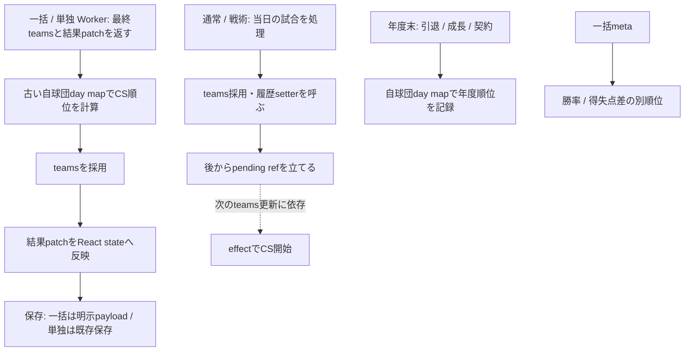
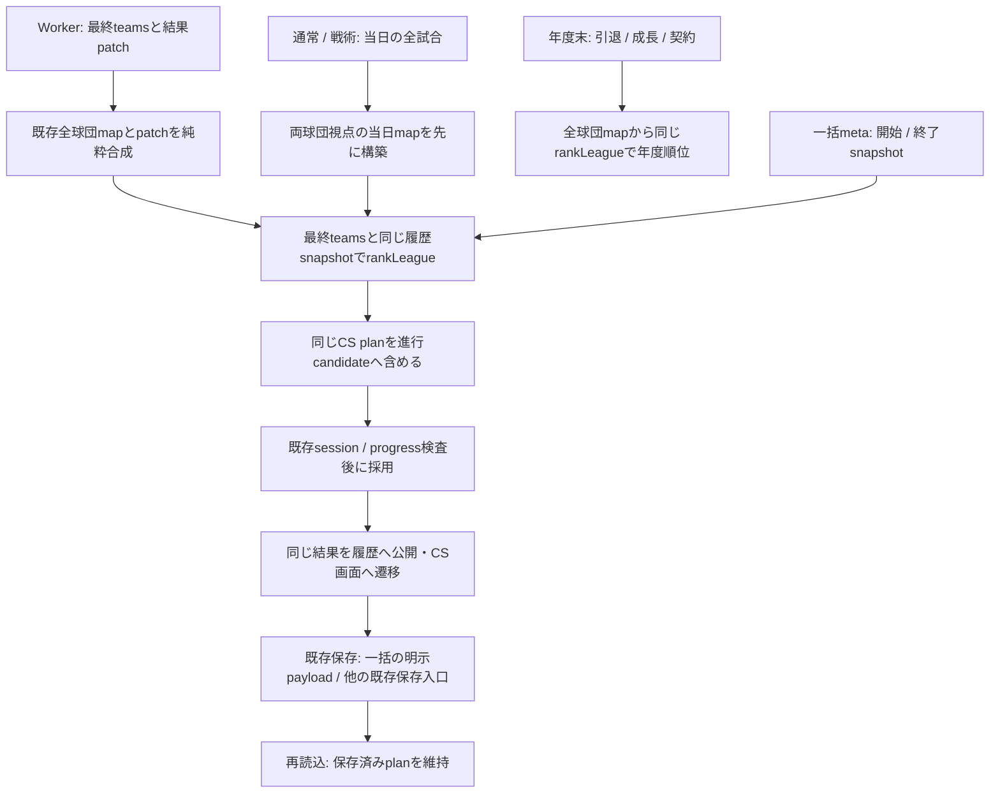

# PR-A 順位確定修正と全体構造監査

## 基準・範囲

2026-11-09の着手時main `e0b1261da102e959aa8adaf5a4c5f1c7d623b0e8`（#558マージ済み）。GitHubのopen PRは0件、作業変更なし。専用ブランチ `fix/season-ranking-snapshot-20261109`。正本は取得時点のmainであり、古い監査の未解決一覧や行数ではない。

目的は、同じ公式戦結果から順位表・CS出場・年度履歴を一致させること。今回の実装は順位領域だけ。コード整理、保存形式変更、予算forecast、native open-offseason、公開有効化は行わない。親機能の「通常プレイからannual年度完走」は未完成のまま。PR-Bは本PRマージ後、PR-CはPR-Bマージ後に開発者が判断する。

## 正本一覧とデータ経路

| 領域 | 実データ入口・正本 | 更新・保存・次の利用先 |
|---|---|---|
| 運用・範囲 | [AGENTS](../../../AGENTS.md)、[CONTRIBUTING](../../../CONTRIBUTING.md)、[ROADMAP](../../../ROADMAP.md)、SPECの契約/年度節 | 今回のユーザー指示を優先。既存資料の記述だけで現機能の完成を認定しない |
| 実名簿・新規作成 | `bootstrapTeams` / `useGameState.handleSelectTeam` | `teams.players/farm` → reducer → 試合/契約 → save/load。今回の統合fixtureも既存new-game実名簿を読む |
| live状態 | `useGameState` / `gameStateReducer` | domain stateはreducer。match history・seasonHistory等は別state/getter。progress/session token、dirty tracker、保存barrierを共有 |
| 公式戦成績 | `teams.wins/losses/draws`、`regularGameUpdates` | 一括/単独Workerと通常/戦術hookから両球団を一度更新。postseasonは別のplayoffStatsで公式成績を変えない |
| 公式戦履歴 | `allTeamResultsMap[teamId][gameDay]` | Workerの`allTeamResultsPatch`、通常/戦術の当日結果 → `mergeTeamResultMaps` / `applyMatchResultPatch` → matchHistory保存。順位判定の対戦記録はこちら |
| 自球団の詳細履歴 | `gameResultsMap[gameDay]`、`allTeamBoxScoresMap` | 詳細結果/日程閲覧。自球団mapは全球団順位の入力ではない。過去年は`nextSeasonMatchHistory`で既存5年方針のarchiveへ |
| 順位規則 | `standings.rankLeague`、[順位/CS設計](../../npb-playoffs.md) | 正確な勝率、セのみ勝数、当該球団間、リーグ内、前年、警告付きID fallback。履歴のW/L/Dが球団合計と一致する場合だけ利用 |
| postseason | `playoff`、`postseasonCalendar`、`offseasonPlan.playoff` | [#558設計](../../superpowers/specs/2026-11-08-gm01-postseason-calendar-design.md)。143戦目の実日程→固定calendar、軽量参加球団、結果再生検証→保存/復帰→`postseasonClosingDate` |
| legacy年度 | `useOffseason.handleRetirePhaseNext/handleNextYear` | 引退career準備→成長/契約/FA→表彰/順位履歴→計画。春にcareer/旧予算/成績リセット/次日程候補を保存してから採用。native取引barrierと同じ意味ではない |
| 旧契約/旧予算 | 選手の旧契約フィールド、`team.budget`、`nextClubBudget` | 旧財布・年数投影・既存rolloverを維持。新制度の承認額の根拠へ転用しない |
| annual契約/支出 | `contractEconomy` → `toAnnualState`、`contractLedger`、`annualSpending`、`annualTransactions` | ledgerの効力年度/保証/移管、全年度authorizations/reservationsが正本。選手salary/残年数は投影。command/revision→単一world候補→共通保存→公開照合→採用 |
| 年度予算 | `annualBudgetPolicy.quoteAnnualBudgetPolicy/annualBudgetHorizon` | 明示forecast入力を全球団・必要全年度で検査/承認。承認policyとauthorizations/rosterRequirementsは対応が必要。通常プレイ向けforecast producerは未接続 |
| 財務・収入証跡 | `clubFinance`、`clubFinanceProfiles`、`annualIncome` / `postingIncome` | 収支は給与控除前の運営収支。実測0と欠測、プロフィール推定を分離。postingの検証済み証跡だけが既存ルールの翌年度限定追加枠を作る |
| 永続化/復元 | `saveload`、`economyPersistence`、`baseballManagerDb`、保存queue/generation/receipt | 検証後にbody/rootを公開。世代・backup・epoch/revision/history整合を維持。annualは`commitEconomyCandidate`→公開root照合→bindings.adopt→採用確認、失敗後は既存recover |

`persistentDataStore`は大きい履歴の遅延selector/summary用であり、第二の契約正本ではない。現在のmatchHistory getterもReactの確定renderに依存するため、未反映patchを読む用途には使わない。

## 確認した問題と限定修正

等級は今回の定義に従う。過去レビューの「P2」をそのまま採用せず、再現する正しさの問題はP0として扱った。

| ID | 等級/結果 | 再現と原因 | 今回 |
|---|---|---|---|
| R1 | P0・修正 | CS開始/年度順位/順位tabが自球団day mapを全球団team mapとして渡す。完全な記録があっても前年順位へfallbackし、実際の対戦勝者とCSシードが逆になる | 全球団mapを渡す。`rankLeague`の公開option名と規則は変更しない |
| R2 | P0・修正 | 142→143戦で初めて同率になる場合、一括は最終patch採用前、単独も古いrender getterを使いW/L/D不一致となる | 直前map＋返却patchを純粋合成し、最終teamsと対で判定。新planを既存candidateへ含める |
| R3 | P0・修正 | 通常/戦術の`teams`更新effectより後にpending refを立てると、次のteams更新までCSが始まらない | 当日全結果mapを先に構築し、既存token検査・候補採用後に同じplanを設定/遷移。effect依存を除去 |
| R4 | P0・修正 | 旧直接オートhandlerはCPU結果だけを全球団mapへ記録し、自球団と相手の記録が欠ける。最終順位の対戦証拠が不足する | 同じ当日mapに自球団戦の両視点を一度記録。既存フィールドとhome/awayを維持 |
| R5 | P0・修正 | 一括結果の`batchMeta`だけ勝率→得失点差で判定し、CS/順位表と食い違う。対戦優位だが得失点差が低いfixtureでafterRank=2を再現 | Workerにも全球団履歴snapshotを渡し、前/後順位を同じ`rankLeague`とpatch合成で計算 |

通常/戦術で追加したのは一時mapとplanで、新しい永続state管理機構ではない。全体監査で見つかった別領域の修正は混ぜない。

### 変更前の順序

### 変更後の順序

これはlegacy公式戦の順序である。annual年度境界に求める「検証済み単一candidateを保存→公開identity/revisionを照合→採用」を、legacyの採用後保存へ置き換える図ではない。

## 全体監査の残課題

| 等級 | 確認結果・実害/制約 | 次の扱い |
|---|---|---|
| P0候補・要追加切分け | legacyのyear/teams.length effectは保存済みscheduleの有無を見ず非同期再生成する。今回の実hook fixtureで設定済みの143戦目matchupが生成日程へ置換される経路を観測した。過去版由来の異なる正常日程やload中断を実セーブで確認する必要があり、通常生成日程でのデータ破損までは認定していない | 順位修正へ混ぜず、旧日程/日付付きplanとhydration取消を専用工程で再現。PR-Cは保存済み日程を正本にし、このeffectをannualへ再利用しない |
| P1 | domain reducer、別のmatchHistory/seasonHistory state、getter/遅延store、Worker snapshotの手組みが併存。R1/R2/#558のplan漏れという具体的修正漏れが発生している | 今回は順位入力にだけ既存map合成を再利用。PR-Cのcandidate入口で必要な全フィールドと採用/保存の対応を一箇所で検証し、全面state再設計はしない |
| P1 | `useOffseason`はlegacyの成長/要求年俸/旧予算とannualのnative取引入口を同居させる。annualは旧handlerを拒否し、12/1の引退予約→postingまでで年度全体の成功を返さない | 既存のmode/session guardとbarrierを維持。PR-B/Cで旧handlerを迂回的に呼ばず、許可されたnative部分だけ接続 |
| P1・後続前提の不足 | mainにはnative契約取引・clock検証・年度別支出・保存barrierはあるが、`open-offseason` command/年度transition receipt producerは確認できない。`cycle.transitionReceipts`は初期化/検査だけ。テストで手組みのclockを翌年にした成功を、本番年度処理の完成とは扱えない | PR-C着手時に最新mainで再確認。既存native基盤を使う境界producerの実装範囲を具体化する。今回新設しない |
| P2 | `useSeasonFlow`に未使用の旧`calcLeagueRank`等のローカル補助が残る。実際に呼ばれる一括meta側だけR5で修正 | 削除整理は目的外。現時点で使われる順位経路を追加しない |
| P2 | 巨大hookの責務や旧資料の古い行数・完了注記は保守負担。ファイルの大きさだけでは正しさのバグと認定しない | 必要な境界ごとの限定抽出を、実害の出た次工程だけで検討 |

R1〜R5以外の**確定した未修正P0は本監査では認定していない**。候補を「P0なしの証明」や「実セーブ破損の確定」と読み替えない。重大破損として緊急に同PRへ混ぜる事象は確認していない。

### 過去指摘の再評価

- #558の一括plan保存漏れ、途中series以降の未検証は現mainで修正済み。既存の実保存統合・不正postseason保存/復元テストを維持し、同じ修正を再実装しない。
- [旧改革監査](../../REFORM_BLUEPRINT_V1.md)のtrade金額/所属・draft手動/全自動・二軍履歴/OPS/総年俸/主催収益は、その後の共通取引/人数/finance等を正本として照合する。現mainでは`tradeTransaction`、`draftRules`、`farmProgression`、`contractPayroll`、`regularGameUpdates.finance`等に処理/テストがある。昔の疑義一覧を現在の未修正P0一覧へ転記しない。本PRは全UI/全ゲームバランスの再認定ではない。
- `annualBudgetPolicy`の全球団/全年度必須入力、`annualIncome`の証跡検査、posting翌年度限定追加枠は既存実装。未完成なのは通常データからのforecast生成と年度境界への接続。旧budgetを根拠にする代替実装は追加しない。
- #558記録のテスト時間/乱数依存（economyCommitのSuspense、postingMarketInputs fixture）は当時の観測。今回CIの成功/失敗と分離し、未再現の問題を修正済みとも常時失敗とも記載しない。

## 保存互換

保存フィールド、schema1、DB5、公開OFF、5年archive、旧契約の挙動は変更しない。一括Workerの一時payloadに全球団mapを渡すだけで、保存schemaを追加しない。旧履歴の不足は警告付き前年/ID fallbackのまま。旧履歴・欠測を実測0に補完せず、保存済みの旧/途中CSを再作成・再順位付けしない。

`standingsContext`の引数名を実構造に合わせ、`rankLeague`の既存`gameResultsMap` option名は互換維持した。試合・履歴・保存candidateのtoken/receipt、tracked queue、backup optionsを維持。単独/戦術をannual用の新しい保存barrierへ置き換えていない。

## 検証記録

- 修正前baseline: 関連4ファイル46件成功。
- RED: 最初の7ケースは修正前すべて失敗。拡充後の13ケースを基準mainの別作業コピーでも実行し、12失敗/旧undated維持1成功。失敗は順位逆転またはCS開始取り逃し。
- R5 RED: 得失点差を不利にした対戦勝者の一括meta順位が2になる3ケースを確認。
- GREEN: 実名簿/生成日程、実Worker core/両hook/実保存によるhome/away・1/2試合patch・引分・最初の一括保存・cold reload・年度履歴・順位tab・旧undated plan、旧不足履歴/パ/入力不変を検証。スコア生成とブラウザWorker輸送だけをテストで制御。
- 追加テストの保存完了は実`handleSave`のPromiseを観測する。並列全件検証と同時実行した際に1秒pollingが保存完了前に切れたため、timeoutを伸ばさず実保存完了を待つ形へ修正した。既存テストの期待値/timeout/retry/skipは変更していない。
- 必須CI/最終HEAD・独立レビュー・最終件数はPR本文を正本とする。ローカルの途中検証と最終HEADのCIを区別する。
- Chromiumの既存最終戦4ケース成功。WebKitは初回OSライブラリ不足。公式Debianライブラリを/tmpのブラウザコピーへ展開し、実起動後3ケース成功。年度一巡1ケースは120秒の総時間上限で失敗し、翌春ホームまで到達したsnapshotを保持。コード固定/競合負荷を除いて該当ケースを再確認し、結果はPR本文へ記載する。自動テストで実iPhone Safariを代用したとは扱わない。

## PR-B / PR-Cへの引継ぎ

1. PR-Aのマージ判断を待つ。PR-Bは`quoteAnnualBudgetPolicy`と`annualBudgetHorizon`へ渡す、12球団×必要年度の決定的forecast producerに限定する。実測収支/記録済み0/欠測プロフィール推定を識別し、給与控除前基準と既存平滑化/増減制限を守る。
2. `clubFinance`は現年度の保存済みreceipt、`forecastClubFinance`は現年度の未消化分推定である。将来複数年の実測と混同しない。過去収支の保存/証跡の不足は黙って0にせず、入力の出所を明示する。旧`budget`/`nextClubBudget`を新承認額へ転用しない。
3. 新forecastのbase承認へposting収入を二重加算しない。既存`inspectAnnualIncome`と`postingBudgetSupplement`の年度限定追加枠を保持する。
4. PR-Cは確定したforecastと#558の`postseasonClosingDate`を入力に、既存native台帳/年度支出/clock検証へ接続する。gameDay144・配列末尾All-Starから閉幕日/12/1を推定しない。上記native境界producerの有無を最新mainで再確認する。
5. 年度境界は検証した単一candidateを`commitEconomyOperation`/`commitEconomyCandidate`のbarrierで一度保存し、公開rootのsaveId/epoch/revision/receipt/署名、元session/progressと採用確認を保つ。公開後の採用失敗は既存recoverで同じ候補を読む。legacyの採用後保存を流用しない。
6. 保存前失敗・公開後応答失敗・再試行・連打・古いsession・旧セーブ・backup復旧を正常/拒否の対で検証する。公開OFFを維持し、annual一般プレイ/成長・要求年俸/翌春builder/annual Worker全面接続は後続に残す。
