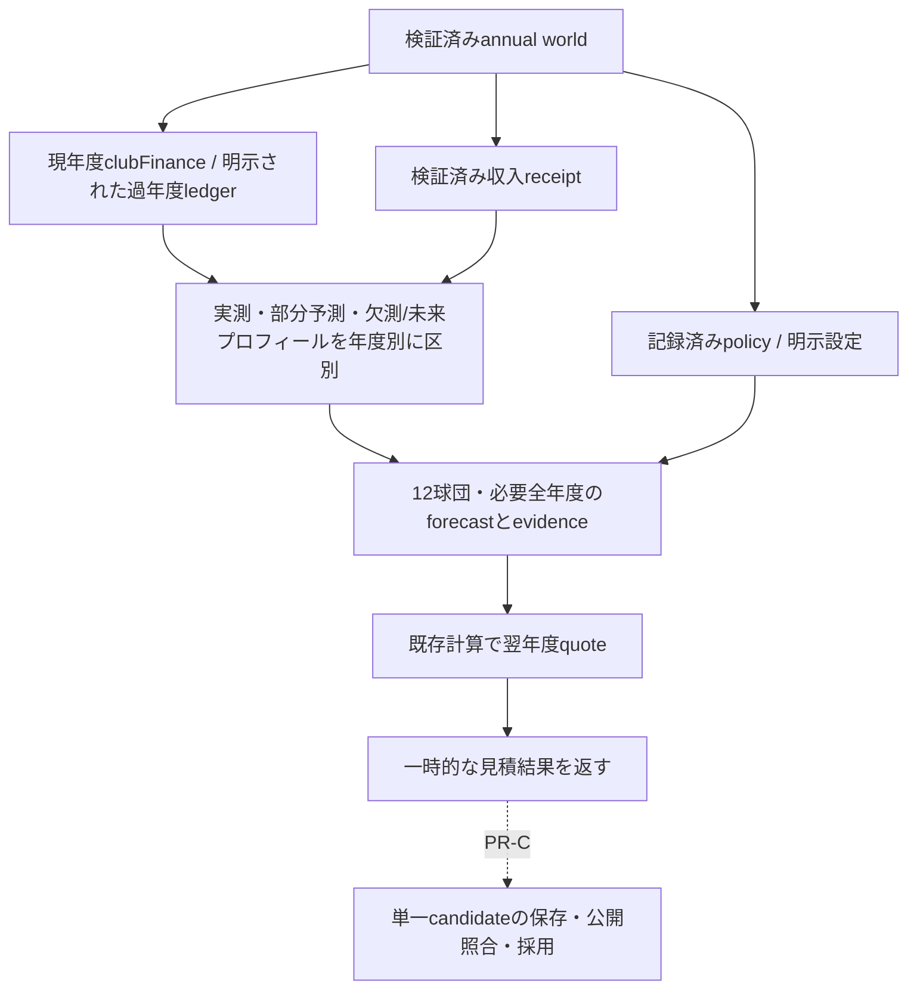

# PR-B 翌年度予算forecast 検証と引継ぎ

基準main `0e0fef008750585df428e4d3cb3bceb7fed16c43`（#559マージ済み）。着手時open PR 0、作業変更なし。今回の範囲は[設計](../../superpowers/specs/2026-11-09-next-budget-forecast-design.md)とユーザーのPR-B指示。PR-C、公開、年度完走の完成認定は含まない。

## 正本・実データ経路

- `bootstrapTeams.createInitialTeams()` → 12球団/名簿/`clubFinance` → native constructorの明示policy → `forecastNextAnnualBudget`。
- 現年度の給与前運営差額は既存`clubFinance`、帰属年度付き臨時収入は検証済み`contractEconomy.incomeReceipts`。
- 係数/球団別支援は記録済み当年の生成policy、または明示設定。前年基準は`budgetPolicies.approvedManYen`。`team.budget`、`revenueThisSeason`、`nextClubBudget`、追加枠込みauthorizationsは基準にしない。
- 現行`clubFinance`に過年度archiveはない。任意の`financeHistory`は明示された完了ledger入力であり、保存stateを新設したものではない。未記録を0や過去実績へ変換しない。
- 本番係数の既定値・校正結果は追加していない。以前のfixtureに係数・支援が記録されていなければ、呼出側が明示設定を渡す必要がある。

## 完成した範囲

`forecastNextAnnualBudget(world, options)`は純粋関数。12球団の翌年〜`annualBudgetHorizon`の最終年まで、既存入力形式のpolicy、sample別の証拠、既存承認形式のquoteを返す。通常は2026 worldから2027〜2034の96行を生成する。

- 完了143戦のledgerは実測。0・負値も実測として保持する。
- 当年途中は既存残り試合予測、欠測/将来は既存プロフィール/生成日程を使う推定。価格・人気・球場を固定し、将来/欠測時の勝敗は5割とする。実績の再現や将来の景気/成長予測ではない。
- 日程不足で幅があれば保守的な下限を使い、幅と`completeSchedule`をevidenceへ残す。
- N年平滑化は審査年SのS-N〜S-1を年度別に使用。sampleごとに実測/推定・basis・運営差額・臨時収入・receipt IDを残す。混合windowは既存sourceではprofileとし、内訳で区別する。
- 引退試合収入は検証済みreceiptの帰属年度へ一度加算し、通常の未来収益へ複製しない。postingは通常原資/平滑化/前年基準に入れず、既存の翌年度限定追加許可だけを適用する。過年度postingの追加込み許可を次の前年基準へ繰り上げない。
- 球団/年度/receiptの順序、JSON往復、入力配列の並べ替えで結果を固定。receipt IDのソートはlocaleに依存しない全順序。同じ照合順になる異なるUnicode文字列も区別する。

`quoteNextAnnualBudgetPolicy`は現worldの時計と契約整合を検証したまま翌年の見積範囲を指定する。既存承認計算を共用し、元の`quoteAnnualBudgetPolicy`とcoverage検査の契約を維持する。偽の12/1時計/年度candidateは作らない。

## 検証

- baseline: 既存承認・posting/引退収入・財務の4ファイル129件成功。
- 新規ユニット36件。最初のfeature REDに加え、レビュー前の35件を基準mainの別コピーで実行して35件REDを確認。追加のnull設定受理とUnicode ID順依存も個別にRED→GREEN。
- 実bootstrap/12球団と既存`applyClubGameFinance`143回×12球団を使用。手作りの金額だけで正常受入を済ませていない。
- 0/赤字/欠測/途中/完了/3年平滑、全年度/最終年、共通係数再利用・不足/不一致拒否、支援/履歴の重複/未来/部分/不正拒否、旧財布非依存、実乱数呼出禁止、JSON/並び替え/入力不変を確認。
- 既存native commandでposting成立と引退予約/収入（0を含む）を生成。253125万円のposting追加は2027のみ、2028への繰越なし、翌春fixtureでも前年基準は通常承認のまま。引退収入は帰属年度のみ、改ざん/合算overflow拒否。
- 実保存4件: bootstrapを保存→冷読込→forecast一致、既存承認形式だけの保存/復元、改ざん拒否/元root保持、backup復旧、legacyの保存保持。テストのfuture quote保存は既存の予算policy更新で、年/時計/budgetSeasonは2026のまま。年度境界の保存成功を主張しない。
- 対象7ファイル319件成功（独立レビューの汎用APIソート補強前）。最終件数・独立レビュー・必須CI/HEADはPR本文を正本とする。
- build成功、既存の大きいchunk警告のみ。UI/通常進行経路へ追加していないため専用画面E2Eは追加せず、既存必須CI全体で回帰を確認する。

## 12球団の静的表

[club-table.csv](./club-table.csv)はseed 20261109のbootstrap → native明示test policy → 実日程と既存財務計上143回 → forecastの観測表。条件は配分50%・平滑1年・増減上限100%・支援0の**テスト設定**で、本番推奨値ではない。2026の差額はこの固定条件実験内の実計上値、2034の値は推定。数字が同じでも実測へ変換しない。

生成元は`budgetForecastWorld(createInitialTeams())`、各球団へ`closeFinance`を適用し`forecastNextAnnualBudget`を実行。使用したfixtureは`src/engine/__tests__/fixtures/budgetForecast.js`、生産関数は`bootstrapTeams/clubFinance/annualBudgetForecast`。テストだけのLCG seedで初期乱数を固定し、forecaster自体は乱数を消費しない。12球団×8年=96行、Node上の単回見積は約130ms。実iPhoneの処理時間・長期収支・負債履行・最適係数を保証する計測ではない。年俸/更改/補強の動的校正は未実施。

## 互換性と残作業

保存schema/DB/公開ゲート、旧財布・旧契約は変更しない。forecast/evidenceは新規永続stateとして保存しない。保存するquoteは既存authorizations/budgetPolicies/rosterRequirements形式のみ。legacyのforecast要求は非変更で拒否し、通常の旧セーブ読込・保存は維持する。

PR-Cはマージ後の最新mainで、このproducerの入力policy/明示履歴の出所を確定し、#558の閉幕日と組み合わせる。現在のclubFinanceがY年度の間にquoteを作り、候補に必要な全フィールドを集め、検証→一度保存→公開identity/revision照合→採用確認へ接続する。policy/evidenceを勝手にrootへ追加しない。

公開OFFを維持し、native open-offseason producer、通常annual移行、年度成長・要求年俸、翌春builder、annual Worker全面接続、実iPhone Safari、長期/係数校正は後続。マージ/自動マージは行わず、開発者本人の判断を待つ。

## 独立レビュー

レビュー対象 `0e0fef00..2cce142c`。固定12球団producerの確定P0/P1/P2指摘なし。3年windowと明示履歴逆順の一致、実bootstrapの見積約100〜110ms/回を独立に確認した。

非ブロッキングの指摘として、今回新設した汎用quote APIで異なる文字列球団IDがlocale照合で同順になるケースを受理すると、返却配列順が変わることを再現。固定12球団に影響はないが、新APIの決定性を維持するため、旧APIに触れず新APIの比較だけをlocale非依存の全順序へ限定修正した。回帰1件RED→GREENで検証する。

明示financeHistoryの球団帰属・実計上由来の保証は呼出側の信頼境界。producerは構造/金額/年度/完了/重複を検証するが、別save/epoch由来かを認証する仕組みは追加しない。PR-Cが保存済みworldと同じ出所の入力を集め、欠測は推定として扱う必要がある。
