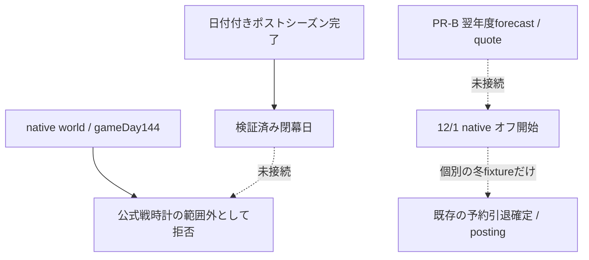
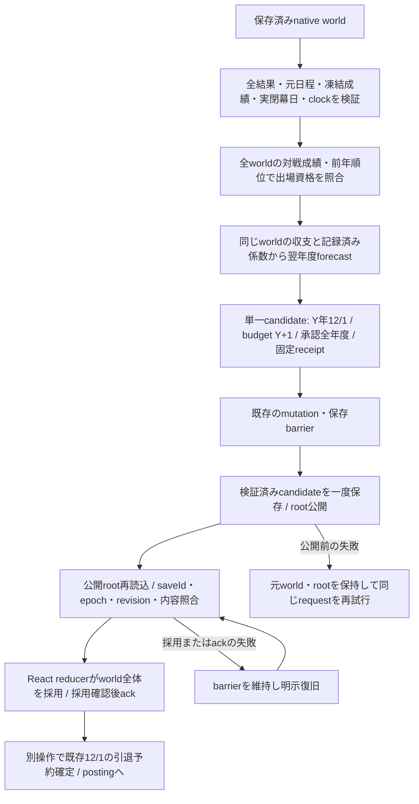

# PR-C native open-offseason 検証・引継ぎ

基準main `a61be5da7d90487134c8098089d190e4e9e2926e`（#560マージ済み）。着手時open PR 0、変更なし。[設計](../../superpowers/specs/2026-11-09-native-open-offseason-design.md)／[計画と実行記録](../../superpowers/plans/2026-11-09-pr-c-open-offseason.md)。最終HEAD・独立レビュー・必須CIは提出PR本文を正本とする。

## 正本一覧と今回の効果

| 対象 | 正本と経路 |
|---|---|
| 閉幕根拠 | 保存済み`offseasonPlan.playoff` → #558 `postseasonClosingDate`。既存全結果replay、日付/元日程/進出/優勝を検証 |
| 年度境界の入力 | 同じworldのyear/myId、gameDay144、postseason stage、各球団143試合分の成績、出場6球団の凍結成績、clockと閉幕日の一致 |
| 出場資格 | 全worldのallTeamResultsMapとseasonHistory → 既存standingsContext/rankLeague → 上位3球団と順序。candidate生成/再生・保存で照合 |
| 契約・保証・留保・既存収入 | `contractEconomy`の台帳/正式留保/履歴。`toAnnualState`で同一worldを検証 |
| 翌年度承認 | PR-B `forecastNextAnnualBudget`。現年度clubFinance、記録済み係数/球団別支援、検証済み収入を利用。履歴欠測は推定 |
| 審査範囲・追加枠 | 既存annualBudgetPolicy/annualBudgetHorizon/収入証跡。Y+1〜必要最終年度、posting追加は既存の対象年度だけ |
| domain採用 | 専用reducer → `useGameState.commitEconomyOperation` → `saveload.commitEconomyCandidate` → 公開root再読込/identity/revision照合 → React採用の確認 |
| 再開・復旧 | 既存load/backup、epoch guard、`recoverEconomyCommand`。公開済みcandidateを再生成・再公開しない |

現行mainにnative open-offseason producerがないことを再確認し、今回その接続を実装した。旧一般プレイをannualへ切り替える実装ではない。

## 処理の前後

変更前：

変更後：

`year`、gameDay144、旧年の成績/名簿/給与/年数/clubFinance/日程/収入を保持する。最低人数枠とbudget表示は既存投影で再計算する。将来承認だけを既存3配列へ設定し、当年/過年度の承認行を保持する。減額/承認0で追加余力が負になっても既存保証を消さない。

phase enumは増やさない。`economyClockFor`の公式戦1〜143制限を維持し、`validateEconomyClock`だけが厳密な完了根拠のあるseason/gameDay144/postseasonを受ける。閉幕日と時計が違う、All-Star行、未完了、無日付の旧履歴、gameDay145は拒否する。新たな期中予約/退団も1〜143の制限を維持する。既存の期中予約/退団を「読む」検証は、完了した144のsnapshotまで受け取れるようにした。

## 保存互換

- schemaVersion 1、DB version 5、公開ゲートOFF。旧セーブを暗黙移行しない。旧財布/旧契約と一般プレイ年度handlerは変更しない。
- 既存`cycle.transitionReceipts`に任意の既存形式の一操作を追加する。IDは`[saveId,epoch,Y,'open-offseason']`、閉幕日・元/新revision・予算審査範囲を持つ。新しいenvelope/root field/forecast archiveは作らない。
- 旧native winterの空receiptも引き続き読込/保存できる。既知の新receiptは構造/重複/identity/年度/現在の閉幕根拠/承認範囲を検証する。未知の古いreceiptを再解釈・補完しない。
- 上書き比較では既存transition receiptの削除/書換えを拒否し、新open receiptは保存済み閉幕snapshotのrevisionからだけ付加する。将来の翌春builderも過去receiptを保持する必要がある。
- receipt IDは既存cycle内で一意。既存barrierのackはroot signatureと経済payload全体、identity/revision、engine transaction IDsを照合する。cycle receiptを別のack/stateへ重複追加しない。
- 財務履歴入力・独自policy・外部quoteをrequestで受けない。同じ保存worldの記録済み係数がない古いnativeは、根拠不足を非変更で拒否する。本番係数や移行policyの校正は行っていない。

## 検証

- baseline関連5ファイル136件成功。新規unitの初回23 RED、13既存拒否はそのまま成功。期中引退予約/退団を含む完了snapshotの追加3ケースも個別RED→GREEN。hook初回13 RED、1既存拒否は成功。
- 新規unit 47件：実bootstrap/実財務143回/実日付producer、通常/14戦決着の日本シリーズ、全12球団・必要全年度の承認、下振れ/0/赤字、旧保証保持、再試行/JSON/順序/無乱数/入力不変、改ざん/古い確認/係数不足/旧セーブ、receipt重複/消去を検証。
- 実native commandの期中引退予約・引退試合12345万円・期中退団を引き継ぐ。新しい冬fixtureへ時計を付け替えず、今回のcandidateから既存引退確定→12球団posting準備を実行できることも確認した。後者は同期の既存native合成処理を含む検証で、一般プレイやannual Workerの完成を意味しない。
- 新規hook 15件：実IndexedDB/Reactで保存→採用→ack、失敗時の元root/backup保持と再試行、一receipt/一revision、同時操作・通常saveのbarrier、古いsession/handler/revision、公開root差替え拒否、公開後のack中断と無再公開の復旧、cold remount/backup、旧native冬・旧セーブ保持、順位用の全対戦記録を保つ採用を検証。
- 実ブラウザ：`npm run test:e2e -- save-generations.spec.js --grep 'native open-offseason' --project=chromium --workers=1 --retries=0` 2件成功。mobile-webkitも同2件成功。実bootstrapで書込失敗→同じ操作の保存/重複拒否→cold reload、公開後の復旧でpublicationが一回だけであることを確認。
- ブラウザの初回は環境sandboxのlocalhost listen拒否。実行権限を付けて再実行。Chromiumの復旧ケース初回はReactの表示反映前にflagを読んだテストの問題を確認し、状態を`waitForFunction`で待って同じ期待値を保持した。timeout/retry変更なし。
- hookの障害注入は実際のgzip/LZ圧縮を展開して同generationの異identityを差し替える。backupテストは既存5分rotationの次回実行を明示して実保存する。保存方針をテスト都合で変更していない。
- ローカルWebKitは公式browserと公式配布の展開済み依存ライブラリを利用し、ldconfig事前検査のみ省略した。実iPhone Safari確認ではない。表示改修はなく、新画面/スクリーンショット検証は対象外。
- レビュー前は関連13ファイル468件成功。修正後は同13ファイル475件、Chromium2件/WebKit2件が再び成功。buildの最終結果と最新HEADの必須CIはPR本文を参照。同じ全suiteのローカル再実行は重ねない。

## 独立レビューと限定修正

別コンテキストが`a61be5da..a5b6f9a0`の差分・実入口・全保存/採用経路を読み、確定P0/P1なし、P2一件を指摘した。12球団の143試合成績を保ったまま、両リーグの下位3球団だけで日付付きの完了playoffを作ると、元の境界はそれを受理した。正規出場球団との照合漏れであり、新境界の受理条件として修正対象とした。

候補生成/保存の2件REDを再現し、既存`rankLeague/standingsContext`へつないで拒否する。再生時にも同じ検証を行う。正規の対戦成績（前年順位と逆）・旧履歴欠損時の前年順位の両方を検証し、全matchHistoryを保存/再開/採用しても順位が一致するhook回帰を追加した。古いnativeの有効な公式戦時計143/postseason stageを拒否しない互換回帰も残す。

順位用matchHistoryはreducerのdomain sliceの外にあるため、部分stateを再順位付けせず、全worldを持つproducerと保存境界で検証する。新stateや順位ルールは追加しない。独立測定では実bootstrapの1,059人でcandidate生成約290ms（サーバー測定、実端末性能ではない）。レビューが対象外とした一般annual進行・公開・次春・実iPhoneは、ユーザーの明示非対象として残す。その他の指摘は既存barrier/検証で拒否されることを確認した。

## 残る問題と引継ぎ

- 本工程の範囲内で現在確認済みの未修正P0はない。独立レビュー後の確定結果はPR本文を正本とする。
- P1：通常プレイのannual移行、閉幕snapshotを実試合から保存するannual Worker接続、期末の新規引退判断、成長・要求年俸、翌春builderは未完了。本工程の成功を通常annual年度完走と報告しない。次工程は既存計画と最新mainに照合し、開発者のマージ判断後に選定する。
- P1：初年度/移行の本番係数・明示policyの校正/記録経路と、予算の理由を通常操作へ表示する統合は残る。記録済み係数がないnativeを勝手な値で進めない。
- P1/P2：PR-Aのstate/hook責務分散と旧年度handlerの併存は残る。legacy日程再生成effectの疑義はP0候補のままで、実セーブ破損を確認済みとは扱わず、このPRへ混ぜない。
- 長期の年度循環、一般プレイ操作、実iPhone負荷/保存は未検証。旧履歴の日付補完、過年度財務archive、新schemaは追加しない。

このPRの提出後はマージ判断で停止する。マージ/自動マージ/main pushは行わない。

## 必須CIの操作前提を修正した根拠

`82b272b7`のCI #732は全unit/integration **4,837件成功・既存2skip**、他11ブラウザ群も成功（保存整合性群は追加4件を含む209件）。legacy QA-D1のWebKit390だけが2回とも`keydown manual payload`の期待`[8505]`に対して`[]`となった。初回traceでは、有効確認542997msの後、focus543191msには保存ボタンがdisabledで、後続の保存圧縮が進行していた。ドラフトUI/当該spec/configは基準mainと同一、fixtureにはcontractEconomyがなく、本体のannual経路は通っていない。

同じ無修正旅程はローカルで成功したが、再実行だけでは再発したため繰り返さず、操作前提を固定再現した。一時診断ラッパーで4回目の手動保存のfocus時に一度だけ500ms disabledとすると、元のspecが同じ`[8505]`対`[]`でRED。前提の修正後は隣接する実Enter経路にも同じfocus喪失（`[8385]`対`[]`）を確認した。

修正はE2Eの操作準備だけ。ボタン有効/focusの確認をscroll・イベント・clickと同じブラウザ処理内に置き、実Enterも有効な対象を解決してからキーを押す。pollは操作前の準備だけを待ち、操作を開始した後はpayloadが空/古い/重複でも必ず結果を返して元の厳密期待値で失敗する。payloadの成否を見て操作を再試行しない。既存の26ケース、期待値、timeout、retries=0、CI設定、ゲーム本体を変更しない。

同じ500ms無効化の固定条件でWebKit390の全旅程がGREEN（1.4分）、通常のChromium390旅程もGREEN（1.2分）。一時ラッパーは検証後に除去し、既存specの操作前提修正を残す。別コンテキストの追加レビューでも、手動callback一回・即時payload・保存root・再読込の受入条件が保持され、失敗を隠さないことを確認した。有効対象の解決は、その後のあらゆる無効化を不可能にする保証ではなく、後から操作が落ちれば同じ期待値で失敗する。

この限定修正を含む最新HEADのCIを最終受入とし、#732の失敗を成功扱いしない。最終結果とHEADはPR本文を正本とする。
