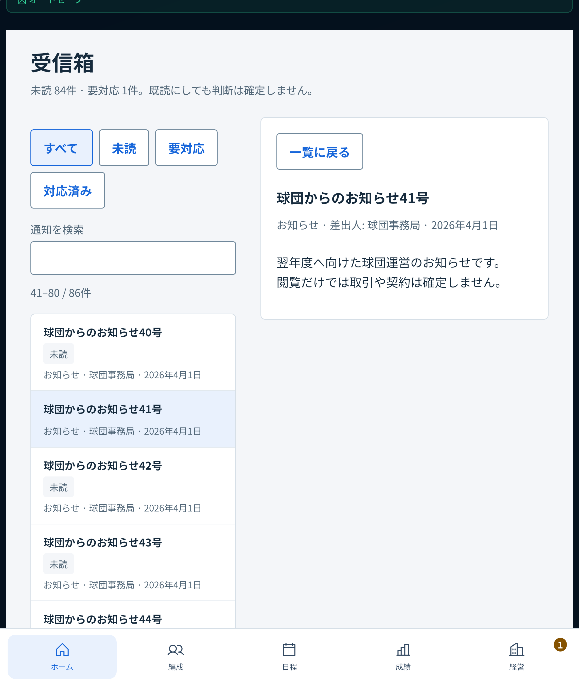
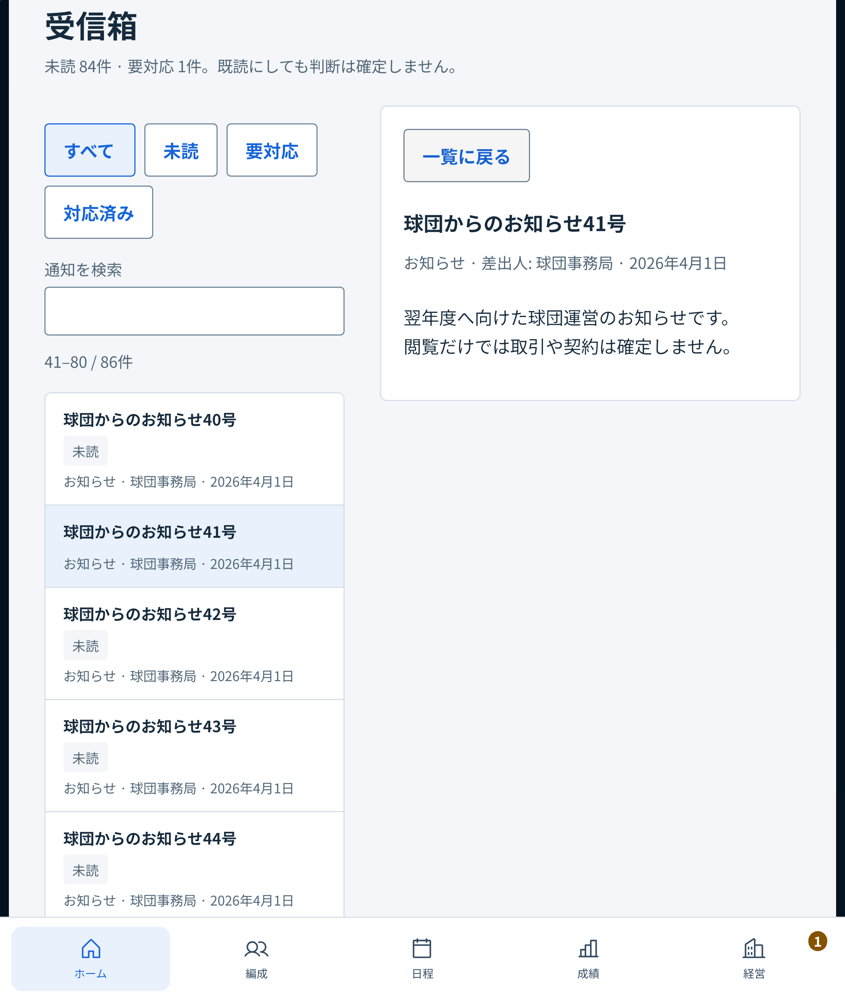

# PR #514: WebKitでの「一覧に戻る」とオートセーブ完了の競合

2026-10-30。ユーザーの追加指示「じゃなおして」により、FA修正のCIを阻害した既存UIを同じPRで修正する。基準headは `6a438706d13776288abfe87fd9d7864daf225fc8`、mainは `521d64b98447d68509b58f0fa3f9e6eaf81f379f`。

## 原因と変更

CI #559は初回・再実行とも、mobile-webkit / 761px / 通知41号から一覧へ戻るケースで失敗した。入力直前のtraceには保存中・通知なし、操作直後には保存済み・通常フローの「💾 オートセーブ」通知があった。本文が動き、押下開始と終了でボタンの位置が変わる競合を疑い、実保存の完了を押下中に制御して確認した。

既存の `HubShell` は契約・トレード・スカウト・FAで、ヘッダーと重複する正常なオートセーブ通知を非表示にしている。同じ判定を選択詳細のある通知・ニュース・OBへ拡張した。通知種別 `ok`、完全一致の成功文言、`saveResult.ok === true` の条件は維持する。手動保存、失敗・警告・一部履歴の問題、保存状態未確認、ホームの表示は変更しない。

`ReadingParts` の選択・フォーカス・スクロール復帰、CSS、保存処理、ゲーム状態、FA処理は変更しない。本番接続済みUIの表示条件だけが変わるため、FA修正段階での「配信物がmainと同一」という結果を、この追加変更後へ適用しない。FA基盤は引き続き本番未接続。

## 再現と検証

- 単体RED: `HubShell.navigation.test.js` の既存ケースを3画面へ拡張。3失敗 / 17成功。正常なオートセーブ通知が本文へ1行挿入された。
- ブラウザRED: `navigator.locks.request` をテスト内で一時保留し、通知を既読にする実操作で保存を開始。戻るボタンでmouse down → 保存解放 → ヘッダー保存済み → 同じ座標でmouse up。761pxのChromiumは成功、WebKitはボタンが **59px移動**し、詳細が閉じず失敗。保存そのものは成功している。
- テストは実アプリ・実保存APIを使い、任意のReact stateや通知DOMを注入しない。保存の失敗を成功へ置換せず、完了の順序だけを制御する。
- 追加ブラウザ回帰は360×800、390×844、761×900、1440×900、Chromium / mobile-webkit。ボタン位置、詳細を閉じる操作、元の行へのフォーカス・スクロール復帰、既読の保存を検査し、完了前後の画像と座標をartifactへ残す。
- 従来の7幅の操作・履歴・保存再開・長文・フィルタ検証は維持。timeout・retry・skip・既存期待値を緩めない。

修正後の関連単体は4ファイル46件成功。新しいブラウザ回帰は8/8成功（3.6分）。独立read-onlyレビューはCritical / Important / Minorとも0件で、保存成功・警告・手動保存の区別、実保存の保留と解除、pointerの後始末、変更範囲に追加指摘なし。

761px WebKitで同じ通知41号を開き、ボタン押下中の実保存を完了させた時点の比較：修正前は本文が59px下がる。修正後はボタンが押下位置に留まる（この画像はmouse up前）。

| 修正前 | 修正後 |
| --- | --- |
|  |  |

元の761pxの全操作フローも両ブラウザで2/2成功（1.3分）。`npx vitest run` は251ファイル・2,700件成功、既存条件付きskip 2ファイル/2件（追加skipなし）、353.73秒。`npm run build` 成功（既存dynamic-import/chunk-size警告のみ）、`git diff --check` 成功。

調査用head `ef817ec` では入力イベントを採取するだけで元のhub-navigation 50件が成功した。タイミング競合のため、これを解消の証拠とせず、上記の制御したRED→GREENを根拠とする。調査専用のイベント採取は最終差分から除去した。最終公開headの全CIはPR本文へ記録し、結果だけの追加pushは行わない。

## 限界

実iPhone/Safariでの検証は未実施。異なる通知（取引結果・警告等）による本文変動や他の画面は今回の変更対象外。正常な自動保存を理由とする同じ競合を、対象3画面で防ぐ修正であり、通知機構全体の再設計ではない。マージ・auto-mergeは実行しない。
