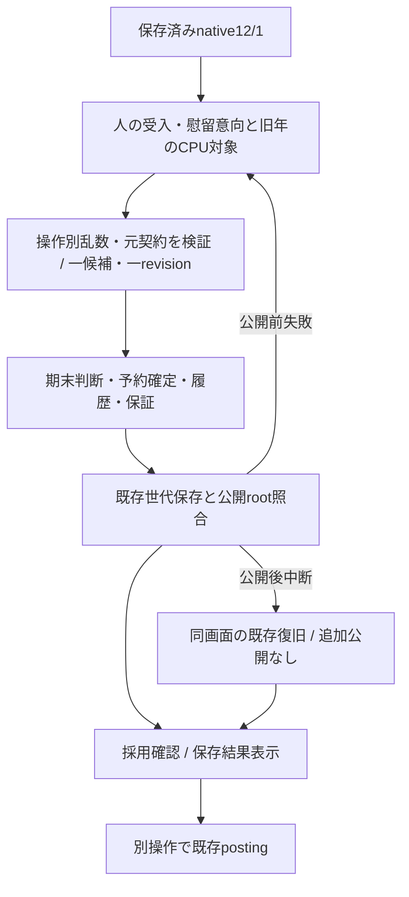

# native期末引退判断 — 検証と引継ぎ

基準main `259c200b18518a228f69abd12274c304be57a027`（PR-C #561マージ済み）。[設計](../../superpowers/specs/2026-11-09-year-end-retirements-design.md)／[計画](../../superpowers/plans/2026-11-09-year-end-retirements.md)。最終HEAD・必須CIは提出PR本文を正本とする。

## プレイヤーができることと完成範囲

保存済みnative 12/1の引退整理で、自球団の一軍/二軍の期末引退候補を確認し、受入/慰留の意向を選んで保存する。CPU判断も同時に確定し、結果と保証を確認後、別操作で既存の海外挑戦希望確認へ進む。保存失敗は同じ意向で再試行、公開後の中断は同じ画面から復旧できる。

**今回はnative期末引退判断の工程。通常プレイのannual年度完走、Task7/A1、ポスティング全体は未完成。** 通常Appの公開OFF/schema1/DB5を維持する。通常/戦術/Workerのannual進行と途中postseason時計、成長/要求年俸、FA/更改計画への年次接続、翌春builder、初年度policy/移行/公開、長期・実iPhoneは残る。次は引退済み選手を除いた旧年成長/要求額の保存接続を、最新mainの依存と照合して選ぶ。

## 正本と保存経路

| 対象 | 正本/生成/利用先 |
|---|---|
| 年度・閉幕・予算 | 保存world → PR-Cのopen-offseason → 同一year/12/1/翌年度枠 |
| 引退対象 | 同じworldの一軍/二軍・既存予約・年齢・出場/モラル/残年数。人は35歳以上/意欲30以上、CPUは35歳以上 |
| 判断と乱数 | 人のaccept/retain意向のみ入力。既存calcRetireWill、economyRandomContext/rngf、年度・選手・操作・用途別scope |
| 期末source | 既存retirementReservationsのorigin=year-end。明示12/1通知/効力日、元雇用は11/30で照合。期中1〜143の通知日は変更しない |
| 引退効果 | 共通finalize-retirement → 元年成績/career/球団履歴、配置除去、保証retain/欠員留保。正式留保・将来契約の自動取消なし |
| 一度だけの判断 | engine.transactionsの親yearEndRetirements + 既存のreserve/finalize子receipt。0人も親を記録。新root/別ロスター/乱数cursorは追加しない |
| 保存/採用 | human adapter → useGameState既存commitEconomyOperation → saveloadの保存・公開root照合 → React採用確認 → ack。careerは同じ世代公開 |
| 次の利用 | 保存結果を既存引退画面へ表示 → 別操作で予約確定済みの既存posting。新規引退判断をpostingの後に追加しない |

## 検証根拠

- 変更前関連3ファイル77件成功。新core初回は8RED/既存拒否8PASS、実装後16件成功。新hook/UI5件は全RED→GREEN。
- 実createInitialTeamsの12球団/1,059人から既存財務143回・日付付きpostseason・PR-Cのopen-offseasonを通し、一軍/二軍・CPUを処理。観測例は19〜20人引退、candidateから検証まで約6.6〜7.9秒（サーバー、実端末性能ではない）。seed前のbootstrapには既存乱数があるため人数は固定主張しない。判断そのものは保存randomRootで固定。
- 成長/加齢を行わず生存選手を全フィールド保持。引退者の当年成績、career、元年給与と将来保証、期中予約との混在、人の慰留成功/失敗、0人、順序/JSON/入力不変/全体乱数独立、低意欲の除外、将来契約/正式留保の人・CPU対、合法な生存選手の後続変更を検証。
- 実IndexedDB/Reactでroot公開失敗→同意向再試行・一度だけの公開、career一回、旧session/新規postingへの近道拒否、公開後ack中断→無再公開の復旧、画面の意向/確認/保存結果を検証。cold reload/結果保持は実ブラウザでも確認。
- 追加の混在テストでatDate fixtureが元日程を置換してmatchupsを失ったため、実生成日程120の時計を使う準備へ修正。製品の時計/日程の条件は変更していない。
- Chromium/WebKitの360/390/1440px旅程と公開後復旧を既存save-generations必須CI内へ追加。画面は既存レイアウト/CSSを保ち、横溢れも確認する。timeout/retries/既存期待値/CI設定は変更しない。
- 最終の関連8ファイル195件成功。Chromium4件、WebKit4件成功。buildも成功（既存のchunk警告）。全suite/最新HEADの必須CIはPR本文を参照。
- WebKitは公式Debian13ブラウザと公式Debian依存を/tmpへ展開。配布ラッパーがLD_LIBRARY_PATHを置換するため、そのsys/libに依存を配置。ldconfig事前確認だけを省略し、実起動/操作で検証する。実iPhone Safariの確認とは区別する。

## 独立レビューと修正

別コンテキストが基準main..`082f55f`の全差分/実入口を読み、P0/P1なし、P2を一件確認した。親receiptだけ、または退職CPUの親candidateを消しても、子の期末引退が保存可能だった。保存済み慰留成功に直接の期末子commandで退職を後付けする再現も確認。

5ケース（親削除、CPU欠落、元予約/確定の逆順、期中予約の親claim欠落、慰留後の直接退職）をRED→GREENで修正。共通projectorは親付加前の子candidateも扱うため、親から子への検証に加え、**完全worldのtoAnnualStateで子から親への一意な所有を検証**する。元予約→確定→親の順と、期中予約をこの親で確定した履歴も照合する。親がなくても有効な旧期中引退は維持し、既存posting済み旧冬へ新規判断を要求しない。

レビューが追加未実行とした正式留保/将来契約の人・CPU対、低意欲除外・生存選手の後続変更は、実装側で対象検証を追加。最終HEADの全件/ブラウザ/CIをレビュー実施の代わりにはせず、結果をPRへ記載する。

提出前の追加確認で、reloadを挟まず引退保存→postingを同画面で続けると、旧useAdvanceの成功済みlockが残り二つ目を実行できないことを実装側で再現した。初期E2Eはcold reload後のpostingだけを確認していた。実hook/UIの連続操作をRED→GREENで修正し、二つの独立操作へそれぞれ既存useAdvanceを適用する。共通legacyのlockは変更しない。reloadなしの実ブラウザ回帰を追加し、両操作の一回保存/revisionを確認する。最終件数・最新HEADのCIはPR本文を正本とする。

この修正後は関連hook/UI3ファイル43件成功。Chromium5件/WebKit5件、計10件成功（再読込なしの連続操作を含む）。旧HEADのCI #735は停止し、修正後HEADのCIを最終受入に使う。ローカルの全suiteも旧HEADから開始した実行中に修正したため、最終HEAD全件の根拠として流用しない。

## 同一状態の画面比較

12球団の小規模native fixture、同じ保存済み12/1から比較。変更前は基準mainの既存画面を描画、変更後は実AppScreenRouter/実hookを使用。比較撮影だけの一時moduleは削除した。

| 幅 | 変更前 | 新規判断 | 保存結果 |
|---|---|---|---|
| 360px | [変更前](screenshots/360-before.png) | [判断](screenshots/360-review.png) | [結果](screenshots/360-saved.png) |
| 390px | [変更前](screenshots/390-before.png) | [判断](screenshots/390-review.png) | [結果](screenshots/390-saved.png) |
| 1440px | [変更前](screenshots/1440-before.png) | [判断](screenshots/1440-review.png) | [結果](screenshots/1440-saved.png) |

保存失敗の確認dialog保持/同じ意向の再試行とcold reloadはE2E添付画像/traceも記録する。表示境界/CSS変更はない。モバイル判断画面とdesktop結果も画像を開いて確認した。

## 互換と残る限界

旧native冬の親receiptなし/空予約は読み込み・従来postingを継続できる。旧posting希望/判断を遡って変更しない。一般legacyは既存画面/年度処理を維持する。新規の期末引退は保存された明示元雇用を使用し、未知保証をtrueや免除へ変換しない。

通常annualの実試合→閉幕snapshotはまだfixtureで代替している。ここでの実名簿・実保存・実画面の成功を、Workerからの年度完走や一般プレイ公開の証拠にしない。実機/長期/成長・要求額/翌春は未検証・未接続。main push・マージ・自動マージは実施しない。
